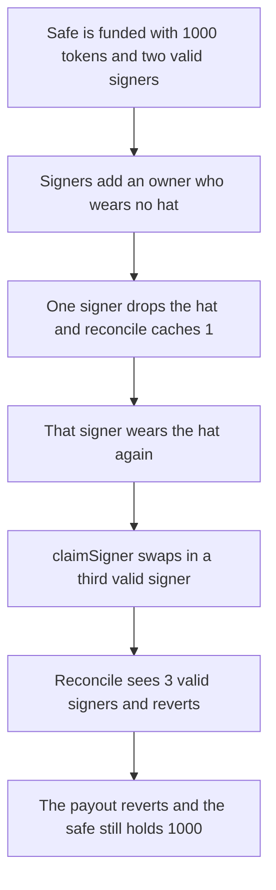

# HatsSignerGate lets a claim exceed maxSigners and brick the safe

> **Vulnerability classes:** vuln/access-control/missing-signer · vuln/dos/frozen-funds

<!-- non-defihacklabs -->
<!-- source-auditvault: https://github.com/Auditware/AuditVault/blob/main/findings/10280-h-8-hatssignergate-multihatssignergate-more-than-maxsignatur.md -->
<!-- date: 2023-02 -->

## Key info

| Field | Value |
|---|---|
| **Loss** | 1,000 tokens stay in the safe. A 1-of-1 payout that meets the current threshold reverts |
| **Vulnerable contract** | `HatsSignerGate.claimSigner` |
| **Attacker EOA** | `0x1111111111111111111111111111111111111111` |
| **Attack contract** | `Exploit` |
| **Attack tx** | `Exploit.run()` |
| **Chain / block / date** | Ethereum model · block 0 · 2023-02 |
| **Compiler** | solc 0.8.27, cancun, via IR |
| **Bug class** | Stale signer count lets valid signers exceed maxSigners, then reconcile reverts every exec |

## TL;DR

`claimSigner` compares the cached `signerCount` with `maxSigners` and does not call `reconcileSignerCount`. After a signer drops a hat, is reconciled, and puts the hat back on, the cache says 1 while two valid signers are already owners. A new wearer is swapped in. Three valid signers now sit on a safe whose max is 2. The next guarded exec calls `reconcileSignerCount`, hits `validSignerCount > maxSigners`, and reverts. The safe still holds 1,000 tokens. A gate that reconciles before the cache check rejects the extra claim, and the same 1,000 transfer succeeds.

## The vulnerable code

```solidity
uint256 currentSignerCount = signerCount;

// @> VULN: cached signerCount is not the live valid-signer count, so this does not stop the swap
if (currentSignerCount >= maxSigs) {
    revert MaxSignersReached();
}
```

`checkTransaction` calls `reconcileSignerCount` before every safe exec. That function reverts once the live count is past the max:

```solidity
// @> VULN: more valid signers than maxSigners reverts, so checkTransaction can no longer exec
if (validSignerCount > maxSigners) {
    revert MaxSignersReached();
}
```

The report walks the same comparison with `maxSigners = 10` becoming 11 valid signers. This reduction uses `maxSigners = 2` and ends at 3 valid signers. The revert is the same line.

## Root cause

`signerCount` is only updated by grant, swap, remove, and reconcile. `claimSigner` reads it before any of those and never recounts wearers. Swapping an invalid owner for a new wearer can therefore push the live valid-signer count above `maxSigners` while the cache still looks legal. Every later exec reconciles first and reverts.

## Preconditions

- `maxSigners` is 2, `targetThreshold` is 2, `minThreshold` is 1.
- Owners start as A and B, both wearers. `signerCount` is 2. The safe later receives 1,000 tokens.
- The signers add C, who wears no hat. Valid signers stay at 2.
- A drops the hat, someone calls `reconcileSignerCount` (cache becomes 1, threshold becomes 1), then A wears the hat again with no second reconcile.

## Attack walkthrough

1. `mint` credits the safe 1,000 tokens ([output.txt](output.txt)).
2. A and B sign `addOwnerWithThreshold(C)`. Reconcile sees 2 valid signers, which is not above the max, and the exec succeeds.
3. A drops the hat. `reconcileSignerCount` stores `signerCount = 1` and sets the threshold to 1.
4. A wears the hat again. Live valid signers are 2. The cache is still 1. C is still an owner.
5. The new wearer calls `claimSigner`. `1 >= 2` is false, so the stale check does not revert. C is swapped out. Live valid signers are 3. The cache increments only to 2.
6. A one-signature `transfer` of the 1,000 is submitted. The threshold is 1 and A is valid, so the signature check would pass.
7. `checkTransaction` reconciles first, sees 3 > 2, and reverts `MaxSignersReached`. The payee's balance stays 0. The safe still holds 1,000.
8. Control: `claimSigner` reconciles before reading the cache. The extra claim reverts `MaxSignersReached`. A two-signature transfer then pays the 1,000 out, and the live count stays at 2.

## Diagrams



## Impact

The safe keeps 1,000 tokens (`1000000000000000000000` base units). The payee receives 0. Any later guarded transaction reverts until some valid signer gives up the hat. On the fixed gate the extra claim is rejected and the payee receives the full 1,000.

## Remediation

Call `reconcileSignerCount` at the start of `claimSigner`, then read `signerCount`. The control gate does that. The extra claim reverts and the payout of 1,000 succeeds.

```diff
 function claimSigner() public virtual {
+    reconcileSignerCount();
     uint256 maxSigs = maxSigners;
     uint256 currentSignerCount = signerCount;
```

## How to reproduce

```bash
cd evm-hack-registry/10280-h-8-hatssignergate-multihatssignergate-more-than-maxsignatur_exp
forge test -vv
```

## Sources

- [AuditVault finding 10280](https://github.com/Auditware/AuditVault/blob/main/findings/10280-h-8-hatssignergate-multihatssignergate-more-than-maxsignatur.md)
- [Sherlock 2023-02-hats judging, issue 51](https://github.com/sherlock-audit/2023-02-hats-judging/issues/51)
- [HatsSignerGate.sol @ 9455cc0](https://github.com/Hats-Protocol/hats-zodiac/blob/9455cc0957762f5dbbd8e62063d970199109b977/src/HatsSignerGate.sol)
- [HatsSignerGateBase.reconcileSignerCount @ 9455cc0](https://github.com/Hats-Protocol/hats-zodiac/blob/9455cc0957762f5dbbd8e62063d970199109b977/src/HatsSignerGateBase.sol)
- [Synthetic](test/10280-h-8-hatssignergate-multihatssignergate-more-than-maxsignatur.sol)
