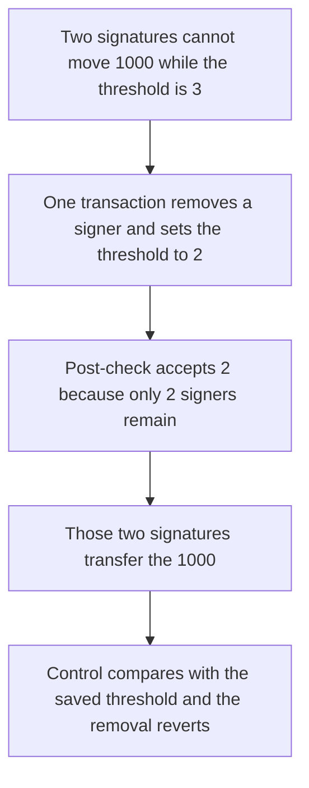

# Signers lower the safe threshold inside one transaction

> **Vulnerability classes:** vuln/access-control/missing-signer · vuln/logic/missing-check

<!-- non-defihacklabs -->
<!-- source-auditvault: https://github.com/Auditware/AuditVault/blob/main/findings/10281-h-9-signers-can-bypass-checks-and-change-threshold-within-a.md -->
<!-- date: 2023-02 -->

## Key info

| Field | Value |
|---|---|
| **Loss** | 1,000 tokens transferred after the threshold falls from 3 to 2 |
| **Vulnerable contract** | `HatsSignerGate.checkAfterExecution` |
| **Attacker EOA** | `0x1111111111111111111111111111111111111111` |
| **Attack contract** | `Exploit` |
| **Attack tx** | `Exploit.run()` |
| **Chain / block / date** | Ethereum model · block 0 · 2023-02 |
| **Compiler** | solc 0.8.27, cancun, via IR |
| **Bug class** | Post-exec threshold check follows the signer count changed in the same transaction |

## TL;DR

`checkAfterExecution` requires `safe.getThreshold() == _getCorrectThreshold()`. The correct value is recomputed from the owners left after the transaction. A fully signed `removeOwner` can delete one signer and set the threshold to 2 in that same transaction, and the check passes because both sides are now 2. Two signatures then transfer 1,000 tokens. Those two signatures revert while the threshold is still 3. The fixed guard compares against the threshold saved before execution, so the removal reverts, the threshold stays 3, and only a 3-signature transfer can move the 1,000.

## The vulnerable code

```solidity
function checkAfterExecution(bytes32, bool) external virtual {
    if (msg.sender != address(safe)) revert NotCalledFromSafe();
    // @> VULN: compared to the post-tx signer count, so removeOwner can lower the threshold in this transaction
    if (safe.getThreshold() != _getCorrectThreshold()) {
        revert SignersCannotChangeThreshold();
    }
}
```

`_getCorrectThreshold` is the live valid-signer count, clamped to `minThreshold` and `targetThreshold`. It is not the threshold from before the transaction.

## Root cause

The guard is documented as stopping signers from changing the threshold. The check does not snapshot the pre-transaction threshold. Any owner change that leaves `getThreshold()` equal to the new signer count satisfies it. The report's example is 8 owners and a threshold of 8 becoming 7. This reduction uses 3 becoming 2, which is the same comparison, and then spends that lower threshold.

## Preconditions

- Three hat-wearing owners. `minThreshold` is 1 and `targetThreshold` is 3, so the correct threshold starts at 3.
- The safe holds 1,000 tokens.
- Signers can submit a safe transaction that calls `removeOwner` and passes a new threshold. Listed addresses stand in for Safe signatures.

## Attack walkthrough

1. The safe is minted 1,000 tokens ([output.txt](output.txt)).
2. A transfer of that 1,000 signed only by A and B reverts `InvalidSigners`. The attacker balance stays 0. The threshold is 3.
3. A, B, and C sign one transaction: `removeOwner` of C with `newThreshold = 2`. The pre-check sees 3 signatures, so it passes.
4. After the call the threshold is 2 and two valid owners remain. `_getCorrectThreshold()` returns 2. The post-check does not revert.
5. The same two signatures now transfer the 1,000 to the attacker. The safe balance is 0. The threshold is still 2.
6. Control: `checkAfterExecution` compares `getThreshold()` to the threshold stored in `checkTransaction`. The removal reverts. The threshold stays 3, owner count stays 3, and the two-signature transfer reverts. A three-signature transfer then pays the 1,000.

## Diagrams



## Impact

The attacker receives 1,000 tokens (`1000000000000000000000` base units) with 2 signatures. Before the removal, those 2 signatures could not move the balance. The threshold ends at 2 instead of 3. On the fixed guard the threshold stays 3 and the two-signature transfer moves nothing.

## Remediation

Save `safe.getThreshold()` in `checkTransaction` and require the post-transaction threshold to equal that saved value.

```diff
 function checkTransaction(...) external {
+    thresholdBefore = safe.getThreshold();
     ...
 }
 function checkAfterExecution(bytes32, bool) external {
-    if (safe.getThreshold() != _getCorrectThreshold()) revert SignersCannotChangeThreshold();
+    if (safe.getThreshold() != thresholdBefore) revert SignersCannotChangeThreshold();
 }
```

## How to reproduce

```bash
cd evm-hack-registry/10281-h-9-signers-can-bypass-checks-and-change-threshold-within-a_exp
forge test -vv
```

## Sources

- [AuditVault finding 10281](https://github.com/Auditware/AuditVault/blob/main/findings/10281-h-9-signers-can-bypass-checks-and-change-threshold-within-a.md)
- [Sherlock 2023-02-hats judging, issue 52](https://github.com/sherlock-audit/2023-02-hats-judging/issues/52)
- [HatsSignerGateBase.checkAfterExecution @ 9455cc0](https://github.com/Hats-Protocol/hats-zodiac/blob/9455cc0957762f5dbbd8e62063d970199109b977/src/HatsSignerGateBase.sol)
- [Synthetic](test/10281-h-9-signers-can-bypass-checks-and-change-threshold-within-a.sol)
