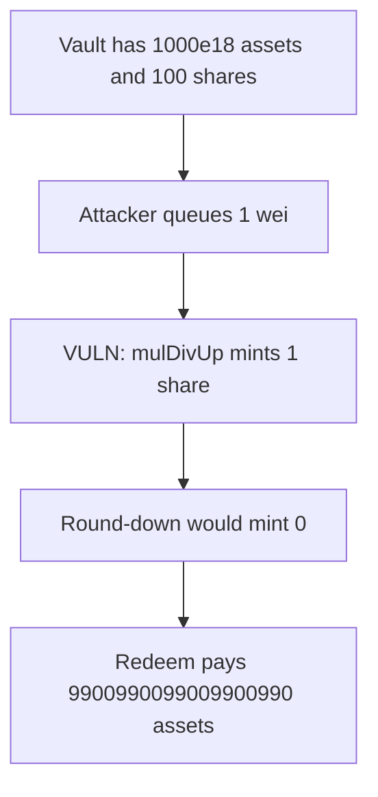

# Pods `mulDivUp` mints 1 share for 1 wei and it withdraws 9900990099009900990 assets

> **Vulnerability classes:** vuln/arithmetic/rounding-direction

<!-- non-defihacklabs -->
<!-- source-auditvault: https://github.com/Auditware/AuditVault/blob/main/findings/10416-rounding-up-in-minting-shares-openzeppelin-pods-finance-ethe.md -->
<!-- date: 2022-12 -->

## Key info

| | |
|---|---|
| **Protocol** | Pods Finance |
| **Finding** | OpenZeppelin, AuditVault 10416 |
| **Vulnerable code** | `BaseVault._processDeposit` |
| **Harm** | 1 extra share, redeemed for 9900990099009900990 assets |
| **Chain** | local synthetic |

## TL;DR

Queued deposits mint shares with `mulDivUp`. The vault holds 1000e18 assets and 100 shares, so 1 wei of assets is worth 0 shares if rounded down. Rounding up mints 1 share. Redeeming it pays `(1000e18 + 1) / 101 = 9900990099009900990` assets. The round-down control mints 0 shares and withdraws nothing.

## The vulnerable code

```solidity
// @> VULN: mulDivUp mints a whole share for 1 wei when the share price is above 1
uint256 shares = currentAssets == 0 || supply == 0 ? assets : assets.mulDivUp(supply, currentAssets);
```

`mulDivUp(1, 100, 1000e18)` is `(1 * 100 + 1000e18 - 1) / 1000e18 = 1`.

## Root cause

Share price is 10e18 assets per share. A 1-wei deposit is a fraction of a share. Rounding that fraction up donates a full share, which is then redeemable against the existing assets.

## Preconditions

`totalSupply` is 100 and `currentAssets` is 1000e18. The attacker queues a 1-wei deposit. No role is required.

## Attack walkthrough

1. The attacker deposits 1 wei.
2. `_processDeposit` rounds `1 * 100 / 1000e18` up to 1 share. Round-down is 0.
3. That share is minted.
4. `redeem(1)` pays 9900990099009900990 assets.

## Diagrams



## Impact

One extra share is created for 1 wei and withdrawn for 9900990099009900990 assets, taken from the other shareholders. The control mints 0 shares and the attacker withdraws 0.

## Remediation

Round share minting down (`mulDivDown` / integer division), so a deposit smaller than one share mints nothing.

## How to reproduce

```bash
cd 10416-rounding-up-in-minting-shares-openzeppelin-pods-finance-ethe_exp
forge test -vv
```

## Sources

- AuditVault finding: https://github.com/Auditware/AuditVault/blob/main/findings/10416-rounding-up-in-minting-shares-openzeppelin-pods-finance-ethe.md
- OpenZeppelin: https://blog.openzeppelin.com/pods-finance-ethereum-volatility-vault-audit-1/
- Audited line: https://github.com/pods-finance/yield-contracts/blob/9389ab46e9ecdd1ea1fd7228c9d9c6821c00f057/contracts/vaults/BaseVault.sol#L392
