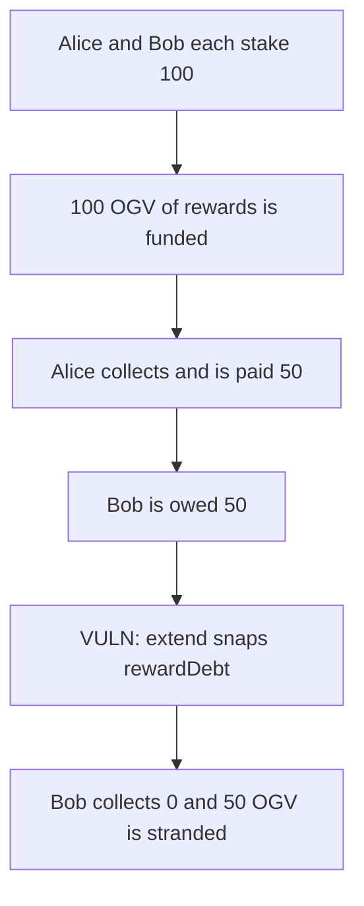

# Origin `extend` discards 50 OGV of rewards

> **Vulnerability classes:** vuln/logic/reward-calculation

<!-- non-defihacklabs -->
<!-- source-auditvault: https://github.com/Auditware/AuditVault/blob/main/findings/10564-extending-the-staking-duration-discards-rewards-openzeppelin.md -->
<!-- date: 2022-07 -->

## Key info

| | |
|---|---|
| **Protocol** | Origin OGV staking |
| **Finding** | OpenZeppelin, AuditVault 10564 |
| **Vulnerable code** | `OgvStaking.extend` |
| **Harm** | Bob loses 50 OGV; the 50 stays in the staking contract |
| **Chain** | local synthetic |

## TL;DR

Alice and Bob each stake 100 points. 100 OGV of rewards accrue. Alice's `collectRewards` updates `accRewardPerShare` and pays her 50, which leaves Bob owed 50. `extend` writes `rewardDebt = balance * acc / 1e12` and does not call `_collectRewards`, so Bob's claim becomes 0. A later collect pays him nothing. The 50 remains in the staking contract. Collecting before `extend` pays the 50.

## The vulnerable code

```solidity
_mint(msg.sender, newPoints - oldPoints);
// @> VULN: rewardDebt is updated here with no prior _collectRewards, so the outstanding rewards are discarded
rewardDebt[msg.sender] = (balanceOf(msg.sender) * accRewardPerShare) / 1e12;
```

## Root cause

`rewardDebt` is an absolute debt. It is only meaningful if `_collectRewards` has just paid `balance * acc / 1e12 - rewardDebt`. `extend` updates the debt as if that payment happened. It did not, so the outstanding rewards are zeroed.

## Preconditions

Another staker has already collected, so `accRewardPerShare` reflects rewards Bob has not been paid. Bob then calls `extend`. Both stakes are 100 points and the reward pot is 100 OGV.

## Attack walkthrough

1. 100 OGV is funded and Alice collects. She receives 50. `accRewardPerShare` becomes `5e11`.
2. `previewRewards(Bob)` is 50 OGV.
3. Bob calls `extend(0, 14 days)`.
4. `rewardDebt` snaps to 50 OGV. Preview drops to 0.
5. Bob's collect transfers 0. The staking contract's OGV balance is 50 higher than before the rewards arrived, and that 50 is unclaimable by Bob.

## Diagrams



## Impact

Bob loses 50 OGV of rewards he had already earned. The tokens sit in the staking contract. The control calls `collectRewards` before `extend` and Bob's balance is 50 OGV.

## Remediation

Call `_collectRewards` before updating `rewardDebt` in `extend`, or store debt per share so a balance change cannot erase unpaid rewards.

## How to reproduce

```bash
cd 10564-extending-the-staking-duration-discards-rewards-openzeppelin_exp
forge test -vv
```

## Sources

- AuditVault finding: https://github.com/Auditware/AuditVault/blob/main/findings/10564-extending-the-staking-duration-discards-rewards-openzeppelin.md
- OpenZeppelin: https://blog.openzeppelin.com/origin-governance-audit/
- Audited function: https://github.com/OriginProtocol/ousd-governance/blob/2b9761606d4ac4062b69367ebbad88220cea45ce/contracts/OgvStaking.sol#L127
