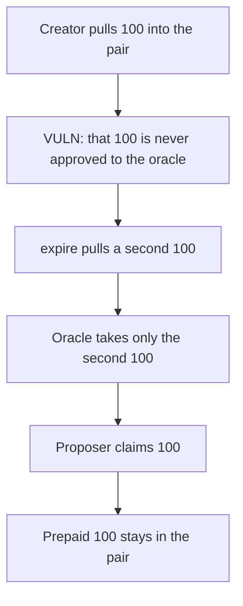

# UMA prepaid proposer reward of 100 stays trapped in the pair

> **Vulnerability classes:** vuln/dos/frozen-funds · vuln/logic/missing-check

<!-- non-defihacklabs -->
<!-- source-auditvault: https://github.com/Auditware/AuditVault/blob/main/findings/10705-c01-trapped-proposer-reward-openzeppelin-uma-audit-l2-bridge.md -->
<!-- date: 2021-12 -->

## Key info

| | |
|---|---|
| **Protocol** | UMA Long Short Pair |
| **Finding** | OpenZeppelin C01, AuditVault 10705 |
| **Vulnerable code** | `LongShortPairCreator.createLongShortPair` |
| **Harm** | 100 collateral of proposer reward is unclaimable |
| **Chain** | local synthetic, one chain |

## TL;DR

The creator pulls `proposerReward` from the deployer into the new pair. `expire()` later pulls a second `proposerReward` from whoever expires the pair and approves only that amount to the optimistic oracle. The proposer can claim the expire-path 100. The prepaid 100 never leaves the pair, and a second claim pays 0. The control does not take the prepaid transfer. One 100 is paid to the proposer and the pair ends at 0.

## The vulnerable code

```solidity
lsp = new LongShortPair(collateral, oracle, proposerReward);
if (proposerReward > 0) {
    // @> VULN: prepaid proposer reward is pulled into the pair and never forwarded to the oracle
    collateral.safeTransferFrom(msg.sender, address(lsp), proposerReward);
}
```

`expire` only approves `proposerReward`, not the pair's whole balance:

```solidity
collateralToken.safeTransferFrom(msg.sender, address(this), proposerReward);
collateralToken.safeApprove(address(optimisticOracle), proposerReward);
```

## Root cause

Two independent transfers both intend to fund the same oracle reward. Only the second one is approved to the oracle. The first one has no withdrawal path.

## Preconditions

`proposerReward` is 100 collateral. The deployer funds creation and a caller later calls `expire`. Modeled on one chain: the creator, the pair, and the oracle are all in this transaction set. No second chain is required.

## Attack walkthrough

1. `createLongShortPair` pulls 100 from the deployer into the pair.
2. `expire` pulls another 100 and approves 100 to the oracle.
3. The oracle takes that 100. The pair balance falls from 200 to 100.
4. The proposer claims 100. A second claim returns 0.
5. The prepaid 100 is still in the pair.

## Diagrams



## Impact

100 collateral of proposer reward cannot be claimed. The control skips the creator transfer, `expire` forwards its 100 to the oracle, and the proposer receives 100 with nothing left in the pair.

## Remediation

Delete the creator's `safeTransferFrom` into the pair. The reward should be taken once, on `expire`, and approved to the oracle.

## How to reproduce

```bash
cd 10705-c01-trapped-proposer-reward-openzeppelin-uma-audit-l2-bridge_exp
forge test -vv
```

## Sources

- AuditVault finding: https://github.com/Auditware/AuditVault/blob/main/findings/10705-c01-trapped-proposer-reward-openzeppelin-uma-audit-l2-bridge.md
- OpenZeppelin: https://blog.openzeppelin.com/uma-audit-l2-bridges/
- Creator: https://github.com/UMAprotocol/protocol/blob/d4e7ea22159b2eed8e39d5b86ce0026ea3b8b995/packages/core/contracts/financial-templates/long-short-pair/LongShortPairCreator.sol#L112-L113
- Pair: https://github.com/UMAprotocol/protocol/blob/d4e7ea22159b2eed8e39d5b86ce0026ea3b8b995/packages/core/contracts/financial-templates/long-short-pair/LongShortPair.sol#L369-L372
