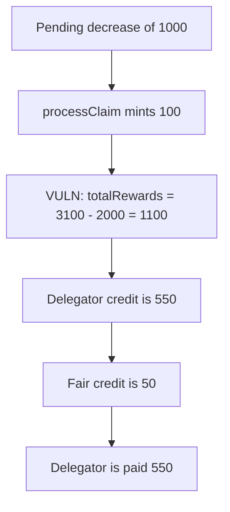

# Audius `claimRewards` pays the delegator 550 instead of 50

> **Vulnerability classes:** vuln/logic/reward-calculation

<!-- non-defihacklabs -->
<!-- source-auditvault: https://github.com/Auditware/AuditVault/blob/main/findings/11316-h05-rewards-calculation-is-incorrect-when-the-service-provid.md -->
<!-- date: 2020-08 -->

## Key info

| | |
|---|---|
| **Protocol** | Audius |
| **Finding** | OpenZeppelin H05, AuditVault 11316 |
| **Vulnerable code** | `DelegateManager.claimRewards` |
| **Harm** | Delegator is paid 550 AUDIO; the fair share of the minted rewards is 50 |
| **Chain** | local synthetic |

## TL;DR

The service provider has 1000 locked in a pending decrease, 1000 unlocked, and 1000 delegated. `processClaim` mints 100. `totalRewards` is computed as staking balance minus outside balance: `3100 - 2000 = 1100`, which is the locked 1000 plus the minted 100. The delegator is credited `1000 * 1100 / 2000 = 550`. Using the minted 100, the same formula pays 50. The control sets `totalRewards` to the minted amount and pays 50.

## The vulnerable code

```solidity
_processClaim();
uint256 _totalBalanceInStaking = token.balanceOf(address(this));
uint256 _totalBalanceInSPFactory = UNLOCKED.add(spLockedStake);
_totalBalanceInSPFactory = _totalBalanceInSPFactory.sub(spLockedStake);
uint256 _totalBalanceOutsideStaking = _totalBalanceInSPFactory.add(DELEGATED);
// ...
uint256 _totalRewards = totalBalanceInStaking.sub(totalBalanceOutsideStaking);
// @> VULN: totalRewards is locked stake plus minted rewards, not the minted rewards alone
totalRewards = _totalRewards;
```

`_totalRewards` is the audited subtraction. viaIR maps the store on the next line, which is what the playground highlights.

## Root cause

The pending decrease is subtracted from the service-provider factory balance and therefore from the "outside" total, but it is still inside the staking balance. Subtracting outside from staking adds the locked stake back in and calls it rewards.

## Preconditions

A decrease-stake request of 1000 is pending. Delegated stake is 1000, unlocked service-provider stake is 1000, and the round mints 100 of rewards. The delegator is paid from that inflated total.

## Attack walkthrough

1. `processClaim` mints 100. Staking balance is 3100.
2. Outside balance is unlocked 1000 plus delegated 1000 = 2000. The locked 1000 was subtracted.
3. `totalRewards` is stored as 1100.
4. Delegator credit is `1000 * 1100 / 2000 = 550`. Fair credit is 50.
5. 550 AUDIO is transferred to the delegator.

## Diagrams



## Impact

The delegator is paid 550 AUDIO against a fair 50. `totalRewards` is 1100 against 100 minted. The extra 450 is principal. The control pays 50.

Audius later reported a second skew in the service-provider base that can cancel the aggregate recorded stake. This reduction isolates the `totalRewards` formula the report blames and shows the delegator payment that formula produces.

## Remediation

Set `totalRewards` to the amount `processClaim` minted, and do not reconstruct it from the difference of two balances that treat locked stake differently.

## How to reproduce

```bash
cd 11316-h05-rewards-calculation-is-incorrect-when-the-service-provid_exp
forge test -vv
```

## Sources

- AuditVault finding: https://github.com/Auditware/AuditVault/blob/main/findings/11316-h05-rewards-calculation-is-incorrect-when-the-service-provid.md
- OpenZeppelin: https://blog.openzeppelin.com/audius-contracts-audit/
- `claimRewards`: https://github.com/AudiusProject/audius-protocol/blob/6f3b31562b9d4c43cef91af0a011986a2580fba2/eth-contracts/contracts/DelegateManager.sol#L352
