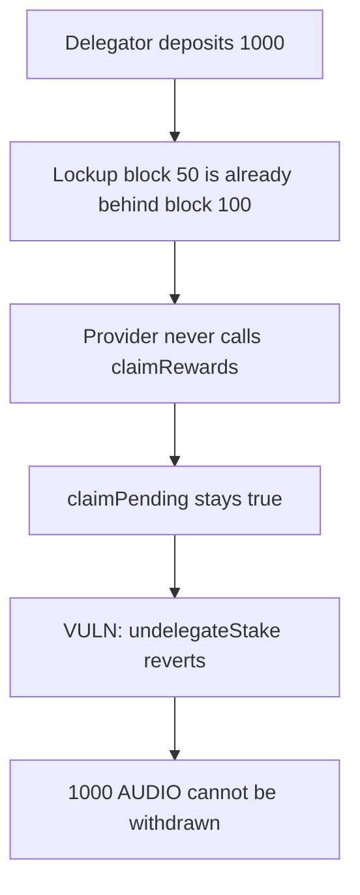

# Audius unresponsive provider locks 1000 of delegator stake

> **Vulnerability classes:** vuln/dos/frozen-funds · vuln/logic/wrong-condition

<!-- non-defihacklabs -->
<!-- source-auditvault: https://github.com/Auditware/AuditVault/blob/main/findings/11323-h12-unresponsive-service-provider-locks-delegator-stake-open.md -->
<!-- date: 2020-08 -->

## Key info

| | |
|---|---|
| **Protocol** | Audius |
| **Finding** | OpenZeppelin H12, AuditVault 11323 |
| **Vulnerable code** | `DelegateManager.undelegateStake` |
| **Harm** | 1000 AUDIO cannot be withdrawn |
| **Chain** | local synthetic |

## TL;DR

`undelegateStake` reverts while `claimPending` is true for the service provider. `claimPending` stays true once a round is funded and the provider has not claimed, and only the provider can call `claimRewards`. After the undelegate lockup (block 50, replayed at block 100) the delegator still cannot exit. 1000 AUDIO remains in the manager. Writing the provider's last-claim block forward, which is what letting anyone claim does, makes the same `undelegateStake` return the 1000.

## The vulnerable code

```solidity
require(undelegateRequests[delegator].lockupExpiryBlock <= block.number, "Lockup must be expired");
// @> VULN: an unresponsive SP never claims, so _claimPending stays true and this require reverts
require(!_claimPending(undelegateRequests[delegator].serviceProvider), "Undelegate not permitted for SP pending claim");
```

```solidity
function claimPending(address _sp) external view returns (bool pending) {
    uint256 lastClaimedForSP = staking.lastClaimedFor(_sp);
    (,,, uint256 numEndpoints,,) = spFactory.getServiceProviderDetails(_sp);
    return (lastClaimedForSP < fundBlock && numEndpoints > 0);
}
```

## Root cause

The exit is gated on a claim that only the service provider is allowed to submit. If that account never calls `claimRewards`, `lastClaimedFor` stays behind `fundBlock` and every delegator of that provider is stuck.

## Preconditions

The provider has at least one endpoint, a funding round exists (`fundBlock = 1`), and `lastClaimedFor` is 0. The delegator's lockup expiry is block 50. The replay uses a single block, number 100, which is already past that expiry. No timestamp warp is required.

## Attack walkthrough

1. The delegator deposits 1000 AUDIO. The request expires at block 50 and names the provider.
2. `undelegateStake` sees `50 <= 100`, so the lockup is over.
3. `claimPending` is true.
4. The require reverts. The 1000 stays in the manager and the delegator balance is 0.

## Diagrams



## Impact

1000 AUDIO is locked. The delegator cannot withdraw it while the provider is unresponsive. The control sets `lastClaimedFor` to the funded round and `undelegateStake` returns the 1000 to the delegator.

## Remediation

Let any account call `claimRewards` for a service provider, so a missed claim cannot freeze delegator exits.

## How to reproduce

```bash
cd 11323-h12-unresponsive-service-provider-locks-delegator-stake-open_exp
forge test -vv
```

## Sources

- AuditVault finding: https://github.com/Auditware/AuditVault/blob/main/findings/11323-h12-unresponsive-service-provider-locks-delegator-stake-open.md
- OpenZeppelin: https://blog.openzeppelin.com/audius-contracts-audit/
- `undelegateStake`: https://github.com/AudiusProject/audius-protocol/blob/6f3b31562b9d4c43cef91af0a011986a2580fba2/eth-contracts/contracts/DelegateManager.sol#L252
- `claimPending`: https://github.com/AudiusProject/audius-protocol/blob/6f3b31562b9d4c43cef91af0a011986a2580fba2/eth-contracts/contracts/ClaimsManager.sol#L312
