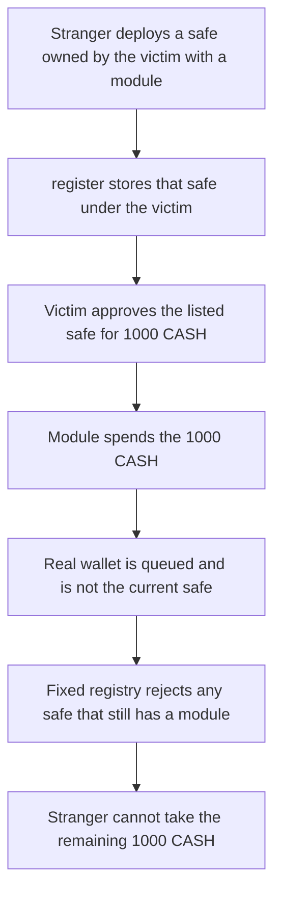

# A stranger registers a backdoored wallet and spends 1,000 of the victim's CASH

> **Vulnerability classes:** vuln/access-control/missing-auth · vuln/logic/missing-check
>
> **Reproduction:** self-contained synthetic Foundry reduction; see [output.txt](output.txt).

<!-- non-defihacklabs -->
<!-- source-auditvault: https://github.com/Auditware/AuditVault/blob/main/findings/11479-c01-anyone-can-register-backdoored-wallets-for-any-owner-in.md -->
<!-- date: 2020-02 -->

## Key info

| Field | Value |
|---|---|
| **Loss** | 1,000 CASH (1000000000000000000000 wei) moves from the victim to the stranger's module |
| **Vulnerable contract** | `GnosisSafeRegistry.recordOwnerSafe` (reduction of `register`) |
| **Attacker EOA** | `0x1111111111111111111111111111111111111111` |
| **Attack contract** | `Exploit` |
| **Attack tx** | `Exploit.run()` |
| **Chain / block / date** | Ethereum model · block 0 · 2020-02 |
| **Compiler** | solc 0.8.27, cancun, via IR |
| **Bug class** | `register` files a safe under `owners[0]` with no module check and no owner authorization |

## TL;DR

`GnosisSafeRegistry.register` accepts any proxy that matches the known Safe bytecode, points at the known master copy, has threshold 1, and has one owner. It never checks modules, and it never checks that the listed owner asked for this wallet. A stranger deploys that proxy, names the victim as the sole owner, enables their own module, and registers it. The victim approves the wallet `getSafe` returns. The module calls `transferFrom` and takes 1,000 CASH. The victim's own module-free wallet is only queued behind it, so it is not the current safe. A registry that rejects safes with a module refuses the backdoor, and the stranger cannot take the victim's remaining 1,000 CASH.

## Background

OpenZeppelin reviewed Augur Core v2 components at commit `67c0fec95e65fca8d27751f28a6c06e5247978c6` and published the report on 27 February 2020. `GnosisSafeRegistry` is the on-chain list of each user's Gnosis Safe. `getSafe` returns the first registered safe. Later safes sit in the queue until the current one deregisters itself. Registration was expected to happen from a user-controlled safe. The checks stop at proxy code hash, master copy, threshold, and owner count. Gnosis modules can execute calls from the safe with no owner signature. A module therefore turns a safe that lists the victim as owner into a wallet the stranger controls.

## The vulnerable code

```solidity
function register() external {
    IGnosisSafe _safe = getAndValidateSafeFromSender();
    address[] memory _owners = _safe.getOwners();
    address _owner = _owners[0];
    // External self-call so the storage write keeps a source map under viaIR.
    this.recordOwnerSafe(_owner, _safe);
}

function recordOwnerSafe(address _owner, IGnosisSafe _safe) external {
    require(msg.sender == address(this), "record");
    // @> VULN: stores this safe under owners[0] with no module check and no proof the owner authorized the wallet
    emit SafeRecorded(_owner, address(_safe)); accountSafes[_owner].push(_safe);
}
```

The audited function is `register` in `GnosisSafeRegistry.sol`. It pushes `msg.sender` onto `accountSafes[owners[0]]` immediately after `getAndValidateSafeFromSender`. That helper checks the proxy hash, `masterCopy == gnosisSafeMasterCopy`, `getThreshold() == 1`, and `getOwners().length == 1`. It does not call `getModules`, and it does not require a signature from `owners[0]`. The synthetic keeps that push. The self-call only separates the write so the line is visible in the trace. `getAndValidateSafeFromSender` is copied verbatim.

## Root cause

The registry treats "this proxy looks like a one-of-one Safe whose owner slot says the victim" as "this is the victim's wallet". Owner slot and control are not the same thing once a module is enabled. Modules are not part of the check, so the stranger can satisfy every require and still be the party that can move tokens.

## Preconditions

- The victim has never registered a safe, or the attacker registers before they do. `getSafe` returns index 0.
- The victim holds CASH and later approves the address `getSafe` returns. Here that amount is 1,000 CASH, and a second 1,000 stays for the control.
- The attacker can deploy a proxy whose runtime hash matches the registry's `proxyCodeHash` and whose master copy is the registry's Safe master. That is the normal factory path.
- The control registry is the same code plus `require(getModules() == address(0))` before the push.

## Attack walkthrough

1. The stranger deploys a proxy aimed at the Safe master and calls `setup(victim, module)`. Threshold is 1, the only owner is the victim, and `getModules` returns the stranger's module ([output.txt](output.txt)).
2. The module makes the proxy call `register`. The proxy hash, master copy, threshold, and owner count all pass. `accountSafes[victim]` stores the proxy.
3. `getSafe(victim)` is that proxy. The victim approves it for 1,000 CASH. The module's `execTransactionFromModule` calls `transferFrom` and the module's balance becomes 1000000000000000000000 ([output.txt:6](output.txt)).
4. The victim then registers a module-free safe on the same registry. It is stored at index 1. `getSafe` still returns the backdoor, so the real wallet is not current ([output.txt:14](output.txt)).
5. Control: the same backdoor calls the fixed registry. `getModules() != address(0)`, so registration reverts ([output.txt:16](output.txt)). The victim registers the module-free safe there. `getSafe` on the fixed registry is that safe. The victim approves it for the remaining 1,000 CASH. The stranger's `trySpend` fails ([output.txt:18](output.txt)). The victim still holds 1000000000000000000000 ([output.txt:8](output.txt)) and the clean allowance is still 1000000000000000000000 ([output.txt:12](output.txt)). The backdoor allowance is 0 ([output.txt:10](output.txt)).
6. `[PASS]` ([output.txt:4](output.txt)).

## Diagrams



## Impact

The victim loses 1,000 CASH. The module's balance increases by 1000000000000000000000 and the victim's balance falls from 2,000 CASH to 1,000 CASH. The wallet the registry advertises as the victim's is the stranger's. The victim's real safe cannot become current until the backdoored safe deregisters itself, which the victim cannot force. On the fixed registry the same module is rejected, the clean safe is the one `getSafe` returns, and the remaining 1,000 CASH stays with the victim with its allowance unused.

## Remediation

Reject safes that have a module, and do not treat `owners[0]` as authorization. The Augur fix in commit `7787dba1` only registers proxies deployed with known parameters and no modules. The control in this reduction is that check:

```diff
 function register() external {
     IGnosisSafe _safe = getAndValidateSafeFromSender();
+    require(_safe.getModules() == address(0), "Safe has a module");
     address[] memory _owners = _safe.getOwners();
     address _owner = _owners[0];
     accountSafes[_owner].push(_safe);
 }
```

Also require that the transaction is authorized by `owners[0]`, not merely sent by a proxy that lists that address.

## How to reproduce

```bash
cd 11479-c01-anyone-can-register-backdoored-wallets-for-any-owner-in_exp
forge test -vv
```

## Sources

- AuditVault finding: [11479-c01-anyone-can-register-backdoored-wallets-for-any-owner-in](https://github.com/Auditware/AuditVault/blob/main/findings/11479-c01-anyone-can-register-backdoored-wallets-for-any-owner-in.md)
- OpenZeppelin, Augur Core v2 Audit: Components, 27 February 2020: https://www.openzeppelin.com/news/augur-core-v2-audit-components
- `AugurProject/augur` `67c0fec95e65fca8d27751f28a6c06e5247978c6` `packages/augur-core/source/contracts/GnosisSafeRegistry.sol` `register` / `getAndValidateSafeFromSender`
- Fix: `AugurProject/augur` commit `7787dba1b0b0ba8b93e23e08be5540561c47dc6f`
