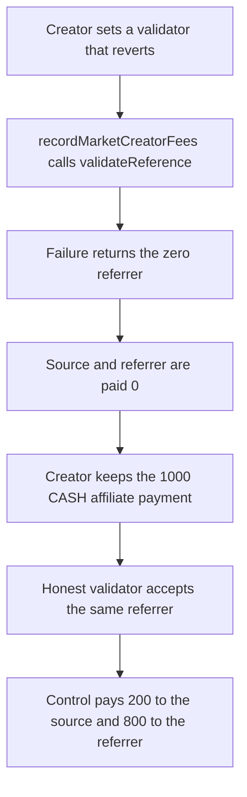

# A malicious market skips a 1,000 CASH affiliate payment

> **Vulnerability classes:** vuln/defi/fee-manipulation · vuln/logic/missing-check
>
> **Reproduction:** self-contained synthetic Foundry reduction; see [output.txt](output.txt).

<!-- non-defihacklabs -->
<!-- source-auditvault: https://github.com/Auditware/AuditVault/blob/main/findings/11480-h01-malicious-market-can-arbitrarily-decide-when-to-pay-affi.md -->
<!-- date: 2020-02 -->

## Key info

| Field | Value |
|---|---|
| **Loss** | 1,000 CASH affiliate payment is not paid. The market creator keeps it. The source trader receives 0 and the referrer receives 0 |
| **Vulnerable contract** | `Affiliates.getAndValidateReferrer` |
| **Attacker EOA** | `0x1111111111111111111111111111111111111111` |
| **Attack contract** | `Exploit` |
| **Attack tx** | `Exploit.run()` |
| **Chain / block / date** | Ethereum model · block 0 · 2020-02 |
| **Compiler** | solc 0.8.27, cancun, via IR |
| **Bug class** | A market-chosen validator can revert and zero the referrer, which skips the affiliate payout |

## TL;DR

`MarketFactory.createMarket` lets the creator pass any `affiliateValidator`. `getAndValidateReferrer` calls `validateReference` with a 30,000 gas stipend and, if that call fails, returns `address(0)`. `recordMarketCreatorFees` then skips both the source-trader cut and the referrer accrual. On a 5,000 CASH creator fee with affiliate divisor 5, that skipped payment is N = 1,000 CASH. The creator is credited the unreduced fee, so they keep the 1,000. The same trade against an honest validator pays 200 CASH to the source trader and 800 CASH to the referrer.

## Background

OpenZeppelin reviewed Augur Core v2 components at commit `67c0fec95e65fca8d27751f28a6c06e5247978c6` and published the report on 27 February 2020. Affiliate fees are taken out of the market creator fee. `Reporting.getAffiliateSourceCutDivisor` is 5, so the trader who was referred receives 20% of the affiliate fee and the referrer keeps the rest. The market is supposed to apply that split whenever the trader has a referrer. The validator was meant to be a limited extra check. Failure was supposed to turn the check off. The code instead treats failure as "there is no referrer", which deletes the payment.

## The vulnerable code

```solidity
(bool _success,) = _affiliateValidator.call{gas: AFFILIATE_VALIDATOR_GAS}(
    abi.encodeWithSelector(AFFILIATE_VALIDATOR_SELECTOR, _account, _referrer)
);
if (!_success) {
    // @> VULN: a market-chosen validator can revert and force a zero referrer, so the affiliate payment is skipped
    emit ReferrerCleared(_account, _referrer); return address(0);
}
```

The audited lines are the gas-limited `validateReference` call and `if (!_success) return address(0)` in `Affiliates.sol`. Back in `Market.recordMarketCreatorFees`, a zero affiliate address skips:

```solidity
uint256 _totalAffiliateFees = _marketCreatorFees / affiliateFeeDivisor;
uint256 _sourceCut = _totalAffiliateFees / SOURCE_CUT_DIVISOR;
uint256 _affiliateFees = _totalAffiliateFees - _sourceCut;
```

`SOURCE_CUT_DIVISOR` is 5, the audited `AFFILIATE_SOURCE_CUT_DIVISOR`. With a 5,000 CASH fee and `affiliateFeeDivisor` of 5, `_totalAffiliateFees` is 1,000 CASH, the source cut is 200 CASH, and the referrer keeps 800 CASH.

## Root cause

The validator address is stored on the market with no allowlist. The call's failure path returns `address(0)` instead of the already-looked-up referrer. The creator chooses the validator, so they choose whether the call succeeds. Revert means the 1,000 CASH affiliate payment is never taken out of their fee.

## Preconditions

- The trader has set a referrer and the two fingerprints differ, so the self-referral check would not zero the referrer on its own.
- The market's affiliate fee divisor is 5. The recorded creator fee is 5,000 CASH, so the affiliate payment N is 1,000 CASH.
- The attack market's validator reverts in `validateReference`. The control market's validator returns true.
- The market already holds the 5,000 CASH creator fee for each trade.

## Attack walkthrough

1. The referrer sets fingerprint `2` and the trader sets fingerprint `1` and names the referrer ([output.txt](output.txt)).
2. The creator points the attack market at a validator whose `validateReference` reverts ([output.txt](output.txt)).
3. `recordMarketCreatorFees(5000 CASH, trader, fingerprint 1)` calls `getAndValidateReferrer`. The validator reverts. The function returns `address(0)`. Source is paid 0 ([output.txt:10](output.txt)). Referrer is paid 0 ([output.txt:12](output.txt)).
4. The creator fee is not reduced by N. The excess over the fair creator fee is 1,000 CASH and is transferred to the creator ([output.txt:6](output.txt), [output.txt:8](output.txt)).
5. Control: the other market uses a validator that returns true. The same 5,000 CASH fee pays 200 CASH to the source and 800 CASH to the referrer. `controlPaid` is 1000000000000000000000 ([output.txt:14](output.txt), [output.txt:16](output.txt), [output.txt:18](output.txt)). The creator's balance stays 1,000 CASH.
6. `[PASS]` ([output.txt:4](output.txt)).

## Diagrams



## Impact

The source trader and the referrer lose the 1,000 CASH affiliate payment on the attack market: 0 to the source, 0 to the referrer. The creator's CASH balance increases by 1000000000000000000000, which is exactly that unpaid N. The fair creator fee of 4,000 CASH stays accounted on the market. On the control market the same inputs pay N in full, split 200 / 800, and the creator does not receive a second skim.

## Remediation

Do not let a market creator install an arbitrary validator. Augur's fix in commit `8e62ffe8` only accepts `AffiliateValidator` instances deployed from the known template. On a failed or out-of-gas `validateReference`, return the referrer that was already stored instead of `address(0)`, so a reverting validator cannot delete the payment.

```diff
- if (!_success) {
-     return address(0);
- }
+ if (!_success) {
+     return _referrer;
+ }
```

That second change matches the comment already in `Affiliates`: a failed call should turn the extra check off, not the payout. The allowlist is what stops the creator from shipping a validator that reverts on purpose.

## How to reproduce

```bash
cd 11480-h01-malicious-market-can-arbitrarily-decide-when-to-pay-affi_exp
forge test -vv
```

## Sources

- AuditVault finding: [11480-h01-malicious-market-can-arbitrarily-decide-when-to-pay-affi](https://github.com/Auditware/AuditVault/blob/main/findings/11480-h01-malicious-market-can-arbitrarily-decide-when-to-pay-affi.md)
- OpenZeppelin, Augur Core v2 Audit: Components, 27 February 2020: https://www.openzeppelin.com/news/augur-core-v2-audit-components
- `AugurProject/augur` `67c0fec95e65fca8d27751f28a6c06e5247978c6` `packages/augur-core/source/contracts/reporting/Affiliates.sol` `getAndValidateReferrer`
- `packages/augur-core/source/contracts/reporting/Market.sol` `recordMarketCreatorFees`
- `packages/augur-core/source/contracts/reporting/Reporting.sol` `AFFILIATE_SOURCE_CUT_DIVISOR = 5`
- Fix: `AugurProject/augur` commit `8e62ffe80226c385d01dcb0ffc9fc1d601dd7da6`
