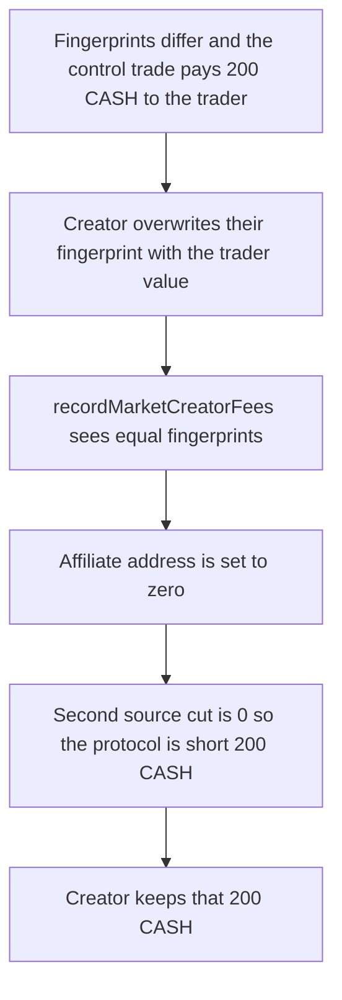

# Market creator skips the trader's 200 CASH source cut

> **Vulnerability classes:** vuln/defi/fee-manipulation · vuln/logic/missing-check
>
> **Reproduction:** self-contained synthetic Foundry reduction; see [output.txt](output.txt).

<!-- non-defihacklabs -->
<!-- source-auditvault: https://github.com/Auditware/AuditVault/blob/main/findings/11481-h02-market-creators-can-avoid-paying-20-cut-of-affiliate-fee.md -->
<!-- date: 2020-02 -->

## Key info

| Field | Value |
|---|---|
| **Loss** | 200 CASH, the trader's 20% of a 1,000 CASH affiliate fee, is not paid. The creator keeps it |
| **Vulnerable contract** | `Market.recordMarketCreatorFees` |
| **Attacker EOA** | `0x1111111111111111111111111111111111111111` |
| **Attack contract** | `Exploit` |
| **Attack tx** | `Exploit.run()` |
| **Chain / block / date** | Ethereum model · block 0 · 2020-02 |
| **Compiler** | solc 0.8.27, cancun, via IR |
| **Bug class** | `setFingerprint` can be overwritten so the self-referral check zeroes a real referrer |

## TL;DR

`recordMarketCreatorFees` compares the fingerprint passed with the trade to the affiliate's stored fingerprint. A match is treated as self-referral and the affiliate address is set to zero, so nobody is paid. `setFingerprint` overwrites any previous value. The market creator, who is the referrer, sees the fingerprint the trader will pass and sets their own fingerprint to that value first. On a 5,000 CASH creator fee with affiliate divisor 5, the affiliate fee is 1,000 CASH and the trader's cut is 20%, N = 200 CASH. That cut is not paid. The same trade while the fingerprints still differ pays the trader 200 CASH and accrues 800 CASH for the referrer.

## Background

OpenZeppelin reviewed Augur Core v2 components at commit `67c0fec95e65fca8d27751f28a6c06e5247978c6` and published the report on 27 February 2020. Affiliate fees come out of the market creator fee. `Reporting.AFFILIATE_SOURCE_CUT_DIVISOR` is 5, so the referred trader gets 20% of the affiliate fee and the referrer is accrued the rest. The fingerprint check was meant to stop a user from referring themselves. It compares a value the trade supplies with a value the affiliate can change at any time in `Affiliates.setFingerprint`.

## The vulnerable code

```solidity
address _affiliateAddress = affiliates.getAndValidateReferrer(_sourceAccount, address(0));
bytes32 _affiliateFingerprint = affiliates.getAccountFingerprint(_affiliateAddress);
if (_fingerprint == _affiliateFingerprint) {
    // @> VULN: creator setFingerprint to the trader fingerprint, so the 20% source cut is not paid
    emit SourceCutSkipped(_sourceAccount, _affiliateAddress); _affiliateAddress = address(0);
}
```

`Affiliates.setFingerprint` is the enabler. It has no "already set" guard:

```solidity
function setFingerprint(bytes32 _fingerprint) external {
    fingerprints[msg.sender] = _fingerprint;
}
```

The audited assignment is `_affiliateAddress = address(0)` in `Market.sol` when the fingerprints are equal. The payout that gets skipped is:

```solidity
uint256 _totalAffiliateFees = _marketCreatorFees / affiliateFeeDivisor;
uint256 _sourceCut = _totalAffiliateFees / SOURCE_CUT_DIVISOR;
cash.transfer(_sourceAccount, _sourceCut);
```

`SOURCE_CUT_DIVISOR` is 5. For 5,000 CASH and divisor 5, `_totalAffiliateFees` is 1,000 CASH and `_sourceCut` is 200 CASH.

## Root cause

The self-referral check trusts a fingerprint the affiliate can rewrite in the same block, before the fee is recorded. Equality then looks like self-referral even though the referrer is a different address. The whole affiliate branch is skipped, including the 20% that the code would have transferred to the trader immediately.

## Preconditions

- The trader's referrer is the market creator. Their fingerprints start out different, so an earlier trade still pays.
- The creator can call `setFingerprint` again. Nothing stops the second write.
- Each trade records a 5,000 CASH creator fee. Affiliate divisor is 5. The source cut N is 200 CASH.
- No separate validator is set. `getAndValidateReferrer` returns the stored referrer.

## Attack walkthrough

1. The creator sets fingerprint `2`. The trader sets fingerprint `1` and names the creator as referrer ([output.txt](output.txt)).
2. The control market records 5,000 CASH. Fingerprints differ. The trader is paid 200000000000000000000 ([output.txt:6](output.txt), [output.txt:8](output.txt)). The referrer is accrued 800000000000000000000 ([output.txt:10](output.txt)).
3. The creator calls `setFingerprint` with fingerprint `1`, the value the next trade will pass.
4. The attack market records another 5,000 CASH. The fingerprints match, so the affiliate is set to zero. The trader's additional cut is 0 ([output.txt:12](output.txt)).
5. The unpaid 200 CASH source cut is transferred to the creator ([output.txt:14](output.txt)). The attack market accrues nothing for the referrer.
6. `[PASS]` ([output.txt:4](output.txt)).

## Diagrams



## Impact

The second trade owes the trader 200 CASH and pays 0. The creator's CASH balance increases by 200000000000000000000, which is that cut. The control trade, recorded before the overwrite, pays the trader the same 200 CASH and accrues 800 CASH to the creator as referrer. The protocol is short one source cut, not the referrer's own 80%.

## Remediation

Do not let an account change its fingerprint after the first write. If there is no reason to rotate it, `setFingerprint` should revert when `fingerprints[msg.sender]` is already set. The report also says the check is a weak Sybil control and can be removed. Augur accepted the risk. The reservation in the report still stands: a creator who is the referrer can delete the trader's 20% by rewriting one storage word before the fee is recorded.

```diff
 function setFingerprint(bytes32 _fingerprint) external {
+    require(fingerprints[msg.sender] == bytes32(0), "fingerprint set");
     fingerprints[msg.sender] = _fingerprint;
 }
```

## How to reproduce

```bash
cd 11481-h02-market-creators-can-avoid-paying-20-cut-of-affiliate-fee_exp
forge test -vv
```

## Sources

- AuditVault finding: [11481-h02-market-creators-can-avoid-paying-20-cut-of-affiliate-fee](https://github.com/Auditware/AuditVault/blob/main/findings/11481-h02-market-creators-can-avoid-paying-20-cut-of-affiliate-fee.md)
- OpenZeppelin, Augur Core v2 Audit: Components, 27 February 2020: https://www.openzeppelin.com/news/augur-core-v2-audit-components
- `AugurProject/augur` `67c0fec95e65fca8d27751f28a6c06e5247978c6` `packages/augur-core/source/contracts/reporting/Market.sol` `recordMarketCreatorFees`
- `packages/augur-core/source/contracts/reporting/Affiliates.sol` `setFingerprint`
- `packages/augur-core/source/contracts/reporting/Reporting.sol` `AFFILIATE_SOURCE_CUT_DIVISOR = 5`
