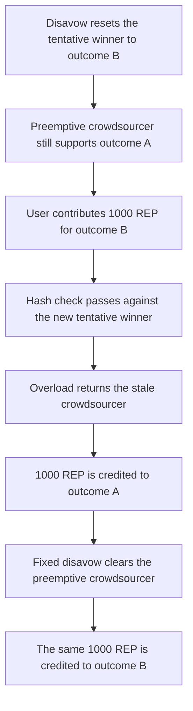

# 1,000 REP is credited to outcome A when the user paid for B

> **Vulnerability classes:** vuln/logic/wrong-condition · vuln/logic/incorrect-state-transition
>
> **Reproduction:** self-contained synthetic Foundry reduction; see [output.txt](output.txt).

<!-- non-defihacklabs -->
<!-- source-auditvault: https://github.com/Auditware/AuditVault/blob/main/findings/11483-h04-user-can-unknowingly-contribute-to-the-wrong-market-outc.md -->
<!-- date: 2020-02 -->

## Key info

| Field | Value |
|---|---|
| **Loss** | 1,000 REP the user sent for outcome B is credited to outcome A |
| **Vulnerable contract** | `Market.getOrCreate` called from `contributeToTentative` |
| **Attacker EOA** | `0x1111111111111111111111111111111111111111` |
| **Attack contract** | `Exploit` |
| **Attack tx** | `Exploit.run()` |
| **Chain / block / date** | Ethereum model · block 0 · 2020-02 |
| **Compiler** | solc 0.8.27, cancun, via IR |
| **Bug class** | `disavowCrowdsourcers` leaves `preemptiveDisputeCrowdsourcer` pointing at the old outcome |

## TL;DR

`disavowCrowdsourcers` resets the dispute chain to the initial reporter and does not clear `preemptiveDisputeCrowdsourcer`. After a fork, the tentative winner can be outcome B while the preemptive crowdsourcer still supports outcome A. `contributeToTentative` checks that the user's numerators hash to the current tentative outcome, then calls `getOrCreate` with `overload = true`. That path returns the preemptive crowdsourcer and ignores the hash. 1,000 REP is credited to A. A market that clears the preemptive crowdsourcer in `disavow` credits the same 1,000 REP to B.

## Background

OpenZeppelin reviewed Augur Core v2 components at commit `67c0fec95e65fca8d27751f28a6c06e5247978c6` and published the report on 27 February 2020. A preemptive dispute crowdsourcer lets users bond REP toward the tentative winning outcome before a dispute opens. If another market forks, non-forking markets disavow their crowdsourcers and the initial reporter becomes tentative again. That reporter's payout can differ from the preemptive crowdsourcer. The user who then calls `contributeToTentative` with the new tentative numerators still funds the old one.

## The vulnerable code

```solidity
function disavowCrowdsourcers() public virtual {
    require(forking, "fork");
    Crowdsourcer initialReporter = participants[0];
    delete participants;
    participants.push(initialReporter);
}

function getOrCreate(bytes32 hash, uint256[] memory nums, bool overload) internal returns (Crowdsourcer crowdsourcer) {
    // @> VULN: overload returns the preemptive crowdsourcer and ignores the payout hash the user just paid for
    emit Routed(hash, address(preemptiveDisputeCrowdsourcer)); crowdsourcer = overload ? preemptiveDisputeCrowdsourcer : Crowdsourcer(address(0));
```

The audited `disavowCrowdsourcers` deletes `participants` and pushes the initial reporter. It does not assign `preemptiveDisputeCrowdsourcer = 0`. The audited `getOrCreateDisputeCrowdsourcer` uses the preemptive crowdsourcer whenever `_overload` is true, which is how `contributeToTentative` calls it. The payout hash is only used when that slot is empty.

## Root cause

Two pieces of state are supposed to describe the same tentative outcome: the last reporting participant, and the preemptive crowdsourcer. Disavow updates the first and not the second. The contribute path checks the first, then writes the user's REP into the second.

## Preconditions

- Outcome A is `[0, 1]`. Outcome B is `[1, 0]`. Their hashes differ.
- The preemptive crowdsourcer was created for A. The initial reporter is B. A later participant made A tentative.
- Another market is forking, so `disavowCrowdsourcers` is allowed. The market is not the forking market.
- The user approves the market for 1,000 REP and passes B's numerators, which now match the tentative winner.

## Attack walkthrough

1. Disavow resets `participants` to the initial reporter. The preemptive crowdsourcer is still the outcome A contract ([output.txt](output.txt)).
2. The user calls `contributeToTentative` with B's numerators and 1,000 REP. The hash check passes because the tentative winner is B.
3. `getOrCreate` returns the preemptive crowdsourcer. `lastHash` is A's hash, not B's. `lastAmount` is 1000000000000000000000 ([output.txt:7](output.txt)). The credited hash is A ([output.txt:9](output.txt)) and it differs from the requested hash ([output.txt:11](output.txt)). Outcome A's REP balance is the same 1,000 ([output.txt:15](output.txt)).
4. Control: the fixed market's disavow also sets `preemptiveDisputeCrowdsourcer` to zero. The same contribution creates a crowdsourcer for B. `controlStake` is 1000000000000000000000 ([output.txt:13](output.txt)).
5. `[PASS]` ([output.txt:4](output.txt)).

## Diagrams



## Impact

The user spends 1,000 REP intending to back outcome B. Outcome A's crowdsourcer balance increases by 1000000000000000000000 and B receives none of that contribution. Those funds support a payout the user did not select. After the preemptive slot is cleared, the same call credits 1,000 REP to a crowdsourcer whose hash is B.

## Remediation

Clear `preemptiveDisputeCrowdsourcer` inside `disavowCrowdsourcers`. That is what Augur did in PR 5564. The fixed market in this reduction does the same assignment, and the following `contributeToTentative` then creates a crowdsourcer for the hash the user passed.

```diff
 function disavowCrowdsourcers() public {
     delete participants;
     participants.push(initialReporter);
+    preemptiveDisputeCrowdsourcer = IDisputeCrowdsourcer(0);
     clearCrowdsourcers();
 }
```

## How to reproduce

```bash
cd 11483-h04-user-can-unknowingly-contribute-to-the-wrong-market-outc_exp
forge test -vv
```

## Sources

- AuditVault finding: [11483-h04-user-can-unknowingly-contribute-to-the-wrong-market-outc](https://github.com/Auditware/AuditVault/blob/main/findings/11483-h04-user-can-unknowingly-contribute-to-the-wrong-market-outc.md)
- OpenZeppelin, Augur Core v2 Audit: Components, 27 February 2020: https://www.openzeppelin.com/news/augur-core-v2-audit-components
- `AugurProject/augur` `67c0fec95e65fca8d27751f28a6c06e5247978c6` `packages/augur-core/source/contracts/reporting/Market.sol` `disavowCrowdsourcers`, `contributeToTentative`, `getOrCreateDisputeCrowdsourcer`
- Fix: https://github.com/AugurProject/augur/pull/5564/files
