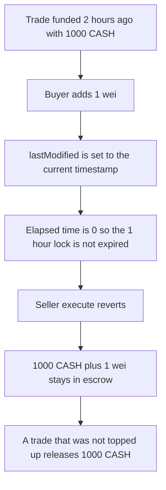

# Buyer top-up locks 1,000 CASH past the seller timeout

> **Vulnerability classes:** vuln/dos/frozen-funds · vuln/logic/missing-check
>
> **Reproduction:** self-contained synthetic Foundry reduction; see [output.txt](output.txt).

<!-- non-defihacklabs -->
<!-- source-auditvault: https://github.com/Auditware/AuditVault/blob/main/findings/11899-buyers-can-lock-funds-indefinitely-openzeppelin-openbazaars.md -->
<!-- date: 2018-10 -->

## Key info

| Field | Value |
|---|---|
| **Loss** | 1,000 CASH plus the 1 wei top-up stay in escrow. The seller release reverts |
| **Vulnerable contract** | `Escrow.addTokensToTransaction` |
| **Attacker EOA** | `0x1111111111111111111111111111111111111111` |
| **Attack contract** | `Exploit` |
| **Attack tx** | `Exploit.run()` |
| **Chain / block / date** | Ethereum model · block timestamp 7200 · 2018-10 |
| **Compiler** | solc 0.8.27, cancun, via IR |
| **Bug class** | Any buyer top-up sets `lastModified` to now, so `isTimeLockExpired` stays false |

## TL;DR

A funded escrow with a 1 hour `timeoutHours` can be released by the seller once `block.timestamp - lastModified` is greater than 3600 seconds, even when the three signatures are not present. `addTokensToTransaction` lets the buyer add any positive amount and sets `lastModified = block.timestamp`. After a 1 wei top-up the elapsed time is 0, the timeout check fails, and `execute` reverts with the under-threshold error. 1,000 CASH stays in the contract. A second trade that the buyer does not refresh, opened long enough ago that the same 1 hour timeout has passed, releases 1,000 CASH to the seller.

## Background

OpenZeppelin reviewed OpenBazaar's escrow at commit `c4f02cdd41cb85d28bba637a01f20a8ee8bb04bd`. `Escrow_v1_0` holds buyer funds until enough owners sign or, after `timeoutHours`, the seller executes alone. `lastModified` is the start of that clock. `addFundsToTransaction` and `addTokensToTransaction` both assign `lastModified = block.timestamp`. A buyer who keeps topping up by a tiny amount never lets the clock finish. With `threshold` above the seller's single signature, nobody else can release either, until the buyer stops.

## The vulnerable code

```solidity
t.value += value;
// @> VULN: topping up resets lastModified, so the seller timeout never elapses
emit FundAdded(scriptHash, msg.sender, value); t.lastModified = block.timestamp;
```

The audited timeout check is unchanged:

```solidity
function isTimeLockExpired(uint32 timeoutHours, uint256 lastModified) public view returns (bool expired) {
    uint256 timeSince = block.timestamp - lastModified;
    expired = (timeoutHours == 0 ? false : timeSince > uint256(timeoutHours) * 3600);
}
```

`timeoutHours == 0` never expires. A positive timeout expires only when `timeSince` is strictly greater than `timeoutHours * 3600`. This reduction uses 1 hour. The replay timestamp is 7200, so a trade whose `lastModified` is still 0 is expired. A trade refreshed in this block is not.

## Root cause

The clock is the time since the last modification, and every top-up is a modification. The buyer is allowed to modify the funded trade. There is no cap on how many times, and the new timestamp replaces the old one instead of preserving the original fund time.

## Preconditions

- The trade is funded, `timeoutHours` is 1, and release needs the seller plus an expired lock because the signature count is under the threshold.
- The block timestamp is 7200. A trade with `lastModified` of 0 has aged 2 hours.
- The buyer can call `addTokensToTransaction` with 1 wei. That is the whole attack.
- The control trade is the same shape and is not topped up.

## Attack walkthrough

1. The control trade is funded with 1,000 CASH and `lastModified` 0. The seller calls `execute`. The lock is expired. The seller's balance is 1000000000000000000000 ([output.txt:7](output.txt)).
2. The attack trade is funded with another 1,000 CASH, also old enough to release.
3. The buyer transfers 1 wei into it. `lastModified` becomes 7200. `isTimeLockExpired` is false.
4. The seller's `execute` reverts. `attackReleased` is 0 ([output.txt:9](output.txt)). The escrow balance is 1000000000000000000001 ([output.txt:11](output.txt)).
5. `[PASS]` ([output.txt:4](output.txt)).

## Diagrams



## Impact

The attack escrow still holds 1,000 CASH plus the 1 wei the buyer added. The seller received nothing from that trade. The control trade, identical except for the missing top-up, paid the seller 1,000 CASH. Repeating the 1 wei top-up before each attempt keeps the attack funds locked for as long as the buyer wants.

## Remediation

Do not move `lastModified` on a top-up, or keep a separate `createdAt` that `isTimeLockExpired` reads. The report's other suggestion is a cap on how many times a funded trade can be modified. Either one lets the seller timeout make progress.

```diff
- transactions[scriptHash].lastModified = block.timestamp;
+ // keep the original lastModified so a top-up cannot restart the seller timeout
```

## How to reproduce

```bash
cd 11899-buyers-can-lock-funds-indefinitely-openzeppelin-openbazaars_exp
forge test -vv
```

The Foundry test warps to timestamp 7200 before `run()`. `run()` itself does not warp. The playground uses the same timestamp for the whole replay.

## Sources

- AuditVault finding: [11899-buyers-can-lock-funds-indefinitely-openzeppelin-openbazaars](https://github.com/Auditware/AuditVault/blob/main/findings/11899-buyers-can-lock-funds-indefinitely-openzeppelin-openbazaars.md)
- OpenZeppelin, OpenBazaar escrow audit: https://blog.openzeppelin.com/openbazaars-escrow-audit/
- `OpenBazaar/smart-contracts` `c4f02cdd41cb85d28bba637a01f20a8ee8bb04bd` `contracts/escrow/Escrow_v1_0.sol` `addTokensToTransaction`, `isTimeLockExpired`
