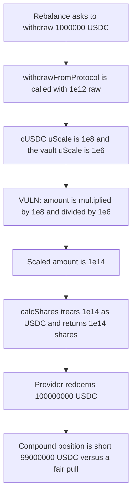

# Derby Vault — withdrawFromProtocol scales a USDC pull by cUSDC decimals

> **Vulnerability classes:** vuln/arithmetic/decimal-mismatch

<!-- non-defihacklabs -->
<!-- source-auditvault: https://github.com/Auditware/AuditVault/blob/main/findings/12293-h-11-vaults-withdrawfromprotocol-incorrectly-scales-amount-t.md -->
<!-- date: 2023-01 -->

## Key info

| | |
|---|---|
| **Protocol** | Derby Finance |
| **Finding** | Sherlock 2023-01 H-11, AuditVault 12293 |
| **Vulnerable code** | `Vault.withdrawFromProtocol` |
| **Harm** | A 1000000 USDC withdrawal redeems 100000000 USDC. The Compound position is short 99000000 USDC. |
| **Chain** | local synthetic (audited Ethereum contracts) |

## TL;DR

`withdrawFromProtocol` is called with an amount already in vault currency. For a USDC vault that is 6 decimals. It then does `_amount = (_amount * protocol.uScale) / uScale`, and `protocol.uScale` is `10**LP decimals`. cUSDC has 8 decimals, so a request of `1e12` (1000000 USDC) becomes `1e14`. `CompoundProvider.calcShares` treats that as USDC and the vault redeems 100 times as much as the caller asked for.

## The vulnerable code

The scale is the audited line. `uScale` on the vault is `1e6`. `protocol.uScale` is `1e8`.

```solidity
IController.ProtocolInfoS memory protocol = controller.getProtocolInfo(vaultNumber, _protocolNum);
// @> VULN: protocol.uScale is 10**cUSDC decimals; calcShares expects USDC decimals, so 1e12 becomes 1e14.
_amount = (_amount * protocol.uScale) / uScale;
uint256 shares = IProvider(protocol.provider).calcShares(_amount, protocol.LPToken);
```

`calcShares` is explicit that `_amount` is underlying, not the LP token:

```solidity
uint256 decimals = IERC20Metadata(ICToken(_cToken).underlying()).decimals();
uint256 shares = (_amount * (10 ** (10 + decimals))) / exchangeRate(_cToken);
```

Fair form, which the control uses. `underlyingScale` is `10**USDC decimals` (`1e6`), the variable the report says to add to `ProtocolInfoS`:

```solidity
_amount = (_amount * underlyingScale) / uScale;
```

## Root cause

`ProtocolInfoS.uScale` is documented as the LP token's scale, and cUSDC is an 8-decimal token. The withdrawal amount is already in vault currency. Multiplying by `1e8` and dividing by the vault's `1e6` shifts a USDC amount into cUSDC decimals. Every provider, including Compound, then sizes the share burn off that inflated underlying amount.

With Compound's 1.0 exchange-rate mantissa (`1e16` for 6-decimal USDC) the share count equals the amount passed in. The bug is therefore exactly `10**(8-6) = 100`.

## Preconditions

The vault currency and the provider underlying are both USDC, and the LP token is cUSDC (8 decimals). The vault's cUSDC balance is larger than the inflated share count, so the `balance < shares` cap does not clip the pull. No caller privilege beyond whatever already reaches `withdrawFromProtocol` (rebalance, `pullFunds`, `blacklistProtocol`) is required. This reduction calls that function directly.

## Attack walkthrough

1. The vault holds 200000000 USDC of cUSDC and no idle USDC. The exchange rate is Compound's 1.0 mantissa, so one raw cUSDC share is one raw USDC.
2. A withdrawal asks `withdrawFromProtocol` for `1e12` raw units, which is 1000000 USDC. That is the figure in the report.
3. The scale line computes `1e12 * 1e8 / 1e6 = 1e14`.
4. `calcShares` treats `1e14` as USDC and returns `1e14` cUSDC shares. The same function on the unscaled `1e12` returns `1e12` shares.
5. The provider redeems those shares. The vault receives 100000000 USDC. cUSDC left on the vault is 100000000. The corrected scale receives 1000000 USDC and leaves 199000000 in Compound, so the position is short 99000000 USDC.

## Diagrams



## Impact

A routine 1000000 USDC withdrawal pulls 100000000 USDC out of Compound. Depositors whose funds were still allocated to that market are short 99000000 USDC of the position: 100000000 cUSDC remains, and the fair scale would have left 199000000. The same 100x applies wherever the LP decimals and the underlying decimals differ. Compound and Idle LP tokens are the cases the report names.

## Remediation

Store the underlying token's decimals on `ProtocolInfoS` and scale the withdrawal into that unit before `calcShares`. When the vault currency is USDC and the underlying is USDC, the scale is the identity and the provider is asked for 1000000 USDC.

## How to reproduce

```bash
cd 12293-h-11-vaults-withdrawfromprotocol-incorrectly-scales-amount-t_exp
forge test -vv
```

## Sources

- AuditVault finding: https://github.com/Auditware/AuditVault/blob/main/findings/12293-h-11-vaults-withdrawfromprotocol-incorrectly-scales-amount-t.md
- Sherlock contest: https://github.com/sherlock-audit/2023-01-derby-judging/issues/132
- Contest repo: https://github.com/sherlock-audit/2023-01-derby/tree/0b520498fc14be28d158ec7dcc5d1d832570b1d1
- Audited vault: https://github.com/sherlock-audit/2023-01-derby/blob/0b520498fc14be28d158ec7dcc5d1d832570b1d1/derby-yield-optimiser/contracts/Vault.sol
- CompoundProvider.calcShares: https://github.com/sherlock-audit/2023-01-derby/blob/0b520498fc14be28d158ec7dcc5d1d832570b1d1/derby-yield-optimiser/contracts/Providers/CompoundProvider.sol
