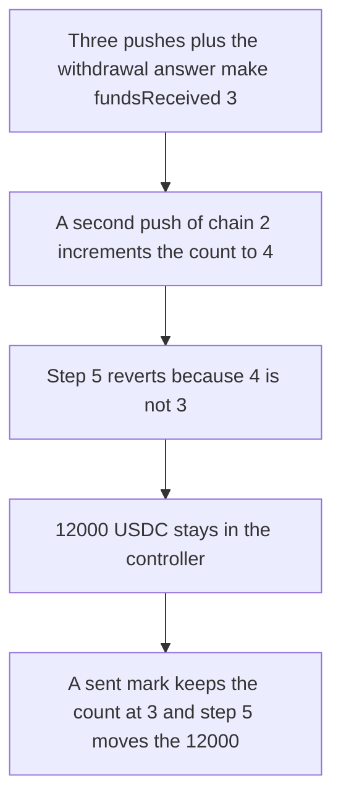

# A second push blocks Derby rebalance step 5

> **Vulnerability classes:** vuln/dos/frozen-funds · vuln/logic/missing-check

<!-- non-defihacklabs -->
<!-- source-auditvault: https://github.com/Auditware/AuditVault/blob/main/findings/12294-h-12-attacker-can-prevent-the-system-from-entering-step-5-du.md -->
<!-- date: 2023-01 -->

## Key info

| Field | Value |
|---|---|
| **Loss** | 12,000 USDC stays in the controller. Step 5 reverts |
| **Vulnerable contract** | `XChainController.sendXChainAmount` |
| **Attacker EOA** | `0x1111111111111111111111111111111111111111` |
| **Attack contract** | `Exploit` |
| **Attack tx** | `Exploit.run()` |
| **Chain / block / date** | Ethereum model · block 0 · 2023-01 |
| **Compiler** | solc 0.8.27, cancun, via IR |
| **Bug class** | Permissionless push increments fundsReceived with no per-chain sent mark |

## TL;DR

`pushVaultAmounts` has no record of which chains were already pushed. A deposit at or above `minimumAmount` does `fundsReceived++`. After the keeper pushes three active vaults and chain 1's withdrawal is answered, `fundsReceived` is 3, equal to `activeVaults`, so step 5 would send chain 2's 12,000 USDC. One extra push of chain 2 makes the count 4. `sendFundsToVault` requires equality and reverts. The 12,000 USDC stays in the controller and the chain 2 vault receives 0. A sent mark rejects the second push, the count stays 3, and step 5 moves the 12,000.

## The vulnerable code

```solidity
} else if (_amountDeposit >= minimumAmount) {
    receivingFunds = true;
    setAmountToDeposit(_vaultNumber, _chainId, _amountDeposit);
    // @> VULN: no per-chain sent mark, so a second push increments fundsReceived again
    vaultStage[_vaultNumber].fundsReceived++;
}
```

Step 5 is `sendFundsToVault`, gated by:

```solidity
require(vaultStage[vaultNumber].fundsReceived == vaultStage[vaultNumber].activeVaults, "Not all funds received");
```

## Root cause

The stage counter is a tally, not a set of chains. `pushVaultAmounts` is callable by anyone once underlyings have been reported. Calling it again for a chain whose deposit is still at least `minimumAmount` (1,000 USDC) counts that chain a second time. The callback that answers a large withdrawal counts separately. The total can only go up, so it can pass `activeVaults` and never land back on it.

## Preconditions

- Vault 1 has three active chains. Allocations are 30, 30, and 20. Total underlying is 80,000 USDC: 50,000 on chain 1, 18,000 on chain 2, 12,000 on chain 3. No withdrawal requests.
- That split makes chain 1 withdraw 20,000 USDC, chain 2 deposit 12,000 USDC, and chain 3 deposit 8,000 USDC. All three are above the 1,000 USDC minimum.
- A large withdrawal does not increment `fundsReceived` until `upFundsReceived`. A large deposit increments immediately.
- The controller holds the 12,000 USDC that step 5 should forward to chain 2.

## Attack walkthrough

1. The controller is minted 12,000 USDC (`12000000000` base units) ([output.txt](output.txt)).
2. Push chain 1. It is a 20,000 USDC withdrawal, so `fundsReceived` stays 0 and `amountToSend` is 20,000 USDC.
3. Push chain 2. The 12,000 USDC deposit increments `fundsReceived` to 1 and stores `amountToDeposit`.
4. Push chain 3. The 8,000 USDC deposit increments `fundsReceived` to 2.
5. The xProvider reports chain 1's funds. `fundsReceived` is 3, equal to `activeVaults`.
6. Push chain 2 again. The same deposit branch increments `fundsReceived` to 4.
7. `sendFundsToVault` for chain 2 reverts `Not all funds received`. The controller still holds 12,000 USDC. The chain 2 vault balance is 0. The queued deposit is still 12,000 USDC.
8. Control: the second push reverts `already pushed`. `fundsReceived` stays 3. Step 5 transfers the 12,000 USDC to the chain 2 vault and the controller balance is 0.

## Diagrams



## Impact

12,000 USDC that step 5 should deliver to the chain 2 vault never moves. The controller balance stays `12000000000` and the vault balance stays 0. Rebalancing for this vault cannot enter step 5 until a guardian overwrites `fundsReceived`. On the fixed controller the same 12,000 USDC arrives at the chain 2 vault.

## Remediation

Record a sent mark per vault and chain at the start of `pushVaultAmounts`, and reject a second push. Check the mark before `sendXChainAmount` increments `fundsReceived`.

## How to reproduce

```bash
cd evm-hack-registry/12294-h-12-attacker-can-prevent-the-system-from-entering-step-5-du_exp
forge test -vv
```

## Sources

- [AuditVault finding 12294](https://github.com/Auditware/AuditVault/blob/main/findings/12294-h-12-attacker-can-prevent-the-system-from-entering-step-5-du.md)
- [Sherlock 2023-01-derby judging, issue 98](https://github.com/sherlock-audit/2023-01-derby-judging/issues/98)
- [XChainController.sol](https://github.com/sherlock-audit/2023-01-derby/blob/main/derby-yield-optimiser/contracts/XChainController.sol)
- [Synthetic](test/12294-h-12-attacker-can-prevent-the-system-from-entering-step-5-du.sol)
