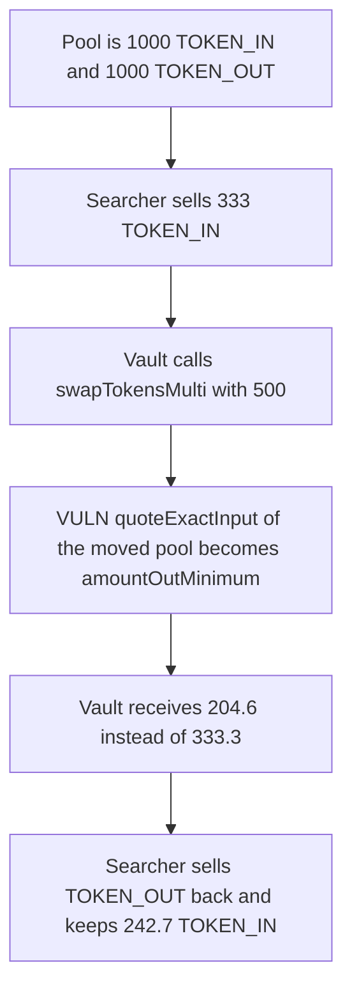

# Derby: the vault quotes its own slippage inside the swap

> **Vulnerability classes:** `vuln/defi/slippage` · `vuln/defi/sandwich-attack`

<!-- non-defihacklabs -->
<!-- source-auditvault: https://github.com/Auditware/AuditVault/blob/main/findings/12295-h-13-vault-executes-swaps-without-slippage-protection-sherlo.md -->
<!-- date: 2023-01 -->

## Key info

| Field | Value |
|---|---|
| **Loss** | Vault receives 204.6 TOKEN_OUT instead of 333.3. Searcher gains 242.7 TOKEN_IN |
| **Vulnerable contract** | `SwapVault.swapTokensMulti` |
| **Attacker EOA** | `0x1111111111111111111111111111111111111111` |
| **Attack contract** | `Exploit` |
| **Attack tx** | `Exploit.run()` |
| **Chain / block / date** | Ethereum model · block 0 · 2023-01 |
| **Compiler** | solc 0.8.27, cancun, via IR |
| **Bug class** | min-out is a same-transaction spot quote |

## TL;DR

`swapTokensMulti` sets `amountOutMinimum` from `quoteExactInput` and then swaps. The quote reads the pool after any earlier trade in the same transaction. A searcher sells 333 TOKEN_IN first. The vault's 500 TOKEN_IN sale clears that quote and receives 204.6 TOKEN_OUT. The untouched pool would have paid 333.3. The searcher sells the output token back and finishes 242.7 TOKEN_IN ahead.

## The vulnerable code

```solidity
uint256 amountOutMinimum = IQuoter(address(router)).quoteExactInput(path, amount);
// @> VULN: min-out is the in-transaction spot quote
ISwapRouter(address(router)).exactInput(params);
```

The Sherlock recommendation is to take the minimum from calldata, computed before the transaction.

## Root cause

A minimum computed from the pool you are about to trade is equal to the fill you are about to receive. It rejects nothing that the pool itself would return. Sandwich protection has to be fixed before the searcher's trade.

## Preconditions

- A constant-product pool holds 1000 TOKEN_IN and 1000 TOKEN_OUT.
- The vault holds 500 TOKEN_IN and will swap all of it.
- The searcher can trade the same pool in the same transaction.

## Attack walkthrough

1. Record the fair output of 500 into the untouched pool: 333.3 TOKEN_OUT.
2. Searcher sells 333 TOKEN_IN and takes TOKEN_OUT out of the pool.
3. Vault calls `swapTokensMulti`. The quote is now the bad price, and that number is the minimum.
4. The swap succeeds. The vault's TOKEN_OUT balance is 204.6.
5. Searcher sells the TOKEN_OUT back. TOKEN_IN balance is 242.7 above the pre-trade capital.

## Diagrams



## Impact

Reward and claim swaps pay the searcher the difference. Here that difference is 242.7 TOKEN_IN taken from the vault's 500 TOKEN_IN sale. A swap that quotes before the pool is touched fills the vault for the full 333.3 and leaves the searcher's 333 TOKEN_IN untouched.

## Remediation

Pass `amountOutMinimum` in from the caller. Do not call the quoter in the same transaction as the swap.

## How to reproduce

```bash
cd 12295-h-13-vault-executes-swaps-without-slippage-protection-sherlo_exp
forge test -vv
```

## Sources

- AuditVault finding: https://github.com/Auditware/AuditVault/blob/main/findings/12295-h-13-vault-executes-swaps-without-slippage-protection-sherlo.md
- Sherlock issue 64: https://github.com/sherlock-audit/2023-01-derby-judging/issues/64
- Swap library: https://github.com/sherlock-audit/2023-01-derby/blob/main/derby-yield-optimiser/contracts/libraries/Swap.sol#L60-L97
