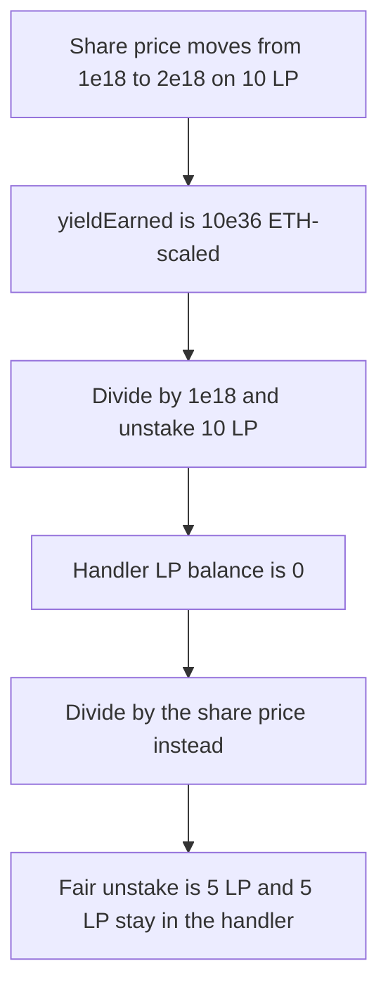

# Claim unstakes 10 LP when the fair yield is 5 LP

> **Vulnerability classes:** vuln/logic/reward-calculation
>
> **Reproduction:** self-contained synthetic Foundry reduction; see [output.txt](output.txt).

<!-- non-defihacklabs -->
<!-- source-auditvault: https://github.com/Auditware/AuditVault/blob/main/findings/13255-convexpositionhandler-claimrewards-incorrectly-calculates-am.md -->
<!-- date: 2022-05 -->

## Key info

| Field | Value |
|---|---|
| **Loss** | 10 LP unstaked. Fair yield is 5 LP. The extra 5 LP is principal |
| **Vulnerable contract** | `BuggyHandler.claimRewards` (reduction of `ConvexPositionHandler._claimRewards`) |
| **Attacker EOA** | `0x1111111111111111111111111111111111111111` |
| **Attack contract** | `Exploit` |
| **Attack tx** | `Exploit.run()` |
| **Chain / block / date** | Ethereum model · block 0 · 2022-05 |
| **Compiler** | solc 0.8.27, cancun, via IR |
| **Bug class** | `yieldEarned` is ETH-scaled and is divided by `1e18` instead of the LP share price |

## TL;DR

`_claimRewards` computes `yieldEarned = (currentSharePrice - prevSharePrice) * totalLpBalance`. That product is an ETH amount because `get_virtual_price` is 18-decimal ETH per LP. The code then sets `lpTokenEarned = yieldEarned / 1e18`. Dividing by the normalization factor only removes the decimals. It does not convert ETH into LP. The fair amount is `yieldEarned / currentSharePrice`. With price moving from `1e18` to `2e18` and 10 LP in the handler, the bug unstakes 10 LP and the fair unstake is 5 LP. The fixed handler leaves those 5 LP in place.

## Background

ConsenSys Diligence reviewed Brahma Fi in May 2022. `ConvexPositionHandler._claimRewards` harvests Convex rewards and also takes Curve LP price appreciation out of the position so it can be sent to the Lyra options leg. LP tokens have to be unstaked and unwrapped to realize that ETH. The number of LP tokens has to be the ETH yield divided by the current LP price. The implementation divides by `NORMALIZATION_FACTOR` (`1e18`) instead. One LP is worth more than one ETH once the virtual price is above `1e18`, so this unstakes more LP than the yield.

## The vulnerable code

```solidity
uint256 totalLpBalance = lp.balanceOf(address(this));
uint256 yieldEarned = (price - prevSharePrice) * totalLpBalance;
// @> VULN: yieldEarned is ETH-scaled; dividing by 1e18 still unstakes ETH units, not LP
lpTokenEarned = yieldEarned / NORMALIZATION_FACTOR;
```

The audited lines are `ConvexPositionHandler.sol` around 293–302. `NORMALIZATION_FACTOR` is `1e18`. The recommended replacement is:

```solidity
uint256 lpTokenEarned = yieldEarned / currentSharePrice;
```

## Root cause

`yieldEarned` and `lpTokenEarned` are different units. The first is ETH (price delta times LP balance, with an 18-decimal price). The second has to be a count of LP tokens. Dividing by `1e18` changes the scale and not the unit. Dividing by `currentSharePrice` does both.

## Preconditions

- `prevSharePrice` is `1e18`. `currentSharePrice` is `2e18`. Both are the Curve virtual price shape.
- The handler holds 10 LP and none of that balance is tracked separately as staked. `totalLpBalance` is 10 LP.
- `yieldEarned = 1e18 * 10e18 = 10e36`.
- Wrong unstake: `10e36 / 1e18 = 10 LP`. Fair unstake: `10e36 / 2e18 = 5 LP`.

## Attack walkthrough

1. The buggy handler claims. It transfers 10000000000000000000 LP to the yield sink ([output.txt:7](output.txt)). Its own LP balance is 0 ([output.txt:11](output.txt)).
2. The fixed handler uses `yieldEarned / currentSharePrice` and transfers 5000000000000000000 LP ([output.txt:9](output.txt)). It still holds 5000000000000000000 LP ([output.txt:13](output.txt)).
3. Paid is greater than fair. The difference is 5 LP of principal that the no-loss leg no longer holds.
4. `[PASS]` ([output.txt:4](output.txt)).

## Diagrams



## Impact

The yield sink receives 10 LP. The fair yield at this price is 5 LP, so 5 LP of principal leaves the Convex leg and is treated as yield for the Lyra options leg. The fixed claim sends 5 LP and leaves 5 LP in the handler. If the options leg loses that principal, the vault's no-loss position is short by the extra LP.

## Remediation

Convert the ETH yield into LP with the current share price, which also cancels the 18-decimal scale:

```diff
- uint256 lpTokenEarned = yieldEarned / NORMALIZATION_FACTOR;
+ uint256 lpTokenEarned = yieldEarned / currentSharePrice;
```

## How to reproduce

```bash
cd 13255-convexpositionhandler-claimrewards-incorrectly-calculates-am_exp
forge test -vv
```

## Sources

- AuditVault finding: [13255-convexpositionhandler-claimrewards-incorrectly-calculates-am](https://github.com/Auditware/AuditVault/blob/main/findings/13255-convexpositionhandler-claimrewards-incorrectly-calculates-am.md)
- ConsenSys Diligence, Brahma Fi, May 2022: https://consensys.net/diligence/audits/2022/05/brahma-fi/
- `ConvexPositionHandler.sol` `_claimRewards` lines 293–302 as quoted in the finding
