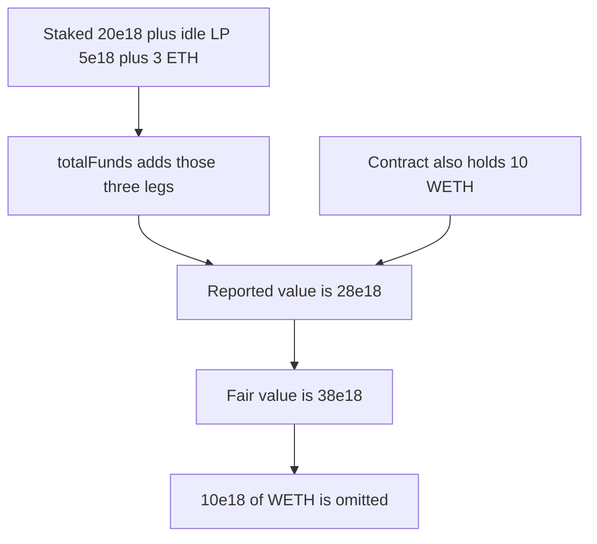

# ConvexTradeExecutor.totalFunds ignores the WETH balance

> **Vulnerability classes:** vuln/logic/omitted-balance · vuln/defi/valuation

> **Reproduction:** self-contained synthetic Foundry reduction; see [output.txt](output.txt).

<!-- non-defihacklabs -->
<!-- source-auditvault: https://github.com/Auditware/AuditVault/blob/main/findings/13256-the-weth-tokens-are-not-taken-into-account-in-the-convextrad.md -->
<!-- date: 2022-05 -->

## Key info

| Field | Value |
|---|---|
| **Loss** | `totalFunds` returns 28e18. The executor holds 38e18. The missing 10e18 is WETH |
| **Vulnerable contract** | `ConvexTradeExecutor.totalFunds` |
| **Attacker EOA** | `0x1111111111111111111111111111111111111111` |
| **Attack contract** | `Exploit` |
| **Attack tx** | `Exploit.run()` with 3 ETH |
| **Chain / block / date** | Ethereum model · block 0 · 2022-05 |
| **Compiler** | solc 0.8.27, cancun, via IR |
| **Bug class** | Position value adds native ETH and leaves out `WETH.balanceOf` |

## TL;DR

`totalFunds` returns `positionInWantToken`, whose sum is staked LP value in ETH, idle LP value in ETH, and `address(this).balance`. The executor is also paid and stored in WETH. That balance is not in the sum. With 20e18 staked, 5e18 idle LP, 3 ETH, and 10 WETH, `totalFunds` returns 28e18. The position is worth 38e18. The fixed function adds `WETH.balanceOf(this)` and returns 38e18.

## Background

ConsenSys Diligence reviewed Brahma Fi in May 2022. Every trade executor's `totalFunds` is supposed to report every asset the contract holds, because later accounting uses that figure. `ConvexTradeExecutor.totalFunds` delegates to `ConvexPositionHandler.positionInWantToken`. `_getTotalBalancesInETH` values staked and idle Curve LP in ETH and then sets `ethBalance = address(this).balance`. WETH is a token balance, so it is invisible. The contract receives WETH up front and holds WETH again before a withdrawal.

## The vulnerable code

```solidity
ethOut = address(this).balance;
uint256 amount = stakedOut + lpOut + ethOut; // @> VULN: ETH is included. WETH is not.
```

The audited return is `stakedLpBalanceInETH + lpTokenBalanceInETH + ethBalance` in `ConvexPositionHandler.positionInWantToken`, and `ethBalance = address(this).balance` in `_getTotalBalancesInETH`.

## Root cause

Native ETH and WETH are the same asset in the position and different balances in the contract. The sum reads only the native balance. Ten WETH on the contract does not change `totalFunds`.

## Preconditions

- Staked LP has already been valued at 20e18 ETH.
- Idle LP has already been valued at 5e18 ETH.
- The executor holds 3 ETH and 10 WETH.
- Buggy total is 28e18. Fair total is 38e18.

## Attack walkthrough

1. `run` forwards 3 ETH into the executor. The 10 WETH is already there.
2. `totalFunds` stores the staked leg, the idle LP leg, and the 3 ETH, then adds those three.
3. The return value is 28e18. `WETH.balanceOf` is still 10e18.
4. The 10e18 gap is minted to the sink. The control adds the WETH balance and returns 38e18.

## Diagrams



## Impact

Any accounting that trusts `totalFunds` understates the Convex leg by the full WETH balance. Here that is 10e18 out of a 38e18 position. Share price, withdrawal value, and the split between the no-loss leg and the rest of the vault are short by that WETH. The tokens are still in the contract. They are just not in the number.

## Remediation

Add the WETH balance to the ETH-denominated sum:

```diff
- uint256 amount = stakedLpBalanceInETH + lpTokenBalanceInETH + address(this).balance;
+ uint256 amount = stakedLpBalanceInETH + lpTokenBalanceInETH
+     + address(this).balance + WETH.balanceOf(address(this));
```

## How to reproduce

```bash
cd 13256-the-weth-tokens-are-not-taken-into-account-in-the-convextrad_exp
forge test -vv
```

## Sources

- AuditVault finding: [13256-the-weth-tokens-are-not-taken-into-account-in-the-convextrad](https://github.com/Auditware/AuditVault/blob/main/findings/13256-the-weth-tokens-are-not-taken-into-account-in-the-convextrad.md)
- ConsenSys Diligence, Brahma Fi, May 2022: https://consensys.net/diligence/audits/2022/05/brahma-fi/
