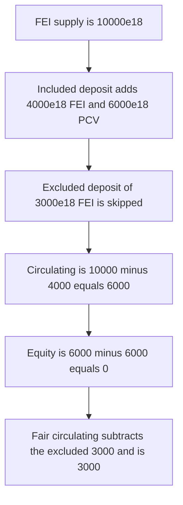

# Excluded-deposit FEI is reported as user-circulating

> **Vulnerability classes:** vuln/oracle/collateralization · vuln/logic/accounting

> **Reproduction:** self-contained synthetic Foundry reduction; see [output.txt](output.txt).

<!-- non-defihacklabs -->
<!-- source-auditvault: https://github.com/Auditware/AuditVault/blob/main/findings/13297-collateralizationoracle-fei-in-excluded-deposits-contributes.md -->
<!-- date: 2021-09 -->

## Key info

| Field | Value |
|---|---|
| **Loss** | `userCirculatingFei` is 6000e18. The fair amount is 3000e18. Protocol equity is 0 instead of 3000e18. The 3000e18 gap is FEI inside the excluded deposit |
| **Vulnerable contract** | `CollateralizationOracle.pcvStats` |
| **Attacker EOA** | `0x1111111111111111111111111111111111111111` |
| **Attack contract** | `Exploit` |
| **Attack tx** | `Exploit.run()` |
| **Chain / block / date** | Ethereum model · block 0 · 2021-09 |
| **Compiler** | solc 0.8.27, cancun, via IR |
| **Bug class** | Supply minus only non-excluded FEI treats excluded-deposit FEI as free |

## TL;DR

`pcvStats` skips deposits in `excludedDeposits`, then sets `userCirculatingFei` to `fei.totalSupply() - protocolControlledFei`. FEI that sits in an excluded deposit is not protocol-controlled and is not removed from supply, so it is reported as user-circulating. With supply `10_000e18`, an included deposit of `4_000e18` FEI, and an excluded deposit of `3_000e18` FEI, circulating is `6_000e18` instead of `3_000e18`. Equity is `0` instead of `3_000e18`. The control subtracts the excluded FEI and does not count it as circulating.

## Background

ConsenSys Diligence reviewed Fei Protocol V2 phase 1 in September 2021. `CollateralizationOracle.pcvStats` walks every PCV deposit, adds resistant balances and resistant FEI, prices the balances, and treats the rest of the FEI supply as user-circulating. A guardian or governor can exclude a deposit that is reporting bad numbers. The exclusion drops that deposit's collateral out of PCV. It also, incorrectly, leaves that deposit's FEI inside `userCirculatingFei`. The report notes that if every deposit is excluded, the entire supply is reported as user-circulating.

## The vulnerable code

```solidity
if (!_excluded[d]) {
    (uint256 b, uint256 f) = Deposit(d).resistantBalanceAndFei();
    balSum += b;
    controlled += f;
}
userCirculatingFei = fei.totalSupply() - controlled; // @> VULN: excluded FEI counts as circulating.
protocolEquity = int256(protocolControlledValue) - int256(userCirculatingFei);
```

The audited function is `CollateralizationOracle.pcvStats` around lines 278-328, as quoted in the finding.

## Root cause

The skip and the supply subtraction do not match. Collateral of an excluded deposit is left out of PCV, which is the point of the exclusion. The FEI in that same deposit is then treated as if a user held it. Circulating is too high by that FEI balance, and equity is too low by the same amount. `validityStatus` stays true.

## Preconditions

- FEI supply is `10_000e18`. The price of the PCV token is `1e18` ($1).
- Included deposit: resistant balance `6_000e18`, resistant FEI `4_000e18`.
- Excluded deposit: resistant FEI `3_000e18`. Its collateral is not added to PCV.
- Buggy circulating is `6_000e18`. Fair circulating is `3_000e18`.
- Buggy equity is `0`. Fair equity is `3_000e18`.

## Attack walkthrough

1. `pcvStats` counts the included deposit and skips the excluded one.
2. PCV is `6_000e18`. Circulating is `10_000e18 - 4_000e18 = 6_000e18`. Equity is `0`.
3. The overstatement, `3_000e18`, is minted to the sink.
4. The control still ignores the excluded collateral, but it subtracts the excluded FEI. Circulating is `3_000e18` and equity is `3_000e18`. No marker is minted.

## Diagrams



## Impact

Downstream consumers of `userCirculatingFei` and `protocolEquity` see `3_000e18` more free FEI than exists, and equity that is `3_000e18` too low. The collateralization ratio is skewed by that amount. The control shows the same balances with the excluded FEI removed from circulating, so the `3_000e18` is not reported as user-held.

## Remediation

Do not treat FEI inside an excluded deposit as user-circulating. Subtract it from supply as well, and do not add that deposit's collateral to PCV:

```diff
- if (!excludedDeposits[deposit]) {
-     (balance, feiBal) = deposit.resistantBalanceAndFei();
-     totalTokenBalance += balance;
-     protocolControlledFei += feiBal;
- }
- userCirculatingFei = fei().totalSupply() - protocolControlledFei;
+ (balance, feiBal) = deposit.resistantBalanceAndFei();
+ if (!excludedDeposits[deposit]) {
+     totalTokenBalance += balance;
+     protocolControlledFei += feiBal;
+ } else {
+     excludedFei += feiBal;
+ }
+ userCirculatingFei = fei().totalSupply() - protocolControlledFei - excludedFei;
```

## How to reproduce

```bash
cd 13297-collateralizationoracle-fei-in-excluded-deposits-contributes_exp
forge test -vv
```

## Sources

- AuditVault finding: [13297-collateralizationoracle-fei-in-excluded-deposits-contributes](https://github.com/Auditware/AuditVault/blob/main/findings/13297-collateralizationoracle-fei-in-excluded-deposits-contributes.md)
- ConsenSys Diligence, Fei Protocol V2 phase 1, September 2021: https://consensys.net/diligence/audits/2021/09/fei-protocol-v2-phase-1/
