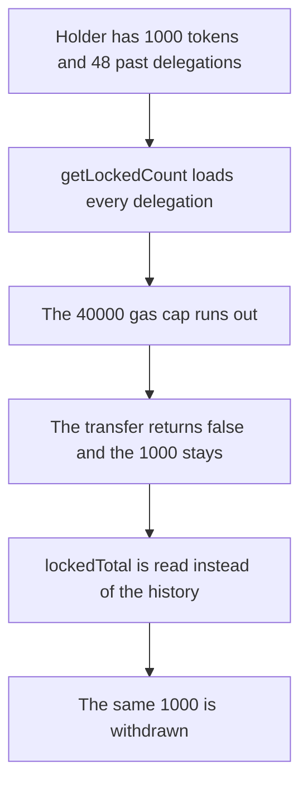

# 48 delegations make getLockedCount exceed 40,000 gas and 1,000 tokens stay put

> **Vulnerability classes:** vuln/dos/frozen-funds · vuln/dos/griefing
>
> **Reproduction:** self-contained synthetic Foundry reduction; see [output.txt](output.txt).

<!-- non-defihacklabs -->
<!-- source-auditvault: https://github.com/Auditware/AuditVault/blob/main/findings/13825-getlockedcount-is-iterating-over-all-history-of-delegations.md -->
<!-- date: 2020-01 -->

## Key info

| Field | Value |
|---|---|
| **Loss** | A transfer of 1,000 tokens reverts. The same transfer succeeds once the locked count is a stored total |
| **Vulnerable contract** | `TokenState.getLockedCount` |
| **Attacker EOA** | `0x1111111111111111111111111111111111111111` |
| **Attack contract** | `Exploit` |
| **Attack tx** | `Exploit.run()` |
| **Chain / block / date** | Ethereum model · block 0 · 2020-01 |
| **Compiler** | solc 0.8.27, cancun, via IR |
| **Bug class** | Unbounded loop over every delegation a holder has ever had, on the transfer path |

## TL;DR

`getLockedCount` loops `getDelegationsByHolder` and calls into each delegation. The list only grows. A transfer that needs the locked count therefore gets more expensive forever, and a long enough history makes the transfer run out of gas so the tokens cannot move. This reduction keeps the history at 48 delegations and caps the lock check at 40,000 gas. The loop does not finish, so 1,000 tokens stay on the holder. The same cap is enough for a precomputed `lockedTotal`, and that path withdraws the 1,000.

## Background

ConsenSys Diligence reviewed the SKALE token in January 2020. `TokenState.getLockedCount` is used when tokens move, because locked delegated tokens must not transfer. The implementation sums every delegation id for the holder, and `getState` on each id can itself write. Old delegations are never dropped from the array. The report's fix is to precalculate the locked amount so the read is O(1).

## The vulnerable code

```solidity
function getLockedCount(address holder) external view returns (uint256 amount) {
    uint256[] memory ids = byHolder[holder];
    for (uint256 i = 0; i < ids.length; ++i) {
        // @> VULN: every historical delegation is loaded; the list is unbounded and this runs on transfer
        Delegation memory d = delegations[ids[i]];
        if (d.locked) {
            amount += d.amount;
        }
    }
}
```

The audited function is `TokenState.getLockedCount` at lines 60–71. It adds `delegation.amount` when `isLocked(getState(id))`, then adds purchased and slashed amounts. The reduction keeps the unbounded walk. The 40,000 gas cap is the stand-in for the block gas limit: 48 entries already miss it, and the list in production is not capped at 48.

## Root cause

The locked amount is recomputed from the full history on every transfer. Nothing bounds that history. A stored counter updated when a delegation is created or when it unlocks answers the same question without the loop.

## Preconditions

- The holder has a balance of 1,000 tokens.
- The holder has 48 past delegations. None of them are currently locked, so the free balance is the full 1,000. The loop still has to load all 48.
- The transfer's lock check is given 40,000 gas. An external call with that stipend runs out inside `getLockedCount` and returns failure.
- `lockedTotal` was maintained as each delegation was recorded. It is 0.

## Attack walkthrough

1. `tryTransfer` calls `getLockedCount` with a 40,000 gas stipend. The loop starts loading `delegations[ids[i]]` and the call fails. `vulnerableMoved` is 0 ([output.txt:7](output.txt)). The holder still has 1,000.
2. `tryTransferBounded` calls `getLockedCountBounded` under the same stipend. That is one storage read. The 1,000 tokens move. The recipient balance is 1000000000000000000000 ([output.txt:9](output.txt)).
3. `[PASS]` ([output.txt:4](output.txt)).

## Diagrams



## Impact

The unbounded check cannot tell the transfer how many tokens are locked, so the 1,000 does not move. The holder is not insolvent. The accounting is fine. The call that is supposed to enforce the lock is what bricks the transfer. With the precomputed total, the same holder withdraws 1000000000000000000000. A longer production history does the same thing against the real block gas limit rather than a 40,000 gas cap.

## Remediation

Keep `lockedTotal[holder]` (and purchased and slashed totals) updated at the points that already change delegation state. `getLockedCount` should return that stored value. Do not walk `getDelegationsByHolder` on the transfer path.

```diff
- for (uint i = 0; i < delegationIds.length; ++i) {
-     uint id = delegationIds[i];
-     if (isLocked(getState(id))) amount += delegationController.getDelegation(id).amount;
- }
- return amount + getPurchasedAmount(holder) + this.getSlashedAmount(holder);
+ return lockedTotal[holder] + purchased[holder] + slashed[holder];
```

## How to reproduce

```bash
cd 13825-getlockedcount-is-iterating-over-all-history-of-delegations_exp
forge test -vv
```

## Sources

- AuditVault finding: [13825-getlockedcount-is-iterating-over-all-history-of-delegations](https://github.com/Auditware/AuditVault/blob/main/findings/13825-getlockedcount-is-iterating-over-all-history-of-delegations.md)
- ConsenSys Diligence, SKALE token, January 2020: https://consensys.net/diligence/audits/2020/01/skale-token/
- `skalenetwork/skale-manager` `TokenState.sol` `getLockedCount` lines 60–71 as quoted in the finding
- Fix discussed in https://github.com/skalenetwork/skale-manager/pull/92
