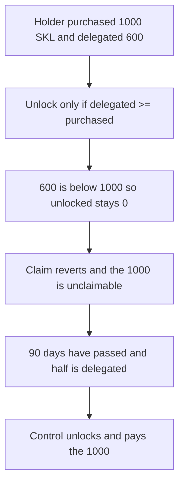

# 1,000 SKL stays unclaimable after 600 is delegated for 90 days

> **Vulnerability classes:** vuln/dos/frozen-funds · vuln/logic/wrong-condition
>
> **Reproduction:** self-contained synthetic Foundry reduction; see [output.txt](output.txt).

<!-- non-defihacklabs -->
<!-- source-auditvault: https://github.com/Auditware/AuditVault/blob/main/findings/13826-tokens-are-unlocked-only-when-delegation-ends-addressed-cons.md -->
<!-- date: 2020-01 -->

## Key info

| Field | Value |
|---|---|
| **Loss** | 1,000 SKL cannot be claimed. The control pays that 1,000 once half has been delegated for 90 days |
| **Vulnerable contract** | `BuggyState.delegatePurchased` (reduction of `TokenState` purchased-delegation handling) |
| **Attacker EOA** | `0x1111111111111111111111111111111111111111` |
| **Attack contract** | `Exploit` |
| **Attack tx** | `Exploit.run()` |
| **Chain / block / date** | Ethereum model · timestamp 8000000 · 2020-01 |
| **Compiler** | solc 0.8.27, cancun, via IR |
| **Bug class** | Unlock requires `totalDelegated >= purchased` inside the delegation callback and never checks the 90-day rule |

## TL;DR

After 90 days with at least half of the purchased tokens delegated, the purchased balance should unlock. The code only unlocks inside the delegation callback, and only when `totalDelegated >= purchased`. A holder who bought 1,000 SKL and delegated 600 never takes that branch. `unlocked` stays 0 and `claim` reverts. The same numbers on the fixed state, at timestamp 8,000,000, unlock the 1,000 and the claim pays it.

## Background

ConsenSys Diligence reviewed the SKALE token in January 2020. Purchased tokens are locked. The legal unlock is time plus a delegation ratio, not "the holder has delegated every purchased token, and only at the moment of that delegation." `TokenState` lines 258–264 add the delegation amount and call `purchasedToUnlocked` only when the running total covers the whole purchased balance. Nothing revisits that decision after 90 days.

## The vulnerable code

```solidity
totalDelegated[holder] += amount;
// @> VULN: no 90-day check; unlock only if delegated >= every purchased token, so 600 of 1000 stays locked
emit Checked(totalDelegated[holder], purchased[holder]);
if (totalDelegated[holder] >= purchased[holder]) {
    unlocked[holder] = purchased[holder];
}
```

600 is not greater than or equal to 1,000, so the body does not run. The audited condition is `_totalDelegated[holder] >= _purchased[holder]`.

## Root cause

The unlock predicate is the wrong one, and it is only evaluated when a purchased delegation is recorded. A later block where 90 days have elapsed does not get a second look. Half delegated is enough under the stated rule and is not enough under this `if`.

## Preconditions

- `purchased` is 1,000 SKL. `totalDelegated` becomes 600 SKL.
- The replay timestamp is 8,000,000, which is past 90 days (7,776,000 seconds). Delegation is treated as having started at timestamp 0. `run()` does not warp.
- The buggy state has no other unlock entry point. `claim` requires `unlocked > 0`.

## Attack walkthrough

1. The holder buys 1,000 and delegates 600. The comparison does not unlock. `unlocked` is 0.
2. `claim` reverts. `buggyClaimed` is 0 ([output.txt:7](output.txt)). The holder token balance is still 0.
3. The fixed state checks `block.timestamp >= 90 days` and `totalDelegated * 2 >= purchased`. Both hold. `claim` pays 1000000000000000000000 ([output.txt:9](output.txt)).
4. `[PASS]` ([output.txt:4](output.txt)).

## Diagrams



## Impact

The holder cannot claim the 1,000 SKL even though more than half has been delegated and the 90-day window is over. The fixed check pays exactly that 1,000. The tokens are not stolen by a third party. They are stuck behind the wrong predicate.

## Remediation

Unlock from the time and ratio rule, not only from `totalDelegated >= purchased` at delegation time. A later call, or the transfer path, should set `unlocked = purchased` when `block.timestamp` is at least 90 days after the delegation that crossed half of `purchased`.

```diff
- if (totalDelegated[holder] >= purchased[holder]) {
-     unlocked[holder] = purchased[holder];
- }
+ if (block.timestamp >= 90 days && totalDelegated[holder] * 2 >= purchased[holder]) {
+     unlocked[holder] = purchased[holder];
+ }
```

## How to reproduce

```bash
cd 13826-tokens-are-unlocked-only-when-delegation-ends-addressed-cons_exp
forge test -vv
```

The Foundry test warps to timestamp 8000000 before `run()`. `run()` does not warp.

## Sources

- AuditVault finding: [13826-tokens-are-unlocked-only-when-delegation-ends-addressed-cons](https://github.com/Auditware/AuditVault/blob/main/findings/13826-tokens-are-unlocked-only-when-delegation-ends-addressed-cons.md)
- ConsenSys Diligence, SKALE token, January 2020: https://consensys.net/diligence/audits/2020/01/skale-token/
- `TokenState.sol` lines 258–264 as quoted in the finding
- Fix discussed in https://github.com/skalenetwork/skale-manager/pull/92
