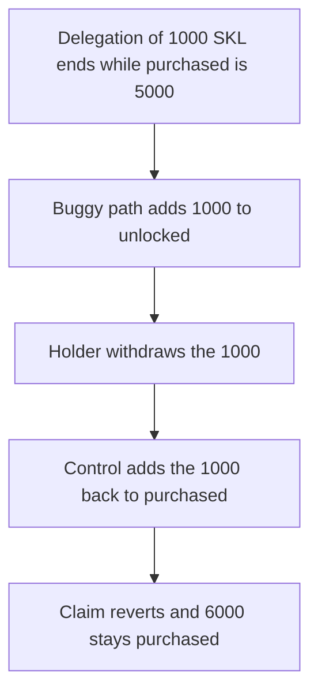

# Ending a 1,000 SKL delegation unlocks it while 5,000 is still locked

> **Vulnerability classes:** vuln/logic/wrong-condition · vuln/logic/incorrect-state-transition
>
> **Reproduction:** self-contained synthetic Foundry reduction; see [output.txt](output.txt).

<!-- non-defihacklabs -->
<!-- source-auditvault: https://github.com/Auditware/AuditVault/blob/main/findings/13827-tokens-after-delegation-should-not-be-unlocked-automatically.md -->
<!-- date: 2020-01 -->

## Key info

| Field | Value |
|---|---|
| **Loss** | 1,000 SKL withdrawn when the delegation ends. Purchased was 5,000, so the lock is not over. Control keeps 6,000 purchased |
| **Vulnerable contract** | `BuggyState.onDelegationEnd` |
| **Attacker EOA** | `0x1111111111111111111111111111111111111111` |
| **Attack contract** | `Exploit` |
| **Attack tx** | `Exploit.run()` |
| **Chain / block / date** | Ethereum model · block 0 · 2020-01 |
| **Compiler** | solc 0.8.27, cancun, via IR |
| **Bug class** | Delegation end moves the amount to `unlocked` instead of back to `purchased` |

## TL;DR

Tokens that were purchased, then delegated, should return to `purchased` when the delegation ends. They stay locked unless `totalDelegated >= purchased`. The buggy end path adds the amount to `unlocked` immediately. A holder who delegated 1,000 of 5,000 purchased SKL withdraws the 1,000 as soon as that delegation ends. The fixed path adds the 1,000 back to `purchased` (now 6,000) and the claim reverts.

## Background

ConsenSys Diligence reviewed the SKALE token in January 2020. Purchased tokens are under a lock. Delegation parks some of them with a validator. When that delegation ends, the amount is no longer delegated, but it is still purchased. The code path quoted at `TokenState.sol` lines 258–264 is the only place that calls `purchasedToUnlocked`, and the report says ending a delegation unlocks tokens that should have been put back into `_purchased` until `totalDelegated >= purchased`.

## The vulnerable code

```solidity
function onDelegationEnd(address holder, uint256 amount) external {
    totalDelegated[holder] -= amount;
    // @> VULN: delegation end unlocks the tokens even though delegated is below purchased
    unlocked[holder] += amount;
}
```

The fixed end path is the opposite assignment:

```solidity
totalDelegated[holder] -= amount;
purchased[holder] += amount;
if (totalDelegated[holder] >= purchased[holder]) {
    unlocked[holder] = purchased[holder];
}
```

After the fixed end, `totalDelegated` is 0 and `purchased` is 6,000. The `if` does not unlock.

## Root cause

Delegation end and unlock are the same write. The lock predicate is never consulted, so any ended delegation becomes spendable even when the holder has not delegated half, let alone all, of the purchased balance.

## Preconditions

- `purchased` is 5,000 SKL. The open delegation is 1,000 SKL. 1,000 is below 5,000.
- The delegation ends in this transaction. No time warp is required. The bug is the state write, not a clock.
- `claim` pays `unlocked` and reverts when it is 0.

## Attack walkthrough

1. The buggy state ends the 1,000 SKL delegation. `unlocked` becomes 1,000. `claim` pays the holder 1000000000000000000000 ([output.txt:7](output.txt)).
2. The fixed state ends the same delegation by adding 1,000 back onto `purchased`. `claim` reverts. `controlClaimed` is 0 ([output.txt:9](output.txt)).
3. `stillLocked` is 6000000000000000000000 ([output.txt:11](output.txt)), which is the original 5,000 plus the returned 1,000. `unlocked` on the fixed state is 0.
4. `[PASS]` ([output.txt:4](output.txt)).

## Diagrams



## Impact

The holder receives 1,000 SKL that the lock still covers. The purchased balance was 5,000 and the ended delegation does not make `totalDelegated >= purchased`. On the fixed path the same 1,000 is purchased again, the claim pays nothing, and 6,000 SKL remains locked.

## Remediation

On delegation end, add the amount back to `purchased` and decrease `totalDelegated`. Call `purchasedToUnlocked` only when `totalDelegated >= purchased` after that update. Do not write the ended amount into `unlocked` directly.

```diff
 function onDelegationEnd(address holder, uint256 amount) external {
     totalDelegated[holder] -= amount;
-    unlocked[holder] += amount;
+    purchased[holder] += amount;
+    if (totalDelegated[holder] >= purchased[holder]) {
+        unlocked[holder] = purchased[holder];
+    }
 }
```

## How to reproduce

```bash
cd 13827-tokens-after-delegation-should-not-be-unlocked-automatically_exp
forge test -vv
```

## Sources

- AuditVault finding: [13827-tokens-after-delegation-should-not-be-unlocked-automatically](https://github.com/Auditware/AuditVault/blob/main/findings/13827-tokens-after-delegation-should-not-be-unlocked-automatically.md)
- ConsenSys Diligence, SKALE token, January 2020: https://consensys.net/diligence/audits/2020/01/skale-token/
- `TokenState.sol` lines 258–264 as quoted in the finding
- Fix discussed in https://github.com/skalenetwork/skale-manager/pull/92
