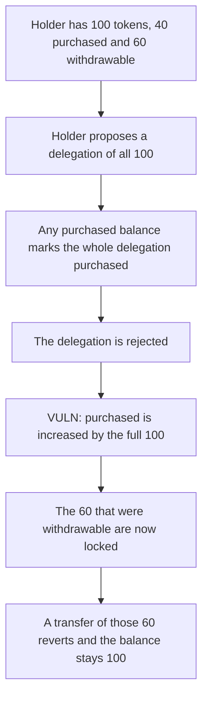

# SKALE TokenState — rejecting a mixed delegation re-locks unlocked tokens

> **Vulnerability classes:** vuln/logic/wrong-condition · vuln/dos/frozen-funds

<!-- non-defihacklabs -->
<!-- source-auditvault: https://github.com/Auditware/AuditVault/blob/main/findings/13828-some-unlocked-tokens-can-become-locked-after-delegation-is-r.md -->
<!-- date: 2020-01 -->

## Key info

| | |
|---|---|
| **Protocol** | SKALE Token |
| **Finding** | ConsenSys Diligence, Jan 2020, AuditVault 13828 |
| **Vulnerable code** | `TokenState._cancel` restores the full delegation amount into `_purchased` |
| **Harm** | 60e18 that was withdrawable is locked after the delegation is rejected |
| **Chain** | local synthetic (audited cancel path) |

## TL;DR

`initProposed` records a single bit. If the holder has any purchased balance, the whole delegation is marked purchased, and `_purchased` is reduced by at most that balance. `_cancel` then calls `purchasedProposedToPurchased`, which adds the full delegation amount back.

A holder with 100 tokens, 40 purchased and 60 withdrawable, proposes all 100. The bit is set and purchased drops to 0. The validator rejects the request. Purchased becomes 100. The 60 that could be transferred before the request cannot be transferred after it. A transfer of those 60 reverts and the balance stays 100.

The control records the purchased slice that was actually consumed and adds only that slice back. The same reject leaves purchased at 40, the 60 stay withdrawable, and the transfer succeeds.

## The vulnerable code

The audited classification treats a mixed balance as entirely purchased:

```solidity
if (_purchased[delegation.holder] > 0) {
    _isPurchased[delegationId] = true;
    if (_purchased[delegation.holder] > delegation.amount) {
        _purchased[delegation.holder] -= delegation.amount;
    } else {
        _purchased[delegation.holder] = 0;
    }
} else {
    _isPurchased[delegationId] = false;
}
```

Rejecting the request then restores the whole amount:

```solidity
function _cancel(uint delegationId, DelegationController.Delegation memory delegation) internal returns (State state) {
    if (_isPurchased[delegationId]) {
        state = purchasedProposedToPurchased(delegationId, delegation);
    } else {
        state = proposedToUnlocked(delegationId);
    }
}
```

```solidity
// @> VULN: the rejected delegation adds its full amount back into _purchased, re-locking tokens that were unlocked.
_purchased[delegation.holder] += delegation.amount;
// FIX: add back only the purchased slice initProposed actually subtracted.
```

## Root cause

Purchased versus unlocked is not stored per token inside the delegation. One boolean stands in for the whole amount. When the delegated amount is larger than the purchased balance, the unlocked part is included in the flag. `purchasedProposedToPurchased` does not know that split, so the reject path locks tokens that were free.

With 40 purchased and a delegation of 100, the inner branch sets `_purchased` to 0 and the flag to true. The later `+= delegation.amount` writes 100. Withdrawable balance is `balance - purchased` once the delegation is `COMPLETED`, so it falls from 60 to 0.

## Preconditions

The holder has a purchased balance strictly between 0 and the delegated amount, and the rest of the delegated tokens are unlocked. No admin key is required. The validator, or the holder, rejects the still-proposed delegation. The numbers here are 100 tokens, 40 purchased, and a delegation of 100.

## Attack walkthrough

1. The holder is seeded with 100 tokens and a purchased balance of 40. Withdrawable is 60.
2. The holder proposes a delegation of 100. `initProposed` sets `_isPurchased` and clears purchased to 0.
3. The request is rejected. `_cancel` takes the purchased branch.
4. `purchasedProposedToPurchased` adds 100 to `_purchased`.
5. Withdrawable is 0. A transfer of the original 60 reverts. The holder still has a balance of 100, all of it locked.
6. On the fixed state machine the same reject restores only 40. Withdrawable stays 60 and the transfer pays the sink 60.

## Diagrams



## Impact

60e18 that the holder could withdraw before the request is not withdrawable after the rejection. Purchased balance grows from 40e18 to 100e18. The transfer of 60e18 reverts, so those tokens stay in the holder. The original 40e18 lock is legitimate. The extra 60e18 lock is not.

## Remediation

Remember how much of the delegation was taken from `_purchased`. On reject, add only that slice back. Tokens that were unlocked before the request stay unlocked.

## How to reproduce

```bash
cd 13828-some-unlocked-tokens-can-become-locked-after-delegation-is-r_exp
forge test -vv
```

`test_reject_relocks_60e18_that_was_withdrawable` asserts withdrawable falls from 60e18 to 0 and the transfer reverts. `test_control_reject_leaves_60e18_unlocked` asserts the fixed path still transfers 60e18.

## Sources

- AuditVault finding: https://github.com/Auditware/AuditVault/blob/main/findings/13828-some-unlocked-tokens-can-become-locked-after-delegation-is-r.md
- ConsenSys Diligence report: https://consensys.net/diligence/audits/2020/01/skale-token/
- Audited function: https://github.com/skalenetwork/skale-manager/blob/b50d2bda0b/contracts/delegation/TokenState.sol
- Fix: https://github.com/skalenetwork/skale-manager/pull/92
