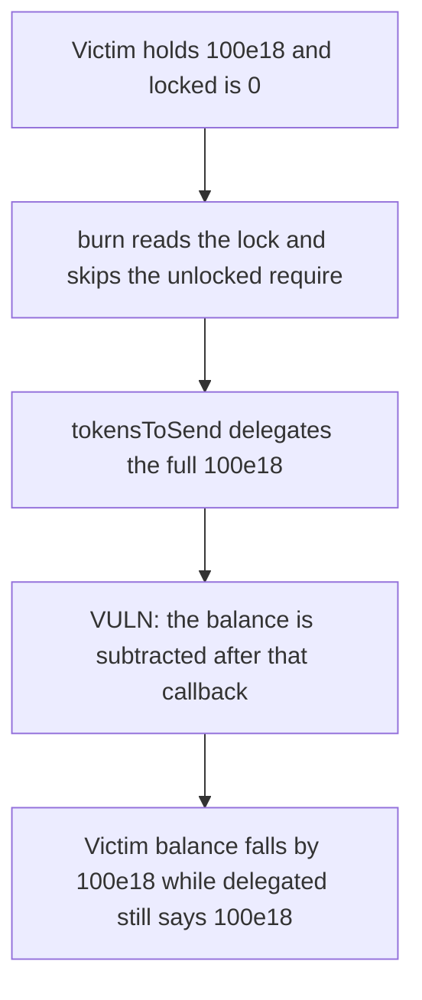

# SKALE LockableERC777 — a burn callback delegates tokens and then burns them

> **Vulnerability classes:** vuln/reentrancy/single-function

<!-- non-defihacklabs -->
<!-- source-auditvault: https://github.com/Auditware/AuditVault/blob/main/findings/13843-users-can-burn-delegated-tokens-using-re-entrancy-attack-add.md -->
<!-- date: 2020-01 -->

## Key info

| | |
|---|---|
| **Protocol** | SKALE Token |
| **Finding** | ConsenSys Diligence, Jan 2020, AuditVault 13843 |
| **Vulnerable code** | `LockableERC777._burn` notifies the holder before it subtracts the balance |
| **Harm** | The victim balance drops by 100e18 after those tokens were delegated |
| **Chain** | local synthetic (audited burn order) |

## TL;DR

`_burn` reads the locked amount, requires the tokens to be unlocked, and only then calls `tokensToSend`. The holder callback runs while the balance is still intact, so the holder can delegate the full amount. The burn continues and subtracts that amount anyway.

Here the victim holds 100e18 and is the ERC777 sender. The unlocked check sees a lock of 0. `tokensToSend` delegates 100e18. The balance write then takes the victim from 100e18 to 0. The delegation record still says 100e18. Those delegated tokens were burned.

The control puts one reentrancy lock on both `burn` and `delegate`. The callback's `delegate` reverts, the burn reverts with it, and the victim balance stays 100e18.

## The vulnerable code

The audited order is the unlocked check, then the holder callback, then the balance update.

```solidity
uint256 locked = _getAndUpdateLockedAmount(from);
if (locked > 0) {
    require(_balances[from] >= locked.add(amount), "Token should be unlocked for burning");
}

_callTokensToSend(operator, from, address(0), amount, data, operatorData);

// Update state variables
_totalSupply = _totalSupply.sub(amount);
this.writeBurnedBalance(from, amount);
```

```solidity
// @> VULN: the balance is reduced after tokensToSend, so tokens delegated in that callback are still burned.
uint256 nextBalance = _balances[from] - amount;
_balances[from] = nextBalance;
```

## Root cause

The lock is observed before the external call and the balance is updated after it. `tokensToSend` is allowed to change `delegated`. Nothing reads that new lock again. The subtraction uses the amount from the original call, so a delegation performed in the callback does not stop the burn.

## Preconditions

The holder is a contract registered as the ERC777 tokens-sender, and its `tokensToSend` delegates the amount being burned. The tokens are unlocked at the start of `burn`, so the require does not fire. No admin key is required. The amount here is 100e18.

## Attack walkthrough

1. The victim is minted 100e18 and registered as its own tokens-sender.
2. The victim calls `burn` for 100e18. Locked is 0, so the unlocked require is skipped.
3. `_callTokensToSend` calls `tokensToSend`.
4. The callback delegates 100e18. The delegation record is 100e18 while the balance is still 100e18.
5. `_burn` subtracts 100e18. The victim balance is 0. The delegation record is still 100e18.
6. On the guarded token the same callback hits `nonReentrant` inside `delegate`. The burn reverts. The victim balance stays 100e18 and delegated stays 0.

## Diagrams



## Impact

The victim balance drops by 100e18. Those tokens were delegated inside the burn callback, and the delegation record still accounts for 100e18 after the balance is gone. A burn that the lock was supposed to refuse destroyed delegated tokens.

## Remediation

Do not update balances after an untrusted callback that can lock tokens. Call `tokensToSend` before the unlocked check so a delegation in the callback fails that check, or share a reentrancy lock between `burn` and `delegate` so the callback cannot delegate.

## How to reproduce

```bash
cd 13843-users-can-burn-delegated-tokens-using-re-entrancy-attack-add_exp
forge test -vv
```

`test_reentry_burns_100e18_of_delegated_tokens` asserts the victim balance falls by 100e18 and the delegation record stays 100e18. `test_control_guard_blocks_reentry_and_keeps_100e18` asserts the guarded burn reverts and the balance stays 100e18.

## Sources

- AuditVault finding: https://github.com/Auditware/AuditVault/blob/main/findings/13843-users-can-burn-delegated-tokens-using-re-entrancy-attack-add.md
- ConsenSys Diligence report: https://consensys.net/diligence/audits/2020/01/skale-token/
- Audited burn order: https://consensys.net/diligence/audits/2020/01/skale-token/
- Fix: https://github.com/skalenetwork/skale-manager/pull/128
