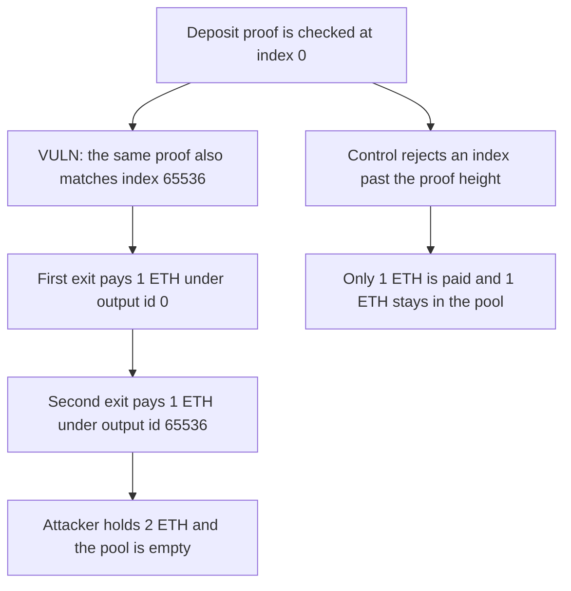

# OmiseGo MoreVP: one deposit proof exits twice

> **Vulnerability classes:** vuln/logic/missing-check · vuln/bridge/replay · vuln/input-validation/boundary

<!-- non-defihacklabs -->
<!-- source-auditvault: https://github.com/Auditware/AuditVault/blob/main/findings/13851-merklecheckmembership-allows-existence-proofs-for-the-same-l.md -->
<!-- date: 2020-01 -->

## Key info

| Field | Value |
|---|---|
| **Loss** | A 1 ETH deposit is paid twice. The attacker receives 2 ETH and the other depositor's 1 ETH is gone |
| **Vulnerable contract** | `ExitGame.checkMembership` |
| **Attacker EOA** | `0x1111111111111111111111111111111111111111` |
| **Attack contract** | `Exploit` |
| **Attack tx** | `Exploit.run()` |
| **Chain / block / date** | Ethereum model · block 0 · 2020-01 |
| **Compiler** | solc 0.8.27, cancun, via IR |
| **Bug class** | Merkle index is not bounded by the proof length |

## TL;DR

`checkMembership` hashes a leaf up the tree using one bit of `index` per 32-byte proof word, then compares the result to the root. It never requires `index < 2**(proof.length/32)`. Any index that shares those low bits verifies with the same proof. A 16-word deposit proof for index 0 also verifies at index 65536. Deposit output ids include the index, so the two exits are different ids and both are paid. The pool held 2 ETH. The attacker receives all of it for a single 1 ETH deposit.

## Background

ConsenSys Diligence, OmiseGo MoreVP, January 2020. `Merkle.checkMembership` is how child-chain transactions are proven on the root chain. The audit showed one proof accepted at indices 2, 6, and 10, and showed deposit exits at indices 0 and `2**16` both succeeding because deposit output ids include the transaction index. The fix is `index < 2**(proof.length/32)`.

## The vulnerable code

```solidity
uint256 j = index;
for (uint256 i = 32; i <= membershipProof.length; i += 32) {
    assembly {
        proofElement := mload(add(membershipProof, i))
    }
    if (j % 2 == 0) {
        computedHash = keccak256(abi.encodePacked(NODE_SALT, computedHash, proofElement)); // @> VULN: high index bits are never consumed
    } else {
        computedHash = keccak256(abi.encodePacked(NODE_SALT, proofElement, computedHash));
    }
    j = j / 2;
}
return computedHash == rootHash;
```

## Root cause

The loop discards `j` after the proof runs out. Index `65536` (`2**16`) has zeros in its low 16 bits, which is exactly the height of this proof, so it walks the same siblings as index 0. The exit game then keys the spent flag by `keccak256("deposit", leaf, index)`. The two ids differ, and the second payment is not treated as a replay.

## Preconditions

- The proof is shorter than the bits available in `index`.
- The output id for a deposit includes that index.
- The exit contract holds more than the single deposit, which it does: one other depositor's 1 ETH sits in the same pool.

## Attack walkthrough

1. The pool is funded with 2 ETH: the attacker's 1 ETH deposit and another depositor's 1 ETH.
2. `checkMembership` accepts the deposit proof at index 0. `processExit` pays 1 ETH.
3. The same proof is accepted at index 65536. That output id is still clear, so another 1 ETH is paid.
4. The attacker holds 2 ETH. `overpaid` is 1 ETH. The pool balance is 0.
5. The control requires `index < 2**(proof.length/32)`. Index 65536 reverts. Only 1 ETH is paid, and 1 ETH stays in the pool.

## Diagrams



## Impact

The attacker is paid 2 ETH for one 1 ETH deposit. The other 1 ETH in the exit pool is the loss. The bounded check stops the second exit: the caller receives 1 ETH and the contract keeps 1 ETH.

## Remediation

Before the hash walk, require `index < 2**(proof.length/32)`. The control uses that bound. A 16-word proof then accepts index 0 and rejects index 65536.

## How to reproduce

```bash
cd 13851-merklecheckmembership-allows-existence-proofs-for-the-same-l_exp
forge test -vv
```

`test_exploit_same_proof_exits_deposit_twice` asserts `paid == 2 ether`, the attacker coin balance is `2 ether`, and `overpaid == 1 ether`. `test_control_index_bound_pays_once` asserts the second exit reverts, `paid == 1 ether`, and the pool still holds `1 ether`.
