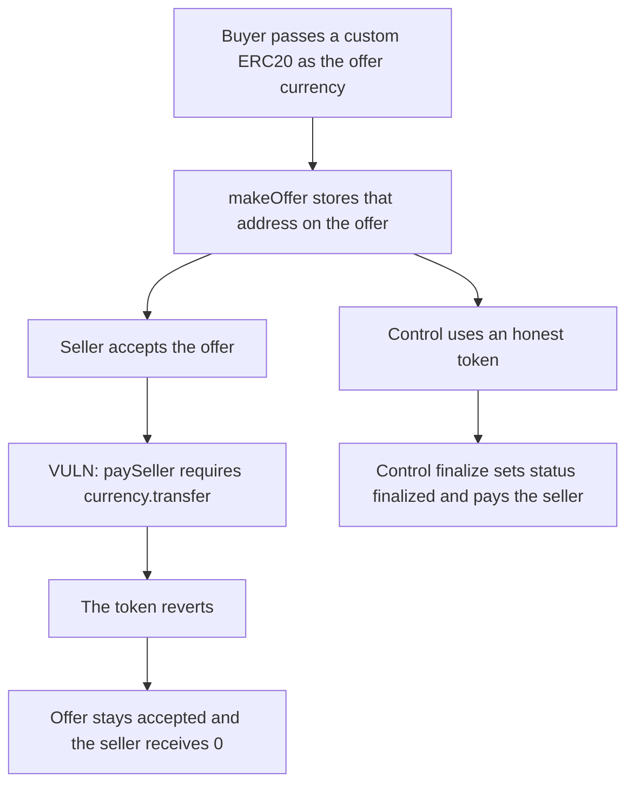

# Origin: a malicious ERC20 currency bricks an accepted offer

> **Vulnerability classes:** `vuln/dos/frozen-funds` · `vuln/logic/missing-check`

<!-- non-defihacklabs -->
<!-- source-auditvault: https://github.com/Auditware/AuditVault/blob/main/findings/17097-remote-code-execution-through-arbitrary-erc20-implementation.md -->
<!-- date: 2018-11 -->

## Key info

| Field | Value |
|---|---|
| **Loss** | The seller cannot finalize. Offer status stays accepted and the seller receives 0 |
| **Vulnerable contract** | `Marketplace.paySeller` |
| **Attacker EOA** | `0x1111111111111111111111111111111111111111` |
| **Attack contract** | `Exploit` |
| **Attack tx** | `Exploit.run()` |
| **Chain / block / date** | Ethereum model · block 0 · 2018-11 |
| **Compiler** | solc 0.8.27, cancun, via IR |
| **Bug class** | Untrusted ERC20 used as the offer currency |

## TL;DR

`makeOffer` stores any address as the offer currency. `paySeller` then requires that currency's `transfer` to succeed. A token that reverts on `transfer` makes `finalize` revert, so an accepted offer can never be completed. The seller's balance stays 0.

## Background

Trail of Bits' November 2018 Origin Protocol review. The report calls the issue remote code execution through an arbitrary ERC20. The concrete effect in `paySeller` is a grief: Bob offers a token that reverts on every `transfer`, Alice accepts, and finalization can never succeed. The short-term fix is a revoke path that does not call the currency. The long-term fix is a currency whitelist.

## The vulnerable code

```solidity
require(IERC20(offer.currency).transfer(offer.buyer, offer.refund), "Refund failed"); // @> VULN
require(IERC20(offer.currency).transfer(listing.seller, value), "Transfer failed");
```

The first `transfer` reverts, so the seller payout on the next line never runs and the offer status is never set to finalized.

```diff
- require(offer.currency.transfer(offer.buyer, offer.refund), "Refund failed");
- require(offer.currency.transfer(listing.seller, value), "Transfer failed");
+ // revoke the accepted offer without calling currency, or only allow a whitelisted currency
```

## Root cause

The currency is caller-chosen and the finalization path treats its return value as a hard requirement. There is no way for the seller or arbitrator to clear an accepted offer without that call.

## Preconditions

- A listing exists.
- The buyer passes a contract whose `transferFrom` returns true and whose `transfer` reverts.
- The seller accepts the offer.

## Attack walkthrough

1. Bob calls `makeOffer` with the malicious token for 1000 units. `transferFrom` returns true, so the offer is stored.
2. Alice accepts. Status becomes accepted.
3. `finalize` calls `paySeller`. The refund `transfer` reverts.
4. Status is still accepted. The seller's balance of the token is 0.

## Diagrams



## Impact

Alice cannot complete the sale and cannot revoke it without another call into the same token. The accepted offer is stuck. An honest currency in the control finalizes and pays the seller 1000 units.

## Remediation

Let the seller or the arbitrator revoke an accepted offer without calling the currency, and restrict `makeOffer` to a whitelist of token addresses.

## How to reproduce

```bash
cd 17097-remote-code-execution-through-arbitrary-erc20-implementation_exp
forge test -vv
```

`test_exploit_malicious_currency_bricks_finalize` asserts finalize fails, status stays 2, and the seller balance is 0. `test_control_honest_token_finalizes` asserts an honest token reaches status 3 and pays the seller. Captured output is `output.txt`.

## Sources

- AuditVault finding: https://github.com/Auditware/AuditVault/blob/main/findings/17097-remote-code-execution-through-arbitrary-erc20-implementation.md
- Trail of Bits report: https://github.com/trailofbits/publications/blob/master/reviews/origin.pdf
- Blamed functions: marketplace `makeOffer` and `paySeller` in the Origin contracts reviewed November 2018
