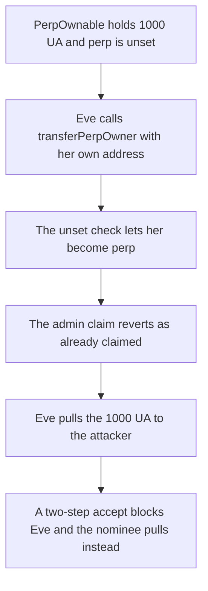

# transferPerpOwner can be front-run, then the new perp pulls the reserves

> **Vulnerability classes:** vuln/access-control/missing-auth

<!-- non-defihacklabs -->
<!-- source-auditvault: https://github.com/Auditware/AuditVault/blob/main/findings/17365-ownership-transfers-can-be-front-run-trailofbits-increment-f.md -->
<!-- date: 2022-09 -->

## Key info

| Field | Value |
|---|---|
| **Loss** | 1,000 UA pulled by the front-runner |
| **Vulnerable contract** | `PerpOwnable.transferPerpOwner` |
| **Attacker EOA** | `0x1111111111111111111111111111111111111111` |
| **Attack contract** | `Exploit` |
| **Attack tx** | `Exploit.run()` |
| **Chain / block / date** | Ethereum model · block 0 · 2022-09 |
| **Compiler** | solc 0.8.27, cancun, via IR |
| **Bug class** | First caller of an unauthenticated transfer becomes the privileged owner |

## TL;DR

`transferPerpOwner` sets `perp` on the first call. Anyone can be that caller. Eve calls it with her own address. The admin's call then reverts `OwnershipAlreadyClaimed`. Eve is the only address allowed to pull the virtual-token reserves, and she pulls 1,000 UA to the attacker. A two-step transfer ignores Eve: she cannot nominate and she cannot accept. The admin nominates the market, the market accepts, and the market pulls the same 1,000 UA to the treasury.

## The vulnerable code

```solidity
function transferPerpOwner(address recipient) external virtual {
    if (recipient == address(0)) revert PerpOwnable_TransferZeroAddress();
    // @> VULN: the first caller sets perp. No role and no accept step.
    if (perp != address(0)) revert PerpOwnable_OwnershipAlreadyClaimed();
    perp = recipient;
    emit PerpOwnerTransferred(msg.sender, recipient);
}
```

`pull` then pays the reserves, and it requires `msg.sender == perp`.

## Root cause

The function is external and the only state check is that `perp` is still unset. The caller is not required to be the admin, the market, or a pre-committed nominee. The first transaction in the mempool wins the role, and every later claim reverts.

## Preconditions

- `perp` is unset. That is the deployment state the review describes, before the admin points the virtual token at the perpetual market.
- The contract holds 1,000 UA. `pull` sends that balance and is gated by `perp`.

## Attack walkthrough

1. 1,000 UA is minted into `PerpOwnable` ([output.txt](output.txt)). `perp` is address zero.
2. Eve calls `transferPerpOwner(eve)`. The unset check does not revert. `perp` becomes Eve. The transfer event records her.
3. The admin calls `transferPerpOwner(treasury)`. It reverts `OwnershipAlreadyClaimed`.
4. Eve calls `pull(attacker, 1000 ether)`. The `msg.sender == perp` check passes. The attacker balance is 1,000 UA and the contract balance is 0.
5. Control: Eve's `transferPerpOwner` reverts because she is not the admin, and her `acceptPerpOwner` reverts because she was not nominated. Her `pull` reverts. The admin nominates the market. The market accepts and pulls the 1,000 UA to the treasury. The attacker's balance stays 0.

## Diagrams



## Impact

The attacker receives 1,000 UA (`1000000000000000000000` base units). The admin never becomes `perp`. On the two-step contract Eve cannot complete the transfer, and the 1,000 UA is pulled by the nominated market to the treasury instead.

## Remediation

Replace the one-shot assignment with a two-step transfer. Only the admin may nominate. Only the nominee may accept, and only that acceptance writes `perp`.

## How to reproduce

```bash
cd evm-hack-registry/17365-ownership-transfers-can-be-front-run-trailofbits-increment-f_exp
forge test -vv
```

## Sources

- [AuditVault finding 17365](https://github.com/Auditware/AuditVault/blob/main/findings/17365-ownership-transfers-can-be-front-run-trailofbits-increment-f.md)
- [Trail of Bits, Increment Protocol review, September 2022](https://github.com/trailofbits/publications/blob/master/reviews/2022-09-incrementprotocol-securityreview.pdf) (`contracts/utils/PerpOwnable.sol`)
- [Synthetic](test/17365-ownership-transfers-can-be-front-run-trailofbits-increment-f.sol)
