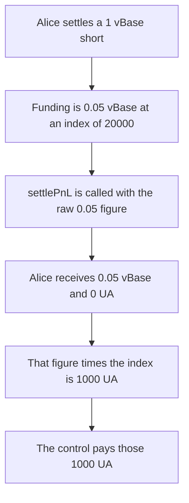

# Funding is paid in vBase instead of UA

> **Vulnerability classes:** vuln/logic/incorrect-calculation · vuln/logic/accounting

<!-- non-defihacklabs -->
<!-- source-auditvault: https://github.com/Auditware/AuditVault/blob/main/findings/17366-funding-payments-are-made-in-the-wrong-token-trailofbits-inc.md -->
<!-- date: 2022-09 -->

## Key info

| Field | Value |
|---|---|
| **Loss** | Alice receives 0.05 vBase and 0 UA instead of 1,000 UA |
| **Vulnerable contract** | `ClearingHouse._settleUserFundingPayments` |
| **Attacker EOA** | `0x1111111111111111111111111111111111111111` |
| **Attack contract** | `Exploit` |
| **Attack tx** | `Exploit.run()` |
| **Chain / block / date** | Ethereum model · block 0 · 2022-09 |
| **Compiler** | solc 0.8.27, cancun, via IR |
| **Bug class** | vBase funding notional is settled without the index conversion into UA |

## TL;DR

`_getFundingPayments` returns funding rate times the vBase position. For Alice's 1 vBase short and a 0.05 cumulative gap, that is 0.05 vBase. `_settleUserFundingPayments` passes that number to `settlePnL` with no `indexPrice`. The index is 20,000 UA per vBase, so she is owed 1,000 UA. She is minted 0.05 vBase and her UA balance stays 0. The control multiplies by the index first and mints 1,000 UA, with no vBase.

## The vulnerable code

```solidity
if (fundingPayments != 0) {
    // @> VULN: fundingPayments is vBase notional and is not multiplied by indexPrice
    vault.settlePnL(account, fundingPayments);
}
```

The figure comes from:

```solidity
upcomingFundingPayment = upcomingFundingRate * vBaseAmountToSettle / 1e18;
```

`upcomingFundingRate` is unitless. `vBaseAmountToSettle` is vBase. The product is vBase. `settlePnL` is the UA ledger in the reviewed code. This reduction mints that unconverted figure as vBase, which is token A, and mints none of token B.

## Root cause

A funding rate times a vBase amount is not a UA amount. The index price is the missing factor. The clearing house never reads it before settlement, so the user's quote balance is wrong by that factor. Here the factor is 20,000.

## Preconditions

- One market. Alice is short 1 vBase (`1e18`). Her stored cumulative funding is 0. The market cumulative is 0.05 (`0.05e18`).
- Index price is 20,000 UA per vBase (`20000e18`).
- Settlement runs on exit, which is the path the review describes.

## Attack walkthrough

1. `settle` sums `settleTrader` ([output.txt](output.txt)). The short is paid `globalCum - userCum`, which is 0.05, times the 1 vBase position. The product is 0.05 vBase.
2. `settlePnL` is called with `50000000000000000` and no index multiplication.
3. The vault mints 0.05 vBase to Alice. Her UA balance is 0.
4. `0.05 * 20,000 = 1,000`. The UA she should have received is `1000000000000000000000` base units.
5. Control: the vault multiplies the same 0.05 vBase by the index and mints 1,000 UA. Her vBase balance stays 0.

## Diagrams



## Impact

Alice receives 0.05 vBase (token A, `50000000000000000` base units) and 0 UA (token B). The index-converted payment is 1,000 UA. She is short 1,000 UA relative to the quote asset the funding payment is supposed to be denominated in. The control pays that 1,000 UA and no vBase.

## Remediation

Convert the vBase funding figure with `indexPrice` before `settlePnL`, and credit UA:

```diff
-vault.settlePnL(account, fundingPayments);
+vault.settlePnL(account, fundingPayments * indexPrice / 1e18);
```

## How to reproduce

```bash
cd evm-hack-registry/17366-funding-payments-are-made-in-the-wrong-token-trailofbits-inc_exp
forge test -vv
```

## Sources

- [AuditVault finding 17366](https://github.com/Auditware/AuditVault/blob/main/findings/17366-funding-payments-are-made-in-the-wrong-token-trailofbits-inc.md)
- [Trail of Bits, Increment Protocol review, September 2022](https://github.com/trailofbits/publications/blob/master/reviews/2022-09-incrementprotocol-securityreview.pdf) (`contracts/ClearingHouse.sol`, `contracts/Perpetual.sol`)
- [Synthetic](test/17366-funding-payments-are-made-in-the-wrong-token-trailofbits-inc.sol)
