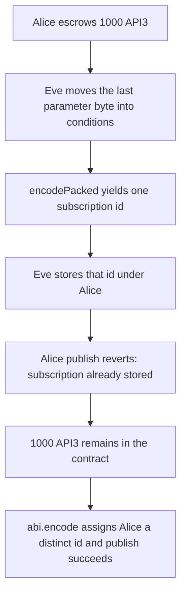

# API3 PSP: a shifted parameter byte blocks publish and sticks the fee

> **Vulnerability classes:** vuln/dos/frozen-funds · vuln/dos/griefing · vuln/logic/missing-validation
>
> **Reproduction:** self-contained synthetic Foundry reduction; see [output.txt](output.txt).

<!-- non-defihacklabs -->
<!-- source-auditvault: https://github.com/Auditware/AuditVault/blob/main/findings/17619-publish-subscribe-protocol-users-are-vulnerable-to-a-denial.md -->
<!-- date: 2022-03 -->

## Key info

| Field | Value |
|---|---|
| **Loss** | Alice's publish reverts. 1000 API3 (1000000000000000000000 wei) stays in PspStorage |
| **Vulnerable contract** | `PspStorage.storeSubscription` (reduction of `StorageUtils.storeSubscription`) |
| **Attacker EOA** | `0x1111111111111111111111111111111111111111` |
| **Attack contract** | `Exploit` |
| **Attack tx** | `Exploit.run()` |
| **Chain / block / date** | Ethereum model · block 0 · 2022-03 |
| **Compiler** | solc 0.8.27, cancun, via IR |
| **Bug class** | `abi.encodePacked` of two dynamic byte strings |

## TL;DR

API3's publish-subscribe id is `keccak256(abi.encodePacked(..., parameters, conditions, ...))`. Both `parameters` and `conditions` are dynamic, so `encodePacked(0x6162, 0x63)` equals `encodePacked(0x61, 0x6263)`. Eve stores the shifted pair under Alice's requester. Alice's `publish` of the honest bytes hits that id and reverts `Subscription already stored`. Her escrowed 1000 API3 stays in the contract. `abi.encode` gives the two layouts different ids (`0xc0b0b90e…971d1` and `0x9650448e…fe006`), and the same publish succeeds.

## Background

Trail of Bits reviewed API3 in February–March 2022 (Simone Monica). `StorageUtils.storeSubscription` hashes the subscription with `abi.encodePacked`. Solidity warns that packing more than one dynamic type is not injective: `abi.encodePacked("ab", "c") == abi.encodePacked("a", "bc")`. The Airnode then serves the stored record, not the bytes the subscriber actually paid for. This reduction keeps that hash and adds the fee escrow the monetization contracts charge to open a subscription: 1000 API3 is pulled in `deposit`, and only a successful `publish` clears `pending`.

## The vulnerable code

```solidity
subscriptionId = keccak256(
    abi.encodePacked(
        chainId,
        airnode,
        templateId,
        parameters,
        conditions,
        relayer,
        sponsor,
        requester,
        fulfillFunctionId
    )
);
```

`publish` recomputes that same packed id and requires `subscriptions[id].airnode == address(0)`. The fixed path swaps in `abi.encode`, which length-prefixes each byte string.

## Root cause

`abi.encodePacked` concatenates the raw bytes of `parameters` and `conditions`. A one-byte shift across that boundary does not change the concatenation, so it does not change the id. The stored record can therefore belong to a different parameter string than the one the subscriber is trying to publish.

## Preconditions

- Alice has escrowed the 1000 API3 fee (`pending == 1000 ether`).
- The other id fields match: chain id 1, the same airnode, template, relayer, sponsor, requester, and fulfill selector.
- Eve may pass Alice's address as `requester`. The function does not require `msg.sender == requester`.

## Attack walkthrough

1. `mint` credits Alice 1000 API3 ([output.txt](output.txt) logs `stuck API3 wei` = `1000000000000000000000`).
2. `deposit` moves that balance into PspStorage and sets `pending(Alice)`.
3. Eve calls `storeSubscription` with parameters `0x61` and conditions `0x6263`, requester = Alice.
4. The packed id is `0x96faf2f485c5d18cba046041af39ed0dc0cb65ddf33b63b9da16993b1a7d8bbd` for both layouts.
5. The slot stores Eve's shifted bytes, not `0x6162` / `0x63`.
6. Alice's `publish(0x6162, 0x63)` reverts `Subscription already stored`. `tryPublish` returns false.
7. `balanceOf(PspStorage)` is still 1000 API3, `pending` is still 1000 API3, and `active` is zero.
8. Control: after the same shifted `storeSubscription`, `publishEncoded` opens `0xc0b0b90e269717ad0585f6d8e55e78666e4fb5339d2be14a4e5088b0ec1971d1`, clears `pending`, and stores Alice's real parameters. Eve's encoded id is `0x9650448e8b26875dc160d1ced4179a77c9b3b35dc011a27b69ec5282a9cfe006`.

## Diagrams



## Impact

Alice cannot publish the subscription she funded. 1000 API3 remains in PspStorage, `pending` stays `1000000000000000000000`, and `active` stays `bytes32(0)`. The stored parameters are `0x61`, not `0x6162`. The control publish succeeds and clears the pending fee.

## Remediation

Hash the subscription with `abi.encode` (or another injective encoding) so each dynamic field keeps its own length. Reject `storeSubscription` when the id is already stored.

## Sources

- AuditVault finding: [17619-publish-subscribe-protocol-users-are-vulnerable-to-a-denial](https://github.com/Auditware/AuditVault/blob/main/findings/17619-publish-subscribe-protocol-users-are-vulnerable-to-a-denial.md)
- Trail of Bits, API3 Security Assessment, 30 March 2022: https://github.com/trailofbits/publications/blob/master/reviews/API3.pdf
- Vulnerable function quoted from `airnode-protocol-v1/contracts/protocol/StorageUtils.sol` (`storeSubscription`, report lines 135–158). The archived repo `api3dao/airnode-protocol-v1` at `contracts/protocol/StorageUtils.sol` on `master` already uses `abi.encode`.
