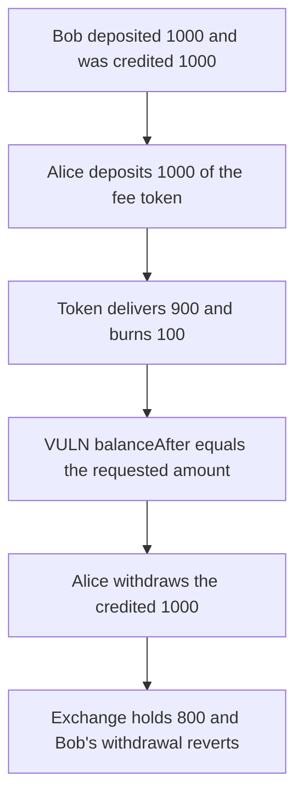

# DeGate: a fee-on-transfer deposit is credited in full

> **Vulnerability classes:** `vuln/logic/fee-calculation` · `vuln/access-control/missing-auth`

<!-- non-defihacklabs -->
<!-- source-auditvault: https://github.com/Auditware/AuditVault/blob/main/findings/17856-token-management-diculties-caused-by-the-addition-of-arbitra.md -->
<!-- date: 2022-11 -->

## Key info

| Field | Value |
|---|---|
| **Loss** | Bob is credited 1000 and can withdraw only 800. His full withdrawal reverts |
| **Vulnerable contract** | `DefaultDepositContract.deposit` |
| **Attacker EOA** | `0x1111111111111111111111111111111111111111` |
| **Attack contract** | `Exploit` |
| **Attack tx** | `Exploit.run()` |
| **Chain / block / date** | Ethereum model · local · 2022-11 |
| **Compiler** | solc 0.8.27, cancun |
| **Bug class** | `needCheckBalance` left false for a permissionlessly registered token |

## TL;DR

Anyone can register a token, and `needCheckBalance` stays false until the owner calls `setCheckBalance`. A 10 percent fee-on-transfer deposit is then credited for the full amount. Alice withdraws that credit. The exchange is left holding 800 against Bob's credit of 1000, so Bob's withdrawal reverts.

## Background

Trail of Bits' DeGate review, November 2022, by Shaun Mirani. The report covers `ExchangeV3.registerToken`, `ExchangeDeposits.deposit`, and `DefaultDepositContract.deposit`. The owner cannot reliably front-run every new token to enable the balance check.

## The vulnerable code

```solidity
bool checkBalance = needCheckBalance[token];
uint256 balanceBefore = checkBalance ? FeeToken(token).balanceOf(address(this)) : 0;
FeeToken(token).transferFrom(from, address(this), uint256(amount));
uint256 balanceAfter = checkBalance ? FeeToken(token).balanceOf(address(this)) : amount; // @> VULN: credits `amount` when the fee token delivered less
```

```diff
- uint256 balanceAfter = checkBalance ? FeeToken(token).balanceOf(address(this)) : amount;
+ uint256 balanceAfter = FeeToken(token).balanceOf(address(this));
```

## Root cause

When the flag is false, `balanceAfter` is the requested amount and `balanceBefore` is 0, so the credit equals `amount` no matter what the token actually delivered.

## Preconditions

- The token takes a 10 percent fee on `transferFrom` and is not on `needCheckBalance`.
- Bob has already deposited 1000 and was credited 1000 while only 900 arrived.
- Alice deposits 1000 and then withdraws her credit.

## Attack walkthrough

1. Bob's earlier deposit left the exchange with 900 tokens and a 1000 credit.
2. Alice deposits 1000. The token burns 100 and delivers 900. She is credited 1000.
3. Alice withdraws 1000. The exchange pays it and has 800 left.
4. Bob's withdrawal of his 1000 credit reverts. Alice is back to the 1000 she started with.

## Diagrams



## Impact

Bob's 1000 credit cannot be paid. The exchange holds 800 of the fee token after Alice's withdrawal. With `setCheckBalance` enabled, the same deposit credits only the 900 that arrived.

## Remediation

Credit the measured balance delta for every token, or refuse tokens that have not been explicitly reviewed and flagged.

## How to reproduce

```bash
cd 17856-token-management-diculties-caused-by-the-addition-of-arbitra_exp
forge test -vv
```

`test_exploit_overcredit_lets_alice_strand_bob` asserts an 800 balance, Bob's 1000 credit, and a reverted withdrawal. `test_control_check_balance_credits_only_what_arrived` asserts a 900 credit. Captured output is `output.txt`.

## Sources

- AuditVault finding: https://github.com/Auditware/AuditVault/blob/main/findings/17856-token-management-diculties-caused-by-the-addition-of-arbitra.md
- Trail of Bits report: https://github.com/trailofbits/publications/blob/master/reviews/DeGate.pdf
