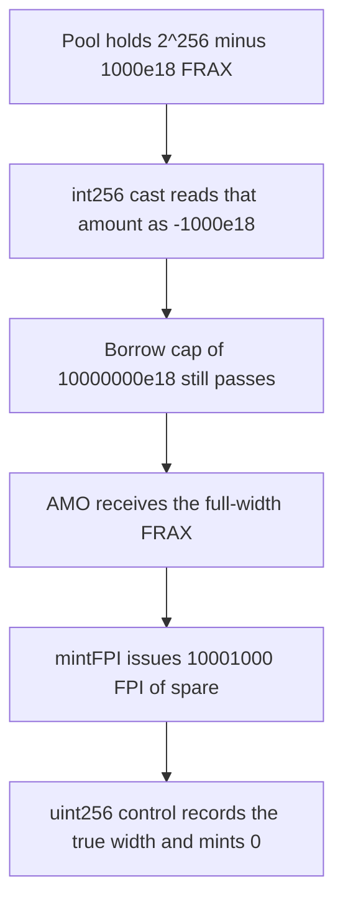

# FPIControllerPool casts a full-width FRAX amount to -1000e18 and mints 10,001,000 FPI

> **Vulnerability classes:** vuln/arithmetic/overflow · vuln/logic/missing-check · vuln/logic/fee-calculation
>
> **Reproduction:** self-contained synthetic Foundry reduction; see [output.txt](output.txt).

<!-- non-defihacklabs -->
<!-- source-auditvault: https://github.com/Auditware/AuditVault/blob/main/findings/17911-unsafe-integer-conversions-in-fpicontrollerpool-trailofbits.md -->
<!-- date: 2022-08 -->

## Key info

| Field | Value |
|---|---|
| **Loss** | 10,001,000 FPI minted. True FRAX moved is 2^256 - 1000e18. The cast stores -1000e18 |
| **Vulnerable contract** | `FPIControllerPool.giveFRAXToAMO` |
| **Attacker EOA** | `0x1111111111111111111111111111111111111111` |
| **Attack contract** | `Exploit` |
| **Attack tx** | `Exploit.run()` |
| **Chain / block / date** | Ethereum model · block 0 · 2022-08 |
| **Compiler** | solc 0.8.27, cancun, via IR |
| **Bug class** | Unsafe `uint256` to `int256` conversion |

## TL;DR

`giveFRAXToAMO` does `int256 frax_amount_i256 = int256(frax_amount)` and then checks that value against `frax_borrow_cap`. The input `2^256 - 1000e18` (`115792089237316195423570985008687907853269984665640564038457584007913129639936`) becomes `-1000e18`. The 10,000,000e18 cap still passes, the AMO receives the full-width FRAX, and `mintFPI` treats the negative debt as spare capacity. It mints `10,001,000e18` FPI. Keeping the amount in `uint256` records the true width and mints 0.

## Background

Trail of Bits reviewed FraxSwap, FPIController, and FraxLend from 25 April to 5 May 2022 (Gustavo Grieco). The published PDF is dated 3 August 2022. `FPIControllerPool.giveFRAXToAMO` lends FRAX to an AMO and accounts the loan as an `int256` so the borrow cap can be a signed sum. Solidity's `int256(uint256)` does not revert. Any value above `2^255 - 1` is a negative `int256`. The current `frax-solidity` master adds `require(frax_amount <= (2**255 - 1))` before the cast. This reduction is the pre-check body quoted in the report.

## The vulnerable code

```solidity
int256 frax_amount_i256 = int256(frax_amount);
require((frax_borrowed_sum + frax_amount_i256) <= frax_borrow_cap, "Borrow cap");
frax_borrowed_balances[destination_amo] += frax_amount_i256;
frax_borrowed_sum += frax_amount_i256;
frax.transfer(destination_amo, frax_amount);
```

`mintFPI` then mints `uint256(frax_borrow_cap - frax_borrowed_sum)`.

## Root cause

The cast keeps 256 bits but interprets the high bit as a sign. `2^256 - 1000e18` and `-1000e18` are the same bit pattern. The cap check and the later mint use the signed reading. The token transfer uses the original `uint256`.

## Preconditions

- The caller is an approved AMO. The report's caller is governance; the cast is what defeats the cap.
- `frax_borrow_cap` is `10_000_000e18`, matching the contract's initial cap.
- The pool holds the full-width FRAX balance so the transfer can succeed.

## Attack walkthrough

1. The true amount is `type(uint256).max - 1000 ether + 1` = `115792089237316195423570985008687907853269984665640564038457584007913129639936` ([output.txt](output.txt)).
2. `giveFRAXToAMO` casts it. `truncatedCast` is `-1000 ether` (`-1000000000000000000000`).
3. `0 + (-1000e18) <= 10_000_000e18`, so the cap require passes.
4. `borrowed_sum` is stored as `-1000e18`. `transfer` still moves the true amount to the AMO.
5. `mintFPI` computes `10_000_000e18 - (-1000e18) = 10_001_000e18` and mints that FPI (`10001000000000000000000000` wei).
6. Control `giveFullWidth` records the same integer as a `uint256`. It is above the cap, so the mint is 0 and the FRAX stays in the pool.

## Diagrams



## Impact

The AMO receives the true FRAX amount and also 10,001,000 FPI. The truncated accounting entry is -1,000 FRAX, not the true width. A full-width cap check mints 0 FPI and does not release the FRAX.

## Remediation

Require `frax_amount <= uint256(type(int256).max)` before the cast, which is the check now present on `frax-solidity` master. Apply the same bound in `receiveFRAXFromAMO` and in `price_info` before `int256(...)`.

## Sources

- AuditVault finding: [17911-unsafe-integer-conversions-in-fpicontrollerpool-trailofbits](https://github.com/Auditware/AuditVault/blob/main/findings/17911-unsafe-integer-conversions-in-fpicontrollerpool-trailofbits.md)
- Trail of Bits, Frax Finance Security Assessment, 3 August 2022: https://github.com/trailofbits/publications/blob/master/reviews/FraxQ22022.pdf
- `FraxFinance/frax-solidity` `src/hardhat/contracts/FPI/FPIControllerPool.sol` `giveFRAXToAMO`. Master already contains the `int256 overflow` require; the reduction uses the unchecked cast quoted in the report.
