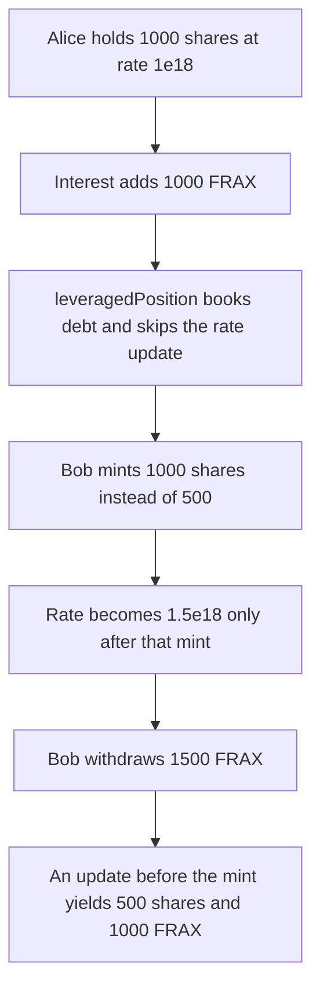

# Fraxlend leveragedPosition leaves the exchange rate stale, so the next mint withdraws 1500 FRAX

> **Vulnerability classes:** vuln/oracle/stale-price · vuln/logic/state-update · vuln/logic/price-calculation
>
> **Reproduction:** self-contained synthetic Foundry reduction; see [output.txt](output.txt).

<!-- non-defihacklabs -->
<!-- source-auditvault: https://github.com/Auditware/AuditVault/blob/main/findings/17912-leveragedposition-and-repayassetwithcollateral-do-not-update.md -->
<!-- date: 2022-08 -->

## Key info

| Field | Value |
|---|---|
| **Loss** | Bob mints 1000 shares instead of 500 and withdraws 1500 FRAX. Alice is left with 1500 FRAX instead of 2000 |
| **Vulnerable contract** | `FraxlendPair.leveragedPosition` |
| **Attacker EOA** | `0x1111111111111111111111111111111111111111` |
| **Attack contract** | `Exploit` (Bob) |
| **Attack tx** | `Exploit.run()` |
| **Chain / block / date** | Ethereum model · block 0 · 2022-08 |
| **Compiler** | solc 0.8.27, cancun, via IR |
| **Bug class** | Stale `exchangeRate` on a debt-increasing call |

## TL;DR

Alice has deposited 1000 FRAX and holds 1000 shares at a stored rate of 1e18. Interest then adds 1000 FRAX, so a fresh rate would be 2e18. `leveragedPosition` books 100 FRAX of debt and checks solvency with the stored rate. It does not call `updateExchangeRate`. Bob deposits 1000 FRAX and is minted 1000 shares instead of 500. After the rate is refreshed to 1.5e18 he withdraws 1500 FRAX. The control calls `updateExchangeRate` first, mints 500 shares, and withdraws 1000 FRAX.

## Background

Trail of Bits reviewed FraxLend in the same April–May 2022 engagement as FPIController (published 3 August 2022). `isSolvent` runs after the function body and reads `exchangeRateInfo.exchangeRate`. `updateExchangeRate` is what refreshes that value, and it returns the stored rate when `lastTimestamp` is already this block. `borrowAsset` calls it. `leveragedPosition` and `repayAssetWithCollateral` do not, so they can borrow against a rate from before the latest accrual. This reduction keeps that split: interest is accrued in `totalAssets`, the stored rate stays 1e18 until someone calls `updateExchangeRate`, and the second user's mint and withdraw both read the stored rate.

## The vulnerable code

```solidity
modifier isSolvent(address borrower) {
    _;
    require(_isSolvent(borrower, exchangeRate), "FraxLendPair: user is insolvent");
}

function leveragedPosition(uint256 borrowAssets) external isSolvent(msg.sender) {
    debt[msg.sender] += borrowAssets;
}
```

`mint` prices shares as `assets * 1e18 / exchangeRate`. `withdraw` prices assets as `shares * exchangeRate / 1e18`.

## Root cause

The rate is a cached value. Accruing interest updates `totalAssets` and not `exchangeRate`. A debt-increasing function that skips `updateExchangeRate` leaves the cache in place for every later mint and withdraw in the same block, and for later blocks until something else refreshes it.

## Preconditions

- Alice already seeded the pair: 1000 FRAX, 1000 shares, rate 1e18. `lastTimestamp` is 0, so one `updateExchangeRate` call in this block will write a new rate. The replay timestamp is 1, so that call is not a no-op.
- Interest of 1000 FRAX is minted into the pair before Bob arrives. No timestamp warp is required.

## Attack walkthrough

1. `accrueInterest(1000 ether)` makes `totalAssets` 2000e18. `fairMint(1000 ether)` is 500e18 shares ([output.txt](output.txt)).
2. Alice's `leveragedPosition(100 ether)` stores the debt. Collateral at the stale rate is 1000e18, so the solvency check passes. The fair collateral is 2000e18.
3. Bob's `mint(1000 ether)` divides by 1e18 and mints 1000e18 shares.
4. `updateExchangeRate` now sees 3000e18 assets and 2000e18 shares and writes 1.5e18.
5. Bob withdraws those 1000 shares for 1500e18 FRAX. His balance goes from 1000e18 to 1500e18, a gain of 500e18. The pair has 1500e18 left for Alice's 1000 shares. At the fair mint she would still have had 2000e18.
6. Control: `updateExchangeRate` before the mint writes 2e18. The mint is 500e18 shares and the withdraw returns 1000e18. Bob's balance is unchanged and the pair still holds 2000e18.

## Diagrams



## Impact

Bob receives 500 FRAX of Alice's interest. The stale mint is 1000 shares against a fair mint of 500 shares, and the withdrawal is 1500 FRAX against a fair withdrawal of 1000 FRAX. Alice's 1000 shares are backed by 1500 FRAX instead of 2000 FRAX.

## Remediation

Call `updateExchangeRate` at the start of every function that increases debt or that mints or burns shares, including `leveragedPosition` and `repayAssetWithCollateral`.

## Sources

- AuditVault finding: [17912-leveragedposition-and-repayassetwithcollateral-do-not-update](https://github.com/Auditware/AuditVault/blob/main/findings/17912-leveragedposition-and-repayassetwithcollateral-do-not-update.md)
- Trail of Bits, Frax Finance Security Assessment, 3 August 2022: https://github.com/trailofbits/publications/blob/master/reviews/FraxQ22022.pdf
- `FraxFinance/fraxlend` `src/contracts/FraxlendPairCore.sol` `leveragedPosition`, `repayAssetWithCollateral`, `updateExchangeRate`, and the `isSolvent` modifier.
