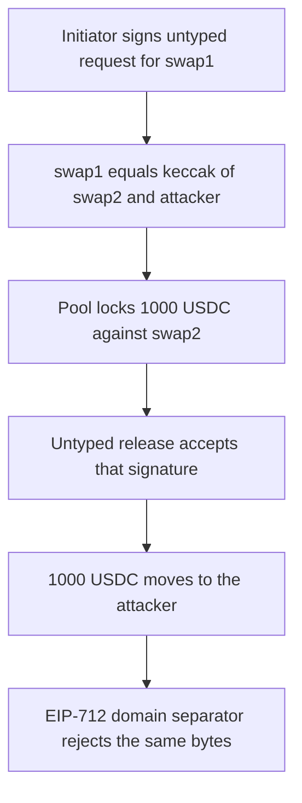

# Meson untyped signatures — one digest authorizes two swap layouts

> **Vulnerability classes:** vuln/auth/signature-validation · vuln/auth/signature-replay · vuln/logic/missing-validation
>
> **Reproduction:** self-contained synthetic Foundry reduction; see [output.txt](output.txt).

<!-- non-defihacklabs -->
<!-- source-auditvault: https://github.com/Auditware/AuditVault/blob/main/findings/18099-hash-collisions-in-untyped-signatures-trailofbits-meson-prot.md -->
<!-- date: 2022-10 -->

## Key info

| Field | Value |
|---|---|
| **Loss** | 1,000.000000 USDC released to the attacker. The signature authorized a different swap: 61,063.167274 USDC in, net 461.499071 USDC, out-token index 9 |
| **Vulnerable contract** | `MesonPool.releaseBody` (reduction of `MesonHelpers._checkReleaseSignature`) |
| **Attacker EOA** | `0x1111111111111111111111111111111111111111` |
| **Attack contract** | `Exploit` |
| **Attack tx** | `Exploit.run()` |
| **Chain / block / date** | Ethereum model · block 0 · 2022-10 |
| **Compiler** | solc 0.8.27, cancun, via IR |
| **Bug class** | Untyped eth_sign over a 32-byte word shared by request and release |

## TL;DR

Meson's legacy path signs both a swap request and a swap release as `"\x19Ethereum Signed Message:\n32"` plus one 32-byte word. The release word is `keccak256(abi.encodePacked(encodedSwap, recipient))`. Grinding the free salt custom-data produces a real collision `swap1 = keccak256(swap2 ‖ attacker)`. The initiator's request signature on swap1 (out-token 9, net 461.499071 USDC) is accepted as the release of swap2, and the pool pays the attacker 1,000 USDC. The same bytes fail an EIP-712 domain-separated release digest.

## Background

Trail of Bits reviewed Meson in October 2022 (TOB-MES-1, high, cryptography). Posting or releasing a swap requires an ECDSA signature. A bit in the encoded swap selects EIP-712 or legacy EIP-191. For the legacy path both messages are 32 bytes under the same `"\n32"` prefix, so a request word that equals a release body is valid in both checks. The report estimates a full production search, with amount, chain, and token fields pinned, at 2^60 to 2^70 tries. This reduction keeps Meson's documented packing (`version:uint8|amount:uint40|salt:uint80|fee:uint40|expireTs:uint40|outChain:uint16|outToken:uint8|inChain:uint16|inToken:uint8`) and the exact untyped hashes, and grinds only the salt's custom-data bits until the hash is a postable swap with a different amount and out-token.

## The vulnerable code

```solidity
function releaseBody(uint256 encodedSwap, address recipient) public pure returns (bytes32 inner) {
    // @> VULN: untyped release body is keccak256(encodedSwap, recipient) with no message type
    inner = keccak256(abi.encodePacked(encodedSwap, recipient));
}
```

The request digest is `keccak256(abi.encodePacked(ETH_SIGN_HEADER, encodedSwap))` with the same 28-byte header `bytes28(0x19457468657265756d205369676e6564204d6573736167653a0a3332)`. The release digest wraps `inner` in that same header. No type tag, and the recipient is not bound except as raw packed bytes inside the inner hash.

## Root cause

The encoding is not injective across message types. Any `swap1`, `swap2`, and `recipient` with `swap1 = keccak256(abi.encodePacked(swap2, recipient))` share one eth_sign digest. The signer authorizes swap1's fields. `release` pays swap2's locked net to whatever recipient completes the collision.

## Preconditions

- The initiator signs the untyped request for swap1. The private key is held here so the signature can be precomputed. There is no `vm.sign`.
- swap2 is a locked non-typed USDC swap, ETH `0x003c` to BSC `0x02ca`, amount 1,000e6, fee 0.
- swap1 passes the request checks: version 1, non-typed bit, in-token 1, out-token not 1, amount at most 100,000e6, and LP fee strictly below the amount.
- The pool holds the 1,000 USDC.

## Attack walkthrough

1. `fund` mints 1,000e6 USDC into the pool ([output.txt:69](output.txt)).
2. `lock` records swap2 for initiator `0xf39Fd6e51aad88F6F4ce6aB8827279cffFb92266`.
3. `checkRequest` on swap1 recovers that initiator from the precomputed signature. Digest `0x03881d817c4bb80041d67d8105a77c1fc9227664064ea8523099f7801f1c654e` ([output.txt:76](output.txt)). Decoded swap1: amount 61,063.167274 USDC, fee 60,601.668203 USDC, net 461.499071 USDC, out-token 9.
4. `release(swap2, attacker, v, r, s)` feeds the same digest to `ecrecover` and gets the same initiator ([output.txt:80](output.txt)).
5. The pool transfers 1,000e6 USDC to `0x1111111111111111111111111111111111111111` ([output.txt:82](output.txt)). The initiator's balance stays 0 ([output.txt:92](output.txt)).
6. `assertEq` records the collision `swap1 = keccak256(swap2, attacker)` ([output.txt:180](output.txt)) and the two amounts ([output.txt:134](output.txt), [output.txt:158](output.txt)).
7. Control: `releaseTyped` hashes `\x19\x01 ‖ domainSeparator ‖ keccak256(Release(...))`. The same `(v, r, s)` recovers `0xda4Ee892A352aF486C286bcA64091534243C1cc9`, not the initiator, and returns false ([output.txt:85](output.txt)). The typed-only test leaves the 1,000 USDC in the pool ([output.txt:51](output.txt)).

## Diagrams



## Impact

The attacker receives 1,000.000000 USDC (1,000,000,000 base units). The signature authorized a different layout: 61,063.167274 USDC in, a 60,601.668203 USDC LP fee, a 461.499071 USDC net, and out-token index 9 rather than USDC index 1. The initiator is paid nothing. A second call through the typed digest does not move funds.

## Remediation

Prefix untyped messages with the message type and include every field in the top-level digest, as the review recommends, or verify legacy signatures as EIP-712 digests passed to `eth_sign`. `releaseTyped` is that control: the same signature bytes do not recover the initiator.

## How to reproduce

```bash
cd evm-hack-registry/18099-hash-collisions-in-untyped-signatures-trailofbits-meson-prot_exp
forge test -vvvv
```

## Sources

- [AuditVault finding 18099](https://github.com/Auditware/AuditVault/blob/main/findings/18099-hash-collisions-in-untyped-signatures-trailofbits-meson-prot.md)
- [Trail of Bits, Meson Protocol review](https://github.com/trailofbits/publications/blob/master/reviews/MesonProtocol.pdf) (October 2022, TOB-MES-1, `contracts/utils/MesonHelpers.sol`)
- [Synthetic](test/18099-hash-collisions-in-untyped-signatures-trailofbits-meson-prot.sol)

*Reference: https://github.com/trailofbits/publications/blob/master/reviews/MesonProtocol.pdf*
