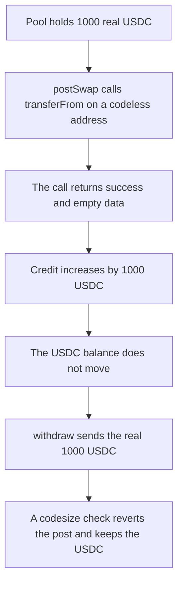

# Meson credits a codeless transferFrom and then pays out 1000 real USDC

> **Vulnerability classes:** vuln/input-validation/missing · vuln/dependency/unchecked-return-value · vuln/logic/missing-check
>
> **Reproduction:** self-contained synthetic Foundry reduction; see [output.txt](output.txt).

<!-- non-defihacklabs -->
<!-- source-auditvault: https://github.com/Auditware/AuditVault/blob/main/findings/18108-lack-of-contract-existence-check-on-transfer-transferfrom-ca.md -->
<!-- date: 2022-10 -->

## Key info

| Field | Value |
|---|---|
| **Loss** | 1000 USDC (1000000000 base units) withdrawn from the pool. The deposit that created the credit moved 0 USDC |
| **Vulnerable contract** | `MesonPool._unsafeDepositToken` (reduction of `MesonHelpers._unsafeDepositToken`) |
| **Attacker EOA** | `0x1111111111111111111111111111111111111111` |
| **Attack contract** | `Exploit` |
| **Attack tx** | `Exploit.run()` |
| **Chain / block / date** | Ethereum model · block 0 · 2022-10 |
| **Compiler** | solc 0.8.27, cancun, via IR |
| **Bug class** | Low-level `call` success on an account with no code |

## TL;DR

`_unsafeDepositToken` calls `transferFrom` and accepts the call when `success` is true and the returndata is empty. An address with no code, the state of a token after `selfdestruct`, returns exactly that. `postSwap` therefore adds 1000 USDC of credit while the pool's USDC balance stays 1000. `withdraw` then sends that real balance to the caller. Requiring `token.code.length > 0` makes the same post revert and leaves the 1000 USDC in the pool.

## Background

Trail of Bits reviewed Meson from 22 August to 9 September 2022 (final report 3 October 2022, Damilola Edwards, TOB-MES-10). `MesonHelpers._unsafeDepositToken` uses `token.call` with selector `0x23b872dd` (`transferFrom`) and does not check that `token` has code. The EVM defines a call to an empty account as successful. The require also treats empty returndata as success, which is how tokens that do not return a bool are supported, and how a missing contract slips through. The pool in this reduction already holds LP USDC. The posted "token" is `address(0xdead)`, which has no code. No selfdestruct is required to reach the state the report describes.

## The vulnerable code

```solidity
(bool success, bytes memory data) = token.call(
    abi.encodeWithSelector(bytes4(0x23b872dd), sender, address(this), amount)
);
require(success && (data.length == 0 || abi.decode(data, (bool))), "transferFrom failed");
```

`postSwap` then does `credit[msg.sender] += amount`. `withdraw` spends that credit with a real `usdc.transfer`.

## Root cause

`success` from `call` is not evidence that a contract ran. Combined with "empty returndata means success", a codeless address is indistinguishable from a token whose `transferFrom` returns nothing. The credit is increased off that boolean alone.

## Preconditions

- The pool holds 1000 USDC of real liquidity. It is minted to the pool before `run`.
- The posted token is not `address(0)` (that case is already rejected) but has codesize 0.
- The attacker later calls `withdraw` for the credited amount.

## Attack walkthrough

1. `CODELESS.code.length` is 0 ([output.txt](output.txt)).
2. `postSwap(CODELESS, 1000e6)` performs the low-level call. `success` is true and `data.length` is 0, so the require passes.
3. `credit` becomes 1000000000. `usdc.balanceOf(pool)` is still 1000000000. The log line "pool USDC while that credit was outstanding" is 1000000000.
4. `withdraw(1000e6)` clears the credit and transfers 1000 USDC to the caller. The pool balance is 0. The caller balance is 1000000000.
5. Control `postSwapChecked` requires `token.code.length > 0`. The call reverts, `posted` is false, credit stays 0, and the pool still holds 1000000000.

## Diagrams



## Impact

The attacker receives 1000 USDC that no deposit transferred in. The phantom credit and the pool balance were both 1000 USDC at the same time, so the credit was not backed by a transfer. The checked path pays 0.

## Remediation

Require `token.code.length > 0` before the low-level call, or compare the token balance before and after and require it increased by `amount`.

## Sources

- AuditVault finding: [18108-lack-of-contract-existence-check-on-transfer-transferfrom-ca](https://github.com/Auditware/AuditVault/blob/main/findings/18108-lack-of-contract-existence-check-on-transfer-transferfrom-ca.md)
- Trail of Bits, Meson Protocol Security Assessment, 3 October 2022: https://github.com/trailofbits/publications/blob/master/reviews/MesonProtocol.pdf
- `MesonFi/meson-contracts-solidity` `contracts/utils/MesonHelpers.sol` `_unsafeDepositToken` (report figure `MesonHelpers.sol:53–69`).
