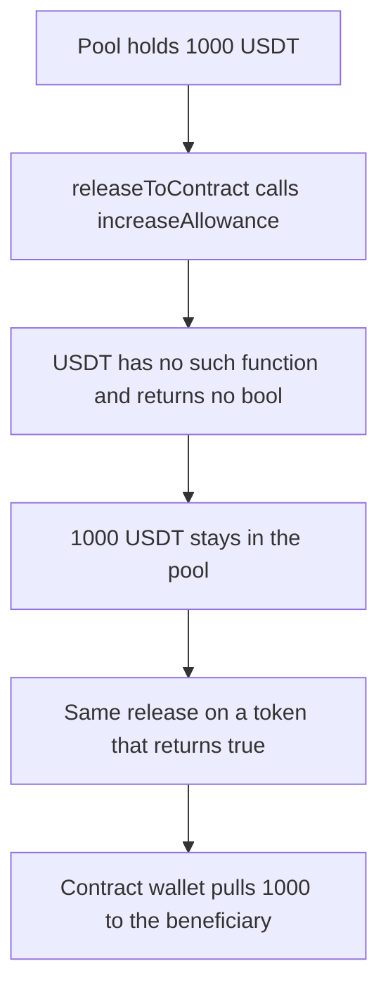

# Meson release to a contract reverts on USDT and leaves 1,000 USDT stuck

> **Vulnerability classes:** vuln/dependency/unsafe-external-call · vuln/dos/frozen-funds · vuln/logic/missing-allowance
>
> **Reproduction:** self-contained synthetic Foundry reduction; see [output.txt](output.txt).

<!-- non-defihacklabs -->
<!-- source-auditvault: https://github.com/Auditware/AuditVault/blob/main/findings/18109-usdt-transfers-to-third-party-contracts-will-fail-trailofbit.md -->
<!-- date: 2022-10 -->

## Key info

| Field | Value |
|---|---|
| **Loss** | 1,000 USDT (1000000000 base units) stays in the pool. The contract beneficiary receives 0 USDT |
| **Vulnerable contract** | `MesonRelease.releaseToContract` (reduction of `MesonHelpers._transferToContract`) |
| **Attacker EOA** | `0x1111111111111111111111111111111111111111` |
| **Attack contract** | `Exploit` |
| **Attack tx** | `Exploit.run()` |
| **Chain / block / date** | Ethereum model · block 0 · 2022-10 |
| **Compiler** | solc 0.8.27, cancun, via IR |
| **Bug class** | High-level `increaseAllowance` against a USDT-like token that returns no bool |

## TL;DR

Releasing funds to a smart-contract wallet calls `IERC20Minimal.increaseAllowance`, which ABI-decodes a bool. USDT does not implement that method, so the call reverts with no bool and `transferWithBeneficiary` never commits. 1,000 USDT stays in the pool and the beneficiary receives 0. The same call on a token whose `increaseAllowance` returns true lets the wallet pull 1,000 to the beneficiary.

## Background

Trail of Bits reviewed Meson from 22 August to 9 September 2022 (final report 3 October 2022, Damilola Edwards). To pay a third-party contract, `MesonHelpers` increases that contract's allowance and then calls `transferWithBeneficiary`. `increaseAllowance` is an OpenZeppelin helper, not part of ERC-20. Mainnet USDT does not implement it, and USDT's `transfer` / `approve` / `transferFrom` return no bool. A user who releases a USDT swap to a contract wallet cannot complete the release. The tokens already locked in the pool stay there.

## The vulnerable code

```solidity
uint256 adjustedAmount = amount;
// @> VULN: increaseAllowance is not ERC-20. USDT does not implement it and returns no bool, so this reverts and the transfer to the contract never commits.
IERC20Minimal(token).increaseAllowance(contractAddr, adjustedAmount);
ITransferWithBeneficiary(contractAddr).transferWithBeneficiary(token, adjustedAmount, beneficiary, 1);
```

The audited lines are `IERC20Minimal(token).increaseAllowance(contractAddr, adjustedAmount)` then `transferWithBeneficiary` (`MesonHelpers.sol` lines 66–67 in the report). The interface declares `returns (bool)`. USDT has no such function and no fallback, so the selector `0x39509351` reverts and the outer release reverts with it.

## Root cause

The release path assumes every supported token implements OpenZeppelin's `increaseAllowance` and returns a bool. USDT does neither. The transfer to the contract is reverted, not completed. A later deployment switched this call to `approve`, which is what the report recommended. This reduction keeps the audited call.

## Preconditions

- The pool already holds the user's 1,000 USDT (6 decimals). That deposit is a separate, successful mint into the pool.
- The recipient is a contract wallet with `transferWithBeneficiary`.
- The out-token is USDT-like: `transfer`, `approve`, and `transferFrom` return no bool, and `increaseAllowance` is absent.
- The control token implements `increaseAllowance` and returns true, and its `transferFrom` returns true.

## Attack walkthrough

1. `mint` parks 1000000000 USDT in the pool ([output.txt:44](output.txt)). `balanceOf` reads it back ([output.txt:50](output.txt)).
2. `releaseToContract` calls `UsdtLike.increaseAllowance` ([output.txt:52](output.txt)).
3. The token reverts: unrecognized selector `0x39509351`, no fallback ([output.txt:53](output.txt)). The release reverts ([output.txt:54](output.txt)).
4. The pool still holds 1000000000 USDT ([output.txt:56](output.txt)). The beneficiary's USDT balance is 0 ([output.txt:58](output.txt)). Allowance stays 0 ([output.txt:60](output.txt)).
5. Control: the same release against `ReturningToken`. `increaseAllowance` returns true ([output.txt:70](output.txt)).
6. The wallet's `transferFrom` returns true and moves 1000000000 to `0x2222222222222222222222222222222222222222` ([output.txt:72](output.txt), [output.txt:77](output.txt), [output.txt:81](output.txt)). The pool's balance of that token is 0 ([output.txt:83](output.txt)).
7. The test logs stuck `1000000000` ([output.txt:13](output.txt)), USDT paid `0` ([output.txt:15](output.txt)), and control received `1000000000` ([output.txt:19](output.txt)). `[PASS]` ([output.txt:6](output.txt)).

## Diagrams



## Impact

The USDT beneficiary receives nothing. 1,000 USDT (1000000000 base units) remains in the pool, so that swap cannot be released to a contract wallet. The same amount of a token that returns true from `increaseAllowance` is pulled to `0x2222222222222222222222222222222222222222`. No attacker profit is required. The harm is the locked payout.

## Remediation

Do not call `increaseAllowance`. Set the allowance with the ERC-20 `approve` path, and do it with a low-level call that treats empty returndata as success, the same way Meson already treats `transfer`. Fetch the current allowance, add the amount, and `approve` the sum in the same transaction so the update stays atomic.

```diff
- IERC20Minimal(token).increaseAllowance(contractAddr, adjustedAmount);
+ uint256 next = IERC20Minimal(token).allowance(address(this), contractAddr) + adjustedAmount;
+ token.call(abi.encodeWithSelector(0x095ea7b3, contractAddr, next));
  ITransferWithBeneficiary(contractAddr).transferWithBeneficiary(token, adjustedAmount, beneficiary, data);
```

A high-level `approve` that ABI-decodes a bool still reverts on USDT, because USDT `approve` returns no bool. The low-level call is the part that accepts that shape.

## How to reproduce

```bash
cd 18109-usdt-transfers-to-third-party-contracts-will-fail-trailofbit_exp
forge test -vv
```

## Sources

- AuditVault finding: [18109-usdt-transfers-to-third-party-contracts-will-fail-trailofbit](https://github.com/Auditware/AuditVault/blob/main/findings/18109-usdt-transfers-to-third-party-contracts-will-fail-trailofbit.md)
- Trail of Bits, Meson Protocol Security Assessment, 3 October 2022: https://github.com/trailofbits/publications/blob/master/reviews/MesonProtocol.pdf
- `MesonFi/meson-contracts-solidity` `contracts/utils/MesonHelpers.sol` `_transferToContract` (report figure `MesonHelpers.sol:66–67`).
