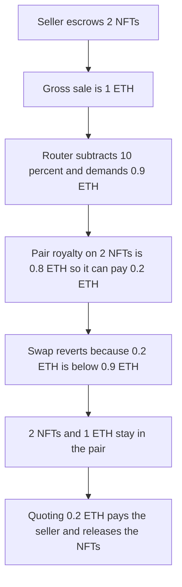

# Sudoswap's linear royalty quote reverts a 2-NFT sale and leaves the NFTs in the pair

> **Vulnerability classes:** vuln/dos/frozen-funds · vuln/logic/fee-calculation · vuln/logic/price-calculation
>
> **Reproduction:** self-contained synthetic Foundry reduction; see [output.txt](output.txt).

<!-- non-defihacklabs -->
<!-- source-auditvault: https://github.com/Auditware/AuditVault/blob/main/findings/18413-linearity-assumption-on-the-royalty-can-lead-to-denial-of-se.md -->
<!-- date: 2023-06 -->

## Key info

| Field | Value |
|---|---|
| **Loss** | 2 NFTs stuck in the pair. The linear minimum is 0.9 ETH. The curve can pay 0.2 ETH. The seller receives 0 |
| **Vulnerable contract** | `VeryFastRouter.quoteLinear` (reduction of `_findMaxFillableAmtForSell`) |
| **Attacker EOA** | `0x1111111111111111111111111111111111111111` |
| **Attack contract** | `Exploit` |
| **Attack tx** | `Exploit.run()` |
| **Chain / block / date** | Ethereum model · block 0 · 2023-06 |
| **Compiler** | solc 0.8.27, cancun, via IR |
| **Bug class** | Royalty treated as a constant fraction of output |

## TL;DR

`VeryFastRouter` prices a sell by subtracting `currentOutput * royaltyAmount / BASE`. For 2 NFTs the gross is 1 ETH and a 10 percent royalty produces a minimum output of 0.9 ETH. This collection's royalty is 0.05 ETH on one NFT and 0.8 ETH on two, so the pair's curve can pay only 0.2 ETH. `swapNFTsForToken` reverts on that minimum. The 2 NFTs were already escrowed in the pair and stay there. The seller receives 0 WETH. Passing the actual 0.2 ETH output as the minimum pays the seller and moves the NFTs out.

## Background

Cyfrin reviewed sudoswap lssvm2 (report dated 1 June 2023, Hans). `_findMaxFillableAmtForSell` binary-searches how many NFTs a pool can buy and does `currentOutput -= currentOutput * royaltyAmount / BASE` inside the search. That treats the royalty as linear in the sale amount. The returned `priceToFillAt` is then the `minOutput` of `swapNFTsForToken`. EIP-2981 asks for a linear royalty, but the router accepts any royalty registry. A registry that charges more on a larger fill makes the quoted minimum higher than the ETH the curve will actually release, and the sell reverts. Here one NFT is linear (10 percent of 0.5 ETH is 0.05 ETH) and two NFTs are not (0.8 ETH, not 0.1 ETH).

## The vulnerable code

```solidity
currentOutput = numItems * 0.5 ether;
currentOutput -= currentOutput * ROYALTY_AMOUNT / BASE;
```

`ROYALTY_AMOUNT` is `0.1 ether` and `BASE` is `1 ether`, so every fill loses 10 percent. `sell` passes that number to the pair as `minOutput`.

## Root cause

The quote and the pair do not use the same royalty function. The quote scales a constant fraction. The pair calls `actualOutput`, which charges 0.8 ETH once the fill is 2 NFTs. The minimum is therefore larger than the payment the pair will make.

## Preconditions

- The seller has escrowed 2 NFTs in the pair. That transfer completes before the sell, so a reverting swap does not pull them back.
- The pair holds 1 ETH, enough to pay either 0.9 ETH or 0.2 ETH. The revert is the slippage check, not an empty reserve.
- The royalty registry is allowed to be non-linear. The report notes sudoswap expected ERC-2981, and ERC-2981 does not bind external registries.

## Attack walkthrough

1. `nft.transfer(pair, 2)` leaves both NFTs in the pair ([output.txt](output.txt), "NFTs stuck in the pair" = 2).
2. `quoteLinear(2)` returns `900000000000000000` wei, 0.9 ETH.
3. `actualOutput(2)` returns `200000000000000000` wei, 0.2 ETH.
4. `trySell` calls `swapNFTsForToken(2, 0.9 ETH, seller)`. The pair computes 0.2 ETH and reverts `slippage`.
5. `sold` is false. The seller's WETH balance is 0. The pair still holds 1 ETH and both NFTs.
6. Control `sellActual` uses `actualOutput(2)` as the minimum. The pair pays `200000000000000000` wei to the seller, sends the 2 NFTs to the router, and keeps 0.8 ETH. The pair's NFT balance is 0.

## Diagrams



## Impact

The seller cannot complete the sale. 2 NFTs remain in the pair and 0 WETH is paid. The unpayable minimum is 0.9 ETH against a curve output of 0.2 ETH. The same sale with the actual curve pays 0.2 ETH and leaves no NFTs in the pair.

## Remediation

Compute `priceToFillAt` from the royalty registry's return value for that exact fill size, instead of scaling a single fraction across the binary search.

## Sources

- AuditVault finding: [18413-linearity-assumption-on-the-royalty-can-lead-to-denial-of-se](https://github.com/Auditware/AuditVault/blob/main/findings/18413-linearity-assumption-on-the-royalty-can-lead-to-denial-of-se.md)
- Cyfrin, sudoswap, 1 June 2023: https://github.com/solodit/solodit_content/blob/main/reports/Cyfrin/2023-06-01-Sudoswap.md
- `sudoswap/lssvm2` at `78d38753b2042d7813132f26e5573c6699b605ef`, `src/VeryFastRouter.sol` `_findMaxFillableAmtForSell` (the `currentOutput * royaltyAmount / BASE` line) and the `priceToFillAt` argument of `swapNFTsForToken`.
