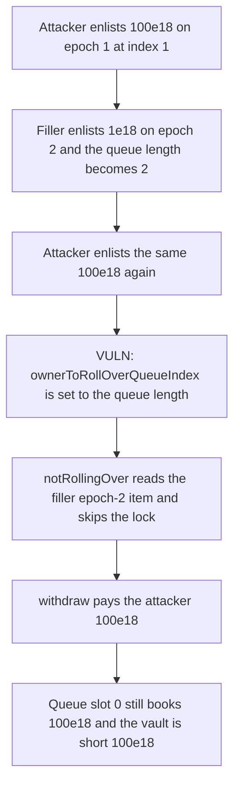

# Y2K Carousel — a second rollover enlist points the index at the wrong queue slot

> **Vulnerability classes:** vuln/logic/state-update · vuln/logic/incorrect-accounting

<!-- non-defihacklabs -->
<!-- source-auditvault: https://github.com/Auditware/AuditVault/blob/main/findings/18533-h-1-funds-can-be-stolen-because-of-incorrect-update-to-owner.md -->
<!-- date: 2023-03 -->

## Key info

| | |
|---|---|
| **Protocol** | Y2K Earthquake (Carousel) |
| **Finding** | Sherlock 2023-03 H-1, AuditVault 18533 |
| **Vulnerable code** | `Carousel.enlistInRollover` writes `ownerToRollOverQueueIndex` after the if/else |
| **Harm** | 100e18 that is still booked as a rollover lock is withdrawn. The vault is short 100e18. |
| **Chain** | local synthetic (audited index update) |

## TL;DR

`enlistInRollover` updates an existing queue item in place, then always sets `ownerToRollOverQueueIndex[receiver] = rolloverQueue.length`. That length is the next 1-based slot, not the caller's slot. `notRollingOver` then reads whatever item sits at the tail. If the tail is another user on a different epoch, the lock check does not apply, and `withdraw` pays out assets the queue still records as locked.

In this reduction the attacker enlists 100e18 on epoch 1, a filler enlists 1e18 on epoch 2, and the attacker enlists again. The index moves from 1 to 2. Withdrawing epoch 1 pays the attacker 100e18. Queue slot 0 still says 100e18 is locked for epoch 1. Victim shares (100e18) plus filler shares (1e18) plus that queue entry (100e18) exceed the cash left in the vault (101e18) by exactly 100e18.

The control writes the index only inside the `else` that pushes a new item. The same second enlist leaves the index at 1, and `withdraw` reverts. The attacker receives 0 and the vault still holds 201e18.

## The vulnerable code

The assignment is the audited line. It runs for a brand-new enlist and for an update.

```solidity
if (ownerToRollOverQueueIndex[msg.sender] != 0) {
    uint256 index = ownerToRollOverQueueIndex[msg.sender] - 1;
    rolloverQueue[index].assets = amount;
    rolloverQueue[index].epochId = epoch;
} else {
    rolloverQueue.push(QueueItem({assets: amount, receiver: msg.sender, epochId: epoch}));
}
// @> VULN: existing rollovers are pointed at the last queue index.
ownerToRollOverQueueIndex[msg.sender] = rolloverQueue.length;
```

`notRollingOver` trusts that index:

```solidity
QueueItem memory item = rolloverQueue[ownerToRollOverQueueIndex[msg.sender] - 1];
if (item.epochId == epoch && (balanceOf[msg.sender][epoch] - item.assets) < amount) {
    revert AlreadyRollingOver();
}
```

The control moves the assignment into the `else` only, which is the fix merged in Y2K PR 128.

## Root cause

The mapping is 1-based (`getRolloverIndex` subtracts one). After the first enlist the attacker's index is 1 and queue slot 0 holds the 100e18 epoch-1 lock. The filler's enlist pushes slot 1 and the length becomes 2. The attacker's second enlist updates slot 0 correctly, then stores `2`. Slot 1 is the filler on epoch 2.

The epoch compare in `notRollingOver` is false, so the `AlreadyRollingOver` branch is skipped and the full balance is transferred out. The queue item at slot 0 is not cleared.

## Preconditions

The caller already has a rollover queue item, and at least one later item belongs to another epoch. No admin role is required. The amounts here are 100e18 locked, 1e18 filler, and 100e18 from a second depositor who never enlists.

## Attack walkthrough

1. The attacker deposits 100e18 into epoch 1 and enlists all of it. Index is 1.
2. The filler deposits 1e18 into epoch 2 and enlists. The queue length is 2.
3. A victim deposits 100e18 into epoch 1 and does not enlist. The vault holds 201e18.
4. The attacker calls `enlistInRollover` again for epoch 1 and 100e18. The index becomes 2.
5. `withdraw` of 100e18 on epoch 1 reads the filler's epoch and does not revert.
6. The attacker holds 100e18. Queue slot 0 still books 100e18 on epoch 1. Vault cash is 101e18, which is 100e18 short of the remaining claims.

On the fixed vault, step 4 leaves the index at 1 and step 5 reverts. Vault cash stays 201e18.

## Diagrams



## Impact

100e18 that the rollover queue still records as locked leaves the vault. The attacker is paid that 100e18. Counting the victim's 100e18 shares, the filler's 1e18 shares, and the untouched queue entry of 100e18, the vault's remaining 101e18 is short by 100e18.

## Remediation

Assign `ownerToRollOverQueueIndex[receiver] = rolloverQueue.length` only in the branch that pushes a new `QueueItem`. An update of an existing item must not change the index.

## How to reproduce

```bash
cd 18533-h-1-funds-can-be-stolen-because-of-incorrect-update-to-owner_exp
forge test -vv
```

`test_buggy_index_withdraws_locked_100e18` asserts the 100e18 payout and the 100e18 shortfall. `test_control_fixed_index_keeps_100e18_locked` asserts the withdraw reverts and the vault still holds 201e18.

## Sources

- AuditVault finding: https://github.com/Auditware/AuditVault/blob/main/findings/18533-h-1-funds-can-be-stolen-because-of-incorrect-update-to-owner.md
- Sherlock contest: https://github.com/sherlock-audit/2023-03-Y2K-judging/issues/2
- Audited function: https://github.com/sherlock-audit/2023-03-Y2K/blob/main/Earthquake/src/v2/Carousel/Carousel.sol
- Fix: https://github.com/Y2K-Finance/Earthquake/pull/128
