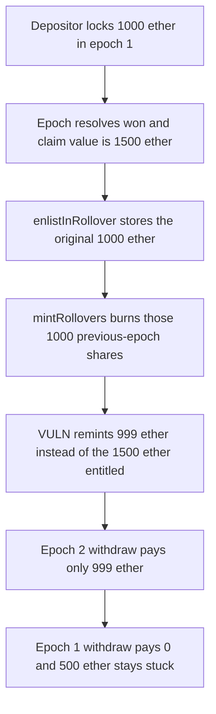

# Y2K Carousel: rolling a winning epoch burns the winnings

> **Vulnerability classes:** vuln/logic/reward-calculation · vuln/logic/incorrect-accounting

> **Reproduction:** a self-contained Foundry PoC that compiles and runs offline with only `forge-std`. No fork, no cheatcodes in the replayed path. Full trace: [output.txt](output.txt). PoC: [test/18536-h-4-when-rolling-over-user-will-lose-his-winnings-from-previ_exp.sol](test/18536-h-4-when-rolling-over-user-will-lose-his-winnings-from-previ_exp.sol).

<!-- non-defihacklabs -->
<!-- source-auditvault: https://github.com/Auditware/AuditVault/blob/main/findings/18536-h-4-when-rolling-over-user-will-lose-his-winnings-from-previ.md -->
<!-- date: 2023-03 -->

---

## Key info

| | |
|---|---|
| **Impact** | **HIGH** — a depositor who won the previous epoch and rolls it forward is paid only the original deposit. The winnings stay in the vault and can no longer be withdrawn. |
| **Protocol** | Y2K Finance — Earthquake `Carousel` (v2 rollover queue) |
| **Vulnerable code** | `Carousel.mintRollovers` — burns `queue.assets` shares, then remints `queue.assets - relayerFee` instead of `entitledShares` |
| **Bug class** | Winning payout dropped on rollover |
| **Finding** | Sherlock — Y2K, 2023-03 · #18536 / H-4 · reporter **iglyx** (and 20 co-finders) |
| **Report** | [sherlock-audit/2023-03-Y2K-judging#163](https://github.com/sherlock-audit/2023-03-Y2K-judging/issues/163) |
| **Source** | [AuditVault](https://github.com/Auditware/AuditVault/blob/main/findings/18536-h-4-when-rolling-over-user-will-lose-his-winnings-from-previ.md) |
| **Status** | Audit finding. Sponsor agreed. Reproduced here as a local synthetic. The control remints `entitledShares` and the depositor keeps the winnings. |
| **Compiler** | solc 0.8.27, cancun, via_ir |

This is an **audit finding**, not a historical on-chain incident. The synthetic keeps the blamed `mintRollovers` statements: `previewWithdraw`, the burn of `queue.assets`, and `assetsToMint = queue.assets - relayerFee`.

---

## TL;DR

1. A depositor puts **1,000 ether** into epoch 1. The epoch resolves as a win: `claimTVL` is **1,500 ether**, so `previewWithdraw` entitles that deposit to **1,500 ether**.
2. The depositor calls `enlistInRollover` for the original **1,000 ether** of shares.
3. `mintRollovers` burns those 1,000 shares. It then mints only `1,000 - 1` ether into the next epoch (the deposit minus a 1 ether relayer fee).
4. Withdraw on the next epoch pays **999 ether**. Withdraw on epoch 1 pays **0** because the shares are gone.
5. **500 ether** of previous-epoch winnings sit in the vault with nobody able to claim them.
6. The fixed rollover mints `entitledShares - relayerFee` (**1,499 ether**). The same depositor keeps the 500 ether winnings and the vault is left empty.

---

## The vulnerable code

`Carousel.mintRollovers` (the blamed lines, reduced from the audited function):

```solidity
uint256 entitledShares = previewWithdraw(
    queue[index].epochId,
    queue[index].assets
);
// mint only if user won epoch he is rolling over
if (entitledShares > queue[index].assets) {
    _burn(
        queue[index].receiver,
        queue[index].epochId,
        queue[index].assets
    );
    // @> VULN: remints the original deposit minus fee, not entitledShares
    uint256 assetsToMint = queue[index].assets - relayerFee;
    _mintShares(queue[index].receiver, _epochId, assetsToMint);
}
```

`withdraw` on a resolved epoch pays `previewWithdraw` (the entitled amount). Rollover burns the same shares but remints only the queued deposit. After the burn there is no balance left to withdraw the difference.

The control uses the same burn and the same fee, and changes one assignment:

```solidity
uint256 assetsToMint = entitledShares - relayerFee;
```

---

## Root cause

`enlistInRollover` stores the depositor's **share amount** (`queue.assets`), which for this vault is the original deposit. On a winning epoch `previewWithdraw` scales that amount by `claimTVL / finalTVL`, so the shares are worth more than `queue.assets`. `mintRollovers` reads `entitledShares` only to decide whether the user won. The amount it actually mints is `queue.assets - relayerFee`. Burning `queue.assets` then destroys the only claim on the surplus.

Emissions are not the bug. The audited function does transfer emission tokens out when it burns emission shares. The underlying winning payout is what never gets reminted.

## Preconditions

- The previous epoch is resolved and the depositor won (`entitledShares > queue.assets`).
- `queue.assets` covers `relayerFee`, so the rollover is not skipped.
- The depositor enlisted the deposit they want to roll, which is the normal path.

## Attack walkthrough

Numbers from the passing test:

| Step | Vault EQ balance | Depositor EQ balance | What happened |
|---|---|---|---|
| Deposit 1,000 | 1,000 | 0 | Epoch 1 shares = 1,000 |
| Win of 500 pulled in | 1,500 | 0 | Entitled value = 1,500 |
| `mintRollovers` | 1,499 | 0 | Burns epoch-1 shares, mints 999 epoch-2 shares, pays 1 ether fee to the relayer |
| Withdraw epoch 2 | 500 | 999 | Pays the reminted shares 1:1 |
| Withdraw epoch 1 | 500 | 999 | Share balance is 0, payout is 0 |

The **500 ether** left in the vault is the previous-epoch winnings. The control pays the depositor **1,499 ether** and leaves **0** in the vault. Difference versus the buggy payout: **500 ether** preserved.

## Diagrams



## Impact

The depositor loses **500 ether** of winnings they were already entitled to. A direct `withdraw` of the same 1,000 shares would have paid 1,500 ether. Rolling over pays 999 ether and leaves the 500 ether claimless inside `Carousel`. Every winning rollover underpays by `entitledShares - queue.assets`, independent of the relayer fee. The fee is still paid. The winnings are not.

## PoC

```bash
cd 18536-h-4-when-rolling-over-user-will-lose-his-winnings-from-previ_exp
forge test -vv
```

`test_exploit_user_loses_previous_epoch_winnings` asserts the vault still holds 500 ether and the depositor holds 999 ether. `test_control_preserves_previous_epoch_winnings` asserts the fixed mint pays 1,499 ether and the vault holds 0. The preserved amount is exactly the 500 ether winnings.

## Remediation

Remint the entitled payout, not the raw queued deposit. Subtract the relayer fee from `entitledShares` so the fee is still paid and the winnings roll forward:

```diff
- uint256 assetsToMint = queue[index].assets - relayerFee;
+ uint256 assetsToMint = entitledShares - relayerFee;
  _mintShares(queue[index].receiver, _epochId, assetsToMint);
```

That is the direction of [Y2K-Finance/Earthquake#125](https://github.com/Y2K-Finance/Earthquake/pull/125). If winnings should not roll, burn only the fraction of shares that corresponds to `queue.assets` after the win, and leave the rest withdrawable. Do not burn the full claim and then mint the pre-win amount.

## Sources

- AuditVault finding: https://github.com/Auditware/AuditVault/blob/main/findings/18536-h-4-when-rolling-over-user-will-lose-his-winnings-from-previ.md
- Sherlock judging issue: https://github.com/sherlock-audit/2023-03-Y2K-judging/issues/163
- Audited `mintRollovers`: https://github.com/sherlock-audit/2023-03-Y2K/blob/main/Earthquake/src/v2/Carousel/Carousel.sol#L361-L459
- Fix PR: https://github.com/Y2K-Finance/Earthquake/pull/125
