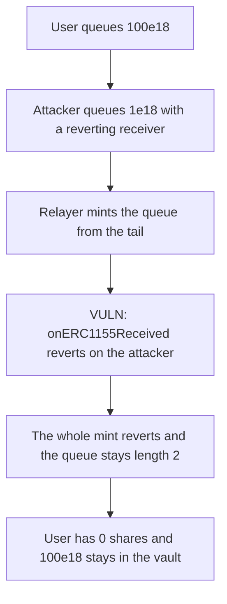

# Y2K Carousel — a reverting receiver freezes the deposit queue

> **Vulnerability classes:** vuln/dos/frozen-funds

<!-- non-defihacklabs -->
<!-- source-auditvault: https://github.com/Auditware/AuditVault/blob/main/findings/18537-h-5-adversary-can-break-deposit-queue-and-cause-loss-of-fund.md -->
<!-- date: 2023-03 -->

## Key info

| | |
|---|---|
| **Protocol** | Y2K Earthquake (Carousel) |
| **Finding** | Sherlock 2023-03 H-5, AuditVault 18537 |
| **Vulnerable code** | `ERC1155._mint` always calls the receiver from `mintDepositInQueue` |
| **Harm** | 100e18 queued ahead of the attacker stays stuck in the vault |
| **Chain** | local synthetic (audited FILO mint) |

## TL;DR

`mintDepositInQueue` walks the deposit queue from the tail. Each item is minted with ERC1155 `_mint`, and `_mint` always calls `onERC1155Received` on the receiver. There is no cancel for a queued deposit.

A user queues 100e18. An attacker queues 1e18 behind them and reverts in the receipt hook. The relayer hits the attacker first. The hook reverts, the whole call reverts, and nothing is popped. The user has 0 shares, a withdraw of 100e18 reverts, and the vault still holds that 100e18.

The control mints shares without the receipt hook. The same two queue items are minted, the queue length goes to 0, and the user withdraws 100e18.

## The vulnerable code

The queue is a stack. The tail is minted first.

```solidity
uint256 i = length - 1;
while ((length - operations) <= i) {
    _mintShares(depositQueue[i].receiver, depositQueue[i].assets);
    depositQueue.pop();
    if (i == 0) break;
    unchecked {
        i--;
    }
}
```

`_mint` then asks the receiver:

```solidity
shares[to] += amount;
// @> VULN: mint always calls the receiver, so one reverting receiver aborts the whole deposit queue.
IERC1155Receiver(to).onERC1155Received(address(this), address(0), 1, amount, "");
```

## Root cause

Queued deposits are not atomic for the depositor, but the relayer's mint is atomic for the whole batch. A callback revert undoes every pop in that call. Because the walk is FILO, a later depositor is processed before everyone who queued earlier, so one bad receiver blocks every deposit in front of it. Those deposits cannot be canceled.

## Preconditions

Epoch 0 queue deposits are open. The attacker queues after the victim, so the attacker is the tail. The attacker's receiver is a contract whose `onERC1155Received` reverts. The amounts here are 100e18 for the user and 1e18 for the attacker. No admin key is required. The relayer is permissionless.

## Attack walkthrough

1. The user queues 100e18. The queue length is 1 and the vault holds 100e18.
2. The attacker queues 1e18. The queue length is 2. The attacker is index 1.
3. The relayer calls `mintDepositInQueue` for both items. The loop starts at the tail.
4. `_mint` credits shares and then calls the attacker. The attacker reverts.
5. The call reverts. The queue length is still 2. The user's share balance is 0.
6. The user tries to withdraw 100e18 and reverts. The vault still holds 101e18, of which 100e18 is the user's deposit.
7. On the fixed vault the same mint does not call the receiver. The queue empties, the user is minted 100e18, and `withdraw` pays the user 100e18.

## Diagrams



## Impact

100e18 that the user queued is stuck. The user receives no shares and cannot withdraw. The vault still holds the deposit. Every queued depositor in front of the reverting receiver is blocked the same way for as long as that tail item remains.

## Remediation

Do not call the ERC1155 receiver from the queue mint. Mint the shares and pop the item even when the receiver cannot accept ERC1155 tokens. A later transfer can enforce the receiver check.

## How to reproduce

```bash
cd 18537-h-5-adversary-can-break-deposit-queue-and-cause-loss-of-fund_exp
forge test -vv
```

`test_reverting_receiver_sticks_100e18_in_the_queue` asserts the mint reverts and 100e18 stays in the vault. `test_control_skips_callback_and_user_withdraws_100e18` asserts the user withdraws 100e18.

## Sources

- AuditVault finding: https://github.com/Auditware/AuditVault/blob/main/findings/18537-h-5-adversary-can-break-deposit-queue-and-cause-loss-of-fund.md
- Sherlock issue: https://github.com/sherlock-audit/2023-03-Y2K-judging/issues/468
- Audited queue: https://github.com/sherlock-audit/2023-03-Y2K/blob/main/Earthquake/src/v2/Carousel/Carousel.sol
- Fix: https://github.com/Y2K-Finance/Earthquake/pull/124
