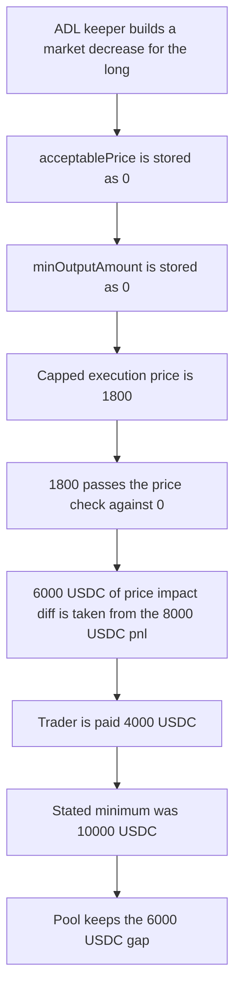

# GMX Synthetics — ADL closes a long below its minimum payout

> **Vulnerability classes:** vuln/defi/slippage · vuln/logic/missing-check · vuln/logic/price-calculation

<!-- non-defihacklabs -->
<!-- source-auditvault: https://github.com/Auditware/AuditVault/blob/main/findings/18631-h-5-adl-operations-do-not-have-any-slippage-protection-sherl.md -->
<!-- date: 2023-02 -->

## Key info

| | |
|---|---|
| **Protocol** | GMX Synthetics |
| **Finding** | Sherlock 2023-02-gmx H-5, AuditVault 18631 |
| **Vulnerable code** | `AdlUtils.createAdlOrder` |
| **Harm** | Trader is paid 4000 USDC on a close whose capped-impact minimum is 10000 USDC. The pool keeps the 6000 USDC difference |
| **Chain** | local synthetic |

## TL;DR

An ADL keeper does not ask the trader for a price or a minimum output. `createAdlOrder` writes `acceptablePrice = 0` on a long and `minOutputAmount = 0`. The decrease path still caps the execution price at `MAX_POSITION_IMPACT_FACTOR`, then subtracts the rest of the negative impact from the trader's profit. That excess is not claimable when the profit covers it. One ADL transaction pays this long 4000 USDC. The stated minimum, collateral plus pnl at the capped price, is 10000 USDC. The control refuses that fill and the capped path pays the 10000 USDC.

## The vulnerable code

The audited order constructor, reduced, with the blamed expressions kept:

```solidity
// @> VULN: long ADL sets acceptablePrice to 0; short ADL sets it to uint256 max
acceptablePrice = position.isLong ? 0 : type(uint256).max;
// @> VULN: minOutputAmount is forced to 0, so the payout has no floor
minOutputAmount = 0;

Numbers memory numbers = Numbers(
    OrderType.MarketDecrease,
    DecreasePositionSwapType.NoSwap,
    sizeDeltaUsd,
    0,
    0,
    acceptablePrice,
    0,
    0,
    minOutputAmount,
    updatedAtBlock
);
```

Those are the two fields from `AdlUtils.createAdlOrder` in the Sherlock tree. A long is filled at any execution price. Nothing on the order remembers a minimum number of collateral tokens.

The decrease that runs the order does cap the price used for pnl. From `DecreasePositionCollateralUtils.getExecutionPrice`, negative impact below `MAX_POSITION_IMPACT_FACTOR` is split off into `priceImpactDiffUsd` and the execution price is built from the capped impact only. `processCollateral` then does this when the position is in profit:

```solidity
if (values.positionPnlUsd > values.priceImpactDiffUsd.toInt256()) {
    adjustedPositionPnlUsd = values.positionPnlUsd - values.priceImpactDiffUsd.toInt256();
    adjustedPriceImpactDiffUsd = 0;
}
```

`adjustedPriceImpactDiffUsd = 0` means the haircut is not written to claimable collateral. The trader simply receives less. After the order, `AdlHandler.executeAdl` only checks that `nextPnlToPoolFactor` moved down and did not overshoot `minPnlFactorForAdl`. It never reads the trader's output.

The sponsor note that `MAX_POSITION_IMPACT_FACTOR` caps price impact is true for the execution price. It is not true for the payout. The synthetic uses that split.

The position is a long of 10000 USDC notional, 2000 USDC collateral, entry price 1000, oracle price 2000. Raw negative impact after the spike and the other exits is 7000 USDC. The cap is 1000 USDC, so:

| Quantity | USDC |
|---|---|
| Capped execution price | 1800 |
| Pnl at that price | 8000 |
| priceImpactDiff | 6000 |
| Stated minimum (collateral + capped pnl) | 10000 |
| Payout (capped pnl minus the diff, plus collateral) | 4000 |
| Left in the pool | 6000 |

`acceptablePrice` is 0, and 1800 is greater than 0, so `getExecutionPrice` does not revert. `minOutputAmount` is 0, so the 4000 transfer is not compared with 10000.

The control stores `minOutputAmount = 10000`. The same quote is 4000, the fill returns 0, and the position stays open. `executeCappedAdl` is the recommended `MAX_POSITION_IMPACT_FACTOR_FOR_ADL`: charge the 1000 cap and do not charge the 6000 diff. The trader receives 10000 USDC and the pool balance is 0.

## Root cause

ADL is a forced market decrease. The keeper, not the trader, chooses the order, and the only price it writes is the extreme that always passes `BaseOrderUtils.getExecutionPrice`. The output field that would have expressed a floor is hardcoded to zero, and the decrease path never consults it. The impact cap limits the price used to compute pnl, then `priceImpactDiffUsd` is taken out of that pnl anyway. When the pnl is larger than the diff, the difference is discarded instead of becoming claimable collateral. The handler's post-check is a pool ratio, so a close that turns an 8000 USDC gain into a 2000 USDC gain still succeeds.

## Preconditions

ADL is enabled for the long side. The trader's position is a long with 2000 USDC of collateral and 10000 USDC of size, entered at 1000. The index oracle is 2000. Closing it into the imbalance costs 7000 USDC of negative impact, and the market's negative impact cap is 1000 USDC. No other keeper action and no timestamp change are required. The whole close is one transaction.

## Attack walkthrough

1. Open the long. The market mints the 2000 USDC collateral into itself and stores the stated minimum, 10000 USDC. See [output.txt](output.txt) line 8.
2. `createAdlOrder` sets `acceptablePrice` to 0 and `minOutputAmount` to 0. See [output.txt](output.txt) lines 11–12.
3. `executeAdl` builds the capped execution price, 1800. The long check is `price >= acceptablePrice`. 1800 passes against 0.
4. Pnl at 1800 is 8000 USDC. `priceImpactDiff` is 6000 USDC. Adjusted pnl is 2000 USDC. Output is 2000 + 2000 collateral = 4000 USDC. See [output.txt](output.txt) line 13.
5. Because `minOutputAmount` is 0, the floor branch is skipped. The market mints the 8000 USDC capped pnl, transfers 4000 USDC to the trader, and zeroes the position.
6. The global flag is set. The pool's balance is 6000 USDC: the collateral and the capped pnl went in, and only 4000 USDC went out. See [output.txt](output.txt) lines 9–10.
7. The requires in `run` are `received == 4000`, `minimum == 10000`, and `received < minimum`.

The control, in a second transaction on a fresh deployment, writes `minOutputAmount = 10000` and calls the same `executeAdl`. The quote is still 4000, so the function returns 0 and the trader's balance stays 0. `executeCappedAdl` then pays 10000 USDC, which is the minimum, and the pool is left empty. See [output.txt](output.txt) lines 17–18.

## Diagrams



## Impact

The trader is force-closed for 4000 USDC when the close at the protocol's own impact cap is worth 10000 USDC. The missing 6000 USDC stays in the pool. It is not claimable collateral: the audited branch sets `adjustedPriceImpactDiffUsd` to 0 whenever pnl covers the diff. The trader's 8000 USDC mark-to-market gain is reduced to 2000 USDC, and with the 2000 USDC of collateral returned the account receives 4000 USDC. A minimum of 10000 USDC stops that fill. Charging only the 1000 USDC cap pays the 10000 USDC.

## Remediation

Give ADL its own impact cap, `MAX_POSITION_IMPACT_FACTOR_FOR_ADL`, the same shape as `MAX_POSITION_IMPACT_FACTOR_FOR_LIQUIDATIONS`, and do not deduct impact beyond that cap from the trader. Also store that capped payout as `minOutputAmount` and revert the ADL when the output is below it, instead of writing 0. The control above is that pair of checks: the 4000 USDC fill is refused, and the capped execution pays 10000 USDC.

## How to reproduce

```bash
cd 18631-h-5-adl-operations-do-not-have-any-slippage-protection-sherl_exp
forge test -vv
```

## Sources

- AuditVault finding: https://github.com/Auditware/AuditVault/blob/main/findings/18631-h-5-adl-operations-do-not-have-any-slippage-protection-sherl.md
- Sherlock issue: https://github.com/sherlock-audit/2023-02-gmx-judging/issues/143
- Vulnerable order: https://github.com/sherlock-audit/2023-02-gmx/blob/main/gmx-synthetics/contracts/adl/AdlUtils.sol#L141-L153
- Global-only ADL check: https://github.com/sherlock-audit/2023-02-gmx/blob/main/gmx-synthetics/contracts/exchange/AdlHandler.sol#L150-L160
- Impact diff taken from pnl: https://github.com/sherlock-audit/2023-02-gmx/blob/main/gmx-synthetics/contracts/position/DecreasePositionCollateralUtils.sol#L151-L175
- Synthetic: [test/18631-h-5-adl-operations-do-not-have-any-slippage-protection-sherl.sol](test/18631-h-5-adl-operations-do-not-have-any-slippage-protection-sherl.sol)
