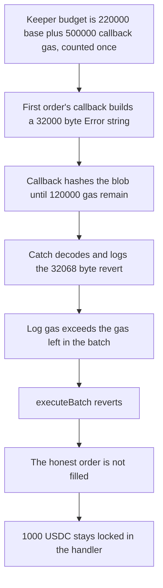

# GMX Synthetics — a long callback revert reverts the keeper batch

> **Vulnerability classes:** vuln/dos/gas-limit · vuln/dos/griefing · vuln/dos/frozen-funds

<!-- non-defihacklabs -->
<!-- source-auditvault: https://github.com/Auditware/AuditVault/blob/main/findings/18632-h-6-keepers-can-be-forced-to-waste-gas-with-long-revert-mess.md -->
<!-- date: 2023-02 -->

## Key info

| | |
|---|---|
| **Protocol** | GMX Synthetics |
| **Finding** | Sherlock 2023-02-gmx H-6, AuditVault 18632 |
| **Vulnerable code** | `CallbackUtils.afterOrderCancellation` |
| **Harm** | 1000 USDC of honest collateral stays escrowed; the order is not filled |
| **Chain** | local synthetic |

## TL;DR

Keepers execute orders in one transaction whose gas budget is `base + callbackGasLimit`, counted once. `afterOrderCancellation` forwards only that stipend to the user's callback, then copies the whole revert blob into the keeper frame and logs it. A callback that spends the stipend on a 32,000-byte `Error(string)` makes the catch cost more than the leftover gas. `executeBatch` runs out of gas, so the honest order behind the malicious one is not filled and its 1000 USDC stays locked. The control catches the revert without copying `reasonBytes` — the same budget fills the honest order and pays the 1000 USDC out.

## The vulnerable code

The audited function, reduced but with the blamed lines intact:

```solidity
try IOrderCallbackReceiver(order.callbackContract()).afterOrderCancellation{
    gas: order.callbackGasLimit()
}(key, order) {} catch (bytes memory reasonBytes) {
    // @> VULN: keeper copies and logs the full revert blob; the estimate counted callbackGasLimit once
    (string memory reason, /* bool hasRevertMessage */) = ErrorUtils.getRevertMessage(reasonBytes);
    emit AfterOrderCancellationError(key, order, reason, reasonBytes);
}
```

`ErrorUtils.getRevertMessage` is the audited decoder: it requires at least 68 bytes, checks selector `0x08c379a0`, and `abi.decode`s the string. The event then logs both that string and the raw `reasonBytes`.

`keeperBudget` follows `GasUtils.estimateExecuteOrderGasLimit`: 220,000 base gas plus `callbackGasLimit` of 500,000, once. It does not reserve a second copy for the decoder or the log.

The shipped fix (gmx-synthetics `b0bac262`) is the control. The catch no longer reads `reasonBytes`:

```solidity
try IOrderCallbackReceiver(order.callbackContract()).afterOrderCancellation{
    gas: order.callbackGasLimit()
}(key, order) {} catch {
    emit AfterOrderCancellationError(key, order, "", "");
}
```

## Root cause

The external call is gas-capped. The `catch (bytes memory reasonBytes)` is not. Solidity copies all returndata into the keeper's memory, `abi.decode` copies the string again, and `LOG` charges 8 gas per byte of the combined payload. A revert string sized to the callback stipend therefore costs about as much again on the keeper's side, on top of the stipend that was already consumed. The estimate only added the stipend once, so the batch frame runs out of gas and every later order in that transaction is rolled back.

## Preconditions

Two orders in one keeper call. The first has a callback contract and `callbackGasLimit` of 500,000. The callback builds a 32,000-byte `Error(string)` (returndata is 32,068 bytes) and hashes that blob until fewer than 120,000 gas remain, so the unused stipend is not refunded. The second order is honest, has no callback, and has 1,000 USDC already escrowed in the handler. No timestamp change is required.

## Attack walkthrough

1. Probe the callback with the same 500,000 gas stipend. It reverts with 32,068 bytes and consumes 412,967 gas. See [output.txt](output.txt) lines 13–14.
2. Create the malicious order, then the honest order. `createOrder` mints 1,000 USDC onto the handler and records `locked[honest]`.
3. Call `executeBatch(malicious, honest)` with `keeperBudget()` = 720,000. That is the once-counted estimate.
4. The handler forwards 500,000 gas into `afterOrderCancellation`. The callback reverts with the long string. `getRevertMessage` decodes it and the event logs the string plus the raw bytes.
5. The catch runs out of gas. The batch frame reverts. `batchOk` is false. The honest order's `filled` flag stays false.
6. The handler still holds 1,000 USDC and `locked[honest]` is still 1,000 USDC. The honest account's balance is 0. See [output.txt](output.txt) lines 15–18.

The control deploys `OrderHandlerFixed`, uses the same callback, the same 720,000 budget, and the same two orders. The empty catch returns, the honest order is filled, the escrow is 0, and the honest account receives 1,000 USDC. See [output.txt](output.txt) lines 6–7.

## Diagrams



## Impact

The honest trader's 1,000 USDC stays in the handler and the order is not executed. In the audited keeper flow that is the whole batch: a single long revert rolls back every order the keeper included after it, and those users' collateral stays escrowed until some later transaction succeeds. The attacker does not receive the 1,000 USDC. The loss is the locked collateral and the skipped fill. The same budget, with the revert isolated, pays the honest account the full 1,000 USDC.

## Remediation

Do not copy `reasonBytes` into the keeper frame. That is what `b0bac262` does: `catch { emit AfterOrderCancellationError(key, order); }` with no string and no raw blob. Counting `callbackGasLimit` three times in the estimate, which was the report's other suggestion, also leaves room for the copy, but dropping the copy removes the unbounded cost entirely. The control above is the drop-the-copy fix.

## How to reproduce

```bash
cd 18632-h-6-keepers-can-be-forced-to-waste-gas-with-long-revert-mess_exp
forge test -vv
```

## Sources

- AuditVault finding: https://github.com/Auditware/AuditVault/blob/main/findings/18632-h-6-keepers-can-be-forced-to-waste-gas-with-long-revert-mess.md
- Sherlock issue: https://github.com/sherlock-audit/2023-02-gmx-judging/issues/141
- Vulnerable callback: https://github.com/sherlock-audit/2023-02-gmx/blob/main/gmx-synthetics/contracts/callback/CallbackUtils.sol#L127-L135
- Gas estimate adds `callbackGasLimit` once: https://github.com/sherlock-audit/2023-02-gmx/blob/main/gmx-synthetics/contracts/gas/GasUtils.sol
- Fix: https://github.com/gmx-io/gmx-synthetics/commit/b0bac262191f4f96edc9606192d2e4abfa043dc3
- Synthetic: [test/18632-h-6-keepers-can-be-forced-to-waste-gas-with-long-revert-mess.sol](test/18632-h-6-keepers-can-be-forced-to-waste-gas-with-long-revert-mess.sol)
