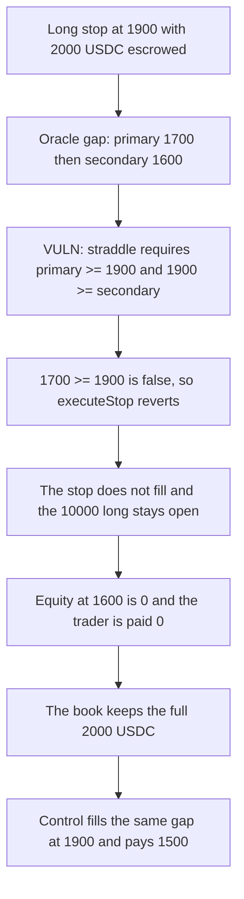

# GMX Synthetics — a price gap makes a stop revert, so the long stays open

> **Vulnerability classes:** vuln/logic/missing-check · vuln/dos/frozen-funds

<!-- non-defihacklabs -->
<!-- source-auditvault: https://github.com/Auditware/AuditVault/blob/main/findings/18633-h-7-limit-orders-are-broken-when-there-are-price-gaps-sherlo.md -->
<!-- date: 2023-02 -->

## Key info

| | |
|---|---|
| **Protocol** | GMX Synthetics |
| **Finding** | Sherlock 2023-02-gmx H-7, AuditVault 18633, reporter IllIllI |
| **Vulnerable code** | `BaseOrderUtils.setExactOrderPrice` |
| **Harm** | The stop does not fill. The trader is paid 0 instead of 1500 USDC, and 2000 USDC stays in the book on a still-open 10000 USDC long |
| **Chain** | local synthetic |

## TL;DR

A long stop-loss is allowed to execute only when the earlier oracle print and the later one straddle the trigger: `primary >= trigger && trigger >= secondary`. After a gap, both prints are already below the trigger (1700 then 1600, trigger 1900), the check reverts, and the order does not fill. The 10000 USDC long stays open. Marked at 1600 its equity is 0, so the trader receives nothing and the 2000 USDC collateral stays in the book. The same gap on the fixed check fills at the trigger and pays 1500 USDC. A normal straddle (1950 then 1850) still fills at 1900 on the vulnerable book, so the failure is the gap.

## The vulnerable code

`setExactOrderPrice` for `StopLossDecrease` with `isLong == true` takes the descending arm (`shouldValidateAscendingPrice = !isLong`):

```solidity
// @> VULN: both prints already below the trigger fail this straddle, so the stop reverts and does not fill
bool ok = primary >= trigger && trigger >= secondary;
if (!ok) {
    revert OrderErrors.InvalidOrderPrices(primary, secondary, trigger, false);
}
```

The prices are from blocks after the order (101 and 102, order block 100). That part passes. The straddle does not: 1700 is not `>= 1900`.

The report says not to revert when both prints are already worse than the trigger, and to use the trigger as the execution price. The control does that:

```solidity
bool straddles = primary >= trigger && trigger >= secondary;
bool gappedWorse = primary < trigger && secondary < trigger;
if (!straddles && !gappedWorse) {
    revert OrderErrors.InvalidOrderPrices(primary, secondary, trigger, false);
}
_fill(trigger);
```

`_fill(1900)` on a 10000 USDC long entered at 2000 realizes a 500 loss and pays `2000 - 500 = 1500`. It does not fill at the gapped 1600 print, which would pay 0.

## Root cause

The straddle encodes "the price traded across the trigger between these two blocks." A gap skips that window: the earlier print is already through the trigger, so `primary >= trigger` is false for a long stop and the later print being even further through does not help. Every later attempt with both prints still below 1900 fails the same check. The stop cannot fire, and the position stays open at the worse price.

Sponsor commit `ec586b87` drops the secondary-price straddle for limit orders and bounds the custom price with the trigger, which is what lets a gapped limit fill at the trigger. The stop-loss arm in that commit still uses the straddle. This reduction follows the report's stated recommendation for the stop the issue says leaves the user exposed.

## Preconditions

A long entered at 2000 with size 10000 USDC and 2000 USDC collateral. The stop trigger is 1900. The order was submitted at block 100. The keeper's oracle is primary 1700 at block 101 and secondary 1600 at block 102. Both blocks are after the order. No timestamp warp is required. The collateral is already escrowed in the book before `executeStop`.

PnL for the long is `size * (price - entry) / entry`. At 1900 that is `-500`. At 1600 it is `-2000`, which consumes the whole 2000 collateral.

## Attack walkthrough

From [output.txt](output.txt):

1. The long is opened and 2000 USDC is escrowed. The stop trigger is 1900.
2. The keeper sets the gapped oracle, 1700 then 1600.
3. `executeStop` reverts with `InvalidOrderPrices(1700, 1600, 1900, false)`. The selector matches. See [output.txt](output.txt) lines 15–18.
4. `filled` is false and the open size is still 10000 USDC. See [output.txt](output.txt) lines 19–20.
5. Equity at the 1900 trigger is 1500 USDC. Equity at the 1600 print is 0. See [output.txt](output.txt) lines 21–22.
6. The trader's balance is 0. The book still holds 2000 USDC. See [output.txt](output.txt) lines 23–24.

The control runs the same gap through the fixed check. It fills at 1900, pays the trader 1500, leaves 500 in the book, and sets the open size to 0. See [output.txt](output.txt) lines 6–11.

A straddle of 1950 then 1850 on the vulnerable book still fills at 1900 and pays 1500. See [output.txt](output.txt) lines 28–29. The buggy check is not "never fill." It fails only when the two prints do not straddle the trigger.

## Diagrams



## Impact

The trader who set a stop at 1900 is not exited. The position remains a 10000 USDC long, the trader is paid 0, and the 2000 USDC collateral stays in the book. At the gapped price the equity is 0, so the whole posted amount is exposed. The same order on the fixed check closes at the trigger, pays 1500 USDC to the trader, and leaves only the 500 USDC loss the stop was supposed to take. The difference versus that fill is 1500 USDC that the trader does not receive, plus an open position instead of a closed one.

## Remediation

If both the primary and the secondary price are already worse than the trigger, do not revert. Fill at the trigger price, which is what the control does for this long stop (`gappedWorse` when both prints are below 1900, then `_fill(trigger)`). Do not execute at the gapped print: that would pay 0 instead of 1500.

## How to reproduce

```bash
cd 18633-h-7-limit-orders-are-broken-when-there-are-price-gaps-sherlo_exp
forge test -vv
```

## Sources

- AuditVault finding: https://github.com/Auditware/AuditVault/blob/main/findings/18633-h-7-limit-orders-are-broken-when-there-are-price-gaps-sherlo.md
- Sherlock issue: https://github.com/sherlock-audit/2023-02-gmx-judging/issues/140
- Audited code: https://github.com/sherlock-audit/2023-02-gmx/blob/main/gmx-synthetics/contracts/order/BaseOrderUtils.sol
- Sponsor commit: https://github.com/gmx-io/gmx-synthetics/commit/ec586b87cd677d6e0426000fb746613537027160
