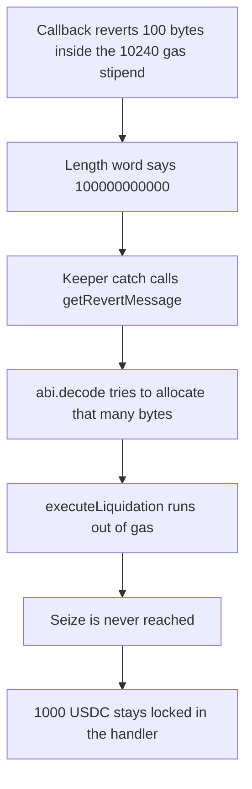

# GMX Synthetics — a faked revert length runs the keeper out of gas

> **Vulnerability classes:** vuln/dos/gas-limit · vuln/dos/unbounded-loop · vuln/dos/frozen-funds

<!-- non-defihacklabs -->
<!-- source-auditvault: https://github.com/Auditware/AuditVault/blob/main/findings/18634-h-8-malicious-revert-reasons-with-faked-lengths-can-disrupt.md -->
<!-- date: 2023-02 -->

## Key info

| | |
|---|---|
| **Protocol** | GMX Synthetics |
| **Finding** | Sherlock 2023-02-gmx H-8, AuditVault 18634 |
| **Vulnerable code** | `ErrorUtils.getRevertMessage` |
| **Harm** | Liquidation does not seize 1000 USDC; the collateral stays locked |
| **Chain** | local synthetic |

## TL;DR

`getRevertMessage` `abi.decode`s a memory blob as a `string` and never checks the length word against the bytes that were actually returned. A callback can revert with 100 bytes whose length word is 100,000,000,000. The callback spends a few hundred gas, inside the 10,240 stipend. The keeper's catch then tries to allocate that string and `executeLiquidation` runs out of gas, so the 1,000 USDC is not seized. The control rejects a stated length larger than the returned bytes (or larger than 256) and the same 400,000 gas budget pays the insurance fund the 1,000 USDC.

This is not the long-string grief. A real 100-billion-byte string cannot be built inside the callback stipend. The attack forges the length word of a 100-byte revert.

## The vulnerable code

```solidity
if (errorSelector == bytes4(0x08c379a0)) {
    assembly {
        result := add(result, 0x04)
    }

    // @> VULN: abi.decode trusts the length word of a memory blob and will try to allocate it
    return (abi.decode(result, (string)), true);
}
```

The callback, taken from the Sherlock test, writes a short `Error(string)` and lies about its length:

```solidity
mstore(p, 0x08c379a000000000000000000000000000000000000000000000000000000000)
mstore(add(p, 4), 32)
mstore(add(p, 36), 100000000000)
mstore(add(p, 68), "Unauthorizedzzzzzz")
revert(p, 100)
```

Because `result` is a memory `bytes`, a read past its end is a zero, not a bounds revert. `abi.decode` therefore tries to allocate `100000000000` bytes.

The control reads the length word first and refuses to allocate:

```solidity
uint256 stated;
assembly {
    stated := mload(add(result, 68))
}
if (stated > 256 || stated + 68 > result.length) {
    return ("", false);
}
```

## Root cause

`abi.decode` of a memory string uses the embedded length, not `result.length`. The callback gas limit does not cover the catch. A revert that is cheap to produce and expensive to decode blows the keeper's remaining gas, and the liquidation never reaches the seize.

## Preconditions

The position has a callback and 1,000 USDC escrowed. The keeper calls `executeLiquidation` with 400,000 gas, which is enough for the 10,240 callback, a real short decode, and the token transfer. The forged length is the value from the report (`100000000000`). No timestamp change is required.

## Attack walkthrough

1. Probe the callback with 10,240 gas. Returndata is 100 bytes. The length word at byte 36 is 100,000,000,000. See [output.txt](output.txt).
2. Open the position. The handler mints 1,000 USDC and records `locked[account]`.
3. Call `executeLiquidation` with 400,000 gas.
4. The callback returns inside its stipend. `getRevertMessage` hits `abi.decode` and the frame runs out of gas. `seized` stays false.
5. The handler still holds 1,000 USDC. The insurance fund's balance is 0. `locked` is still 1,000 USDC.

The control is the same callback and the same 400,000 gas on `OrderHandlerFixed`. The capped decoder returns an empty reason, `_seize` runs, the handler balance is 0, and the insurance fund receives 1,000 USDC.

## Diagrams



## Impact

The liquidation does not happen. 1,000 USDC that should have been paid to the insurance fund stays in the handler, and the position is not marked seized. The same call, once the malformed length is rejected, moves the full 1,000 USDC to the insurance fund. The report's other instances (a cancel that cannot run, an order that cannot be frozen) are the same decoder running in the keeper's frame.

## Remediation

Before `abi.decode`, require the stated length to fit in the returned bytes and under a small cap. If it does not, treat the reason as empty and continue. Dropping the decode entirely, which is what gmx-synthetics `b0bac262` did, also removes the allocation. The control above is the length check: the forged word is rejected and the 1,000 USDC is seized.

## How to reproduce

```bash
cd 18634-h-8-malicious-revert-reasons-with-faked-lengths-can-disrupt_exp
forge test -vv
```

## Sources

- AuditVault finding: https://github.com/Auditware/AuditVault/blob/main/findings/18634-h-8-malicious-revert-reasons-with-faked-lengths-can-disrupt.md
- Sherlock issue: https://github.com/sherlock-audit/2023-02-gmx-judging/issues/139
- Vulnerable decoder: https://github.com/sherlock-audit/2023-02-gmx/blob/main/gmx-synthetics/contracts/utils/ErrorUtils.sol#L7-L27
- Callback use: https://github.com/sherlock-audit/2023-02-gmx/blob/main/gmx-synthetics/contracts/callback/CallbackUtils.sol
- Fix: https://github.com/gmx-io/gmx-synthetics/commit/b0bac262191f4f96edc9606192d2e4abfa043dc3
- Synthetic: [test/18634-h-8-malicious-revert-reasons-with-faked-lengths-can-disrupt.sol](test/18634-h-8-malicious-revert-reasons-with-faked-lengths-can-disrupt.sol)
