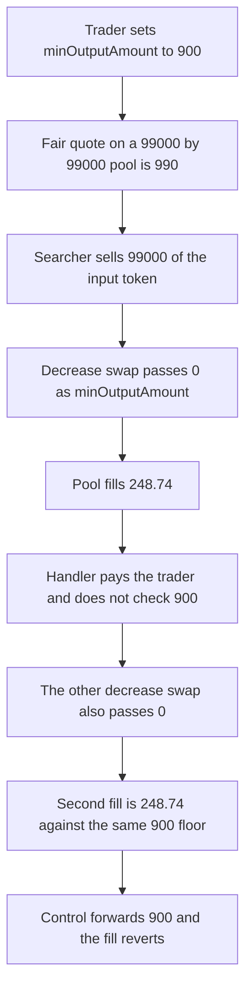

# GMX Synthetics — decrease orders ignore the user's slippage floor

> **Vulnerability classes:** vuln/defi/slippage · vuln/defi/sandwich-attack · vuln/logic/missing-check

<!-- non-defihacklabs -->
<!-- source-auditvault: https://github.com/Auditware/AuditVault/blob/main/findings/18635-h-9-user-supplied-slippage-for-decrease-orders-is-ignored-sh.md -->
<!-- date: 2023-02 -->

## Key info

| | |
|---|---|
| **Protocol** | GMX Synthetics |
| **Finding** | Sherlock 2023-02-gmx H-9, AuditVault 18635 |
| **Vulnerable code** | `DecreasePositionCollateralUtils.swapProfitToCollateralToken` and `swapWithdrawnCollateralToPnlToken` |
| **Harm** | Trader receives 248.74 instead of at least 900 on both decrease swaps; searcher extracts 750.63 of each token |
| **Chain** | local synthetic |

## TL;DR

A decrease order stores the trader's `minOutputAmount`. Both internal swaps that turn PnL into collateral, or withdrawn collateral into the PnL token, call the swap handler with `minOutputAmount` hardcoded to `0`. `DecreaseOrderUtils.processOrder` then pays the returned amounts and never compares them to the floor on the order. After a searcher moves a 99,000/99,000 pool, each 1,000-token swap that fairly quotes 990 fills at 248.74. The trader set the floor at 900. Both received amounts are below it. The control passes 900 into the same sandwiched swap and reverts `InsufficientOutputAmount`.

## The vulnerable code

The audited calls, reduced, with the blamed literal kept:

```solidity
// @> VULN: profit-to-collateral decrease swap ignores the user's minOutputAmount
amountOut = poolA.swapExactIn(address(pnl), amountIn, 0, address(this)); // minOutputAmount
```

```solidity
// @> VULN: collateral-to-pnl decrease swap ignores the user's minOutputAmount
amountOut = poolB.swapExactIn(address(col), amountIn, 0, address(this)); // minOutputAmount
```

`executeDecrease` writes `order.minOutputAmount` into `ignoredMin` and then transfers `paid` to the trader. It does not `require(paid >= order.minOutputAmount)`.

In the audited tree those zeros sit in the `SwapParams` literal:

```solidity
0, // minOutputAmount
```

`DecreaseOrderUtils.processOrder` in that tree transfers `outputAmount` and, when present, `secondaryOutputAmount` with no check against `order.minOutputAmount()`. A later swap along `swapPath` does pass the floor, but a revert there is caught and the original output is still paid out.

The control is the check the report asked for, applied on the swap itself: forward the order's floor, and revert when the quote is short.

```solidity
paid = poolA.swapExactIn(address(pnl), amountIn, minOutputAmount, address(this));
require(paid >= minOutputAmount, "InsufficientOutputAmount");
```

## Root cause

The user's floor is an input to order creation and a field on the order. The two decrease collateral swaps replace it with zero, so the pool's `amountOut >= minOut` check cannot fail for any positive quote. The caller that pays the trader does not put the check back. Any price the swap returns is a successful fill.

## Preconditions

Two constant-product pools, each seeded 99,000 USDC and 99,000 WETH. The trader's decrease sells 1,000 of one token into a pool. Fair output is 990. The order's `minOutputAmount` is 900. The searcher sells 99,000 of the same token in first, which cuts the output reserve in half. No timestamp change and no oracle. The keeper then calls `executeDecrease`.

## Attack walkthrough

1. Record the floor, 900, and the fair profit quote, 990. 990 is above 900. See [output.txt](output.txt) lines 9–10.
2. The searcher sells 99,000 WETH into the profit pool. Collateral reserves drop from 99,000 to 49,500.
3. `swapProfitToCollateralToken` passes `0` as `minOutputAmount` and swaps the trader's 1,000 WETH. The pool returns 248.743718592964824120 USDC. The handler pays that to the trader. See [output.txt](output.txt) line 11.
4. The searcher buys the WETH back. The round trip leaves 750.629722921914357682 WETH more than it started with.
5. The same sequence runs the other way on the second pool. Fair quote 990 WETH, floor 900, fill 248.743718592964824120 WETH. See [output.txt](output.txt) lines 12–13.
6. The searcher's collateral round trip leaves the same 750.629722921914357682 USDC. See [output.txt](output.txt) lines 14–15.

The control sandwiches the profit pool the same way, quotes 248.74, which is below 900, and calls the fixed handler with `minOutputAmount` 900. The pool reverts `InsufficientOutputAmount`. The trader is not paid.

## Diagrams



## Impact

The trader asked for at least 900 of each output token and received 248.743718592964824120 of each. That is a shortfall of 651.256281407035175880 per swap, 1,302.51 tokens across both fills. The searcher extracts 750.629722921914357682 WETH from the profit-swap sandwich and the same amount of USDC from the collateral-swap sandwich. The tokens the trader does not receive stay in the pool and are bought back by the searcher. The control on the same quote does not pay the trader at all.

## Remediation

Pass the order's `minOutputAmount` into both decrease swaps, and `require` the final output is at least that floor after the position is decreased and before the transfer. That is what the control does. The shipped GMX fix in pull 108 checks output value against `minOutputAmount` in `DecreaseOrderUtils` and reverts `InsufficientOutputAmount` when the fill is short. Treating the floor as a USD sum of both output tokens matches a decrease that can pay two tokens. This synthetic compares each swap's raw output to the same 900 floor, which is enough to show the ignored check.

## How to reproduce

```bash
cd 18635-h-9-user-supplied-slippage-for-decrease-orders-is-ignored-sh_exp
forge test -vv
```

## Sources

- AuditVault finding: https://github.com/Auditware/AuditVault/blob/main/findings/18635-h-9-user-supplied-slippage-for-decrease-orders-is-ignored-sh.md
- Sherlock issue: https://github.com/sherlock-audit/2023-02-gmx-judging/issues/138
- Profit swap with `minOutputAmount` 0: https://github.com/sherlock-audit/2023-02-gmx/blob/main/gmx-synthetics/contracts/position/DecreasePositionCollateralUtils.sol#L425-L438
- Collateral swap with `minOutputAmount` 0: https://github.com/sherlock-audit/2023-02-gmx/blob/main/gmx-synthetics/contracts/position/DecreasePositionCollateralUtils.sol#L383-L396
- Caller pays outputs without checking the floor: https://github.com/sherlock-audit/2023-02-gmx/blob/main/gmx-synthetics/contracts/order/DecreaseOrderUtils.sol#L38-L70
- Order field: https://github.com/sherlock-audit/2023-02-gmx/blob/main/gmx-synthetics/contracts/order/Order.sol#L92-L103
- Fix: https://github.com/gmx-io/gmx-synthetics/pull/108
- Synthetic: [test/18635-h-9-user-supplied-slippage-for-decrease-orders-is-ignored-sh.sol](test/18635-h-9-user-supplied-slippage-for-decrease-orders-is-ignored-sh.sol)
