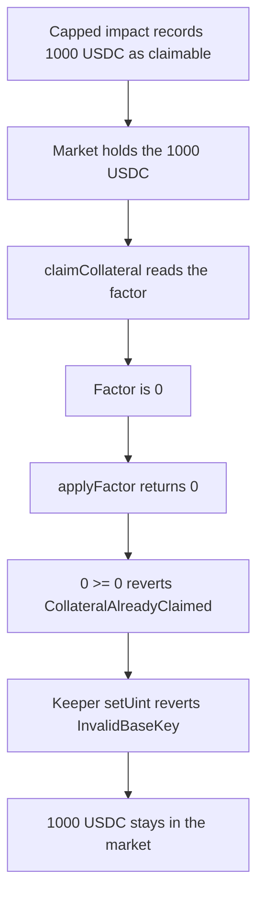

# GMX Synthetics — claimable collateral cannot be claimed

> **Vulnerability classes:** vuln/dos/frozen-funds · vuln/logic/missing-checkault

<!-- non-defihacklabs -->
<!-- source-auditvault: https://github.com/Auditware/AuditVault/blob/main/findings/18636-h-10-collateral-cannot-be-claimed-because-there-is-no-mechan.md -->
<!-- date: 2023-02 -->

## Key info

| | |
|---|---|
| **Protocol** | GMX Synthetics |
| **Finding** | Sherlock 2023-02-gmx H-10, AuditVault 18636 |
| **Vulnerable code** | `MarketUtils.claimCollateral` and `Config._initAllowedBaseKeys` |
| **Harm** | 1000 USDC of claimable collateral stays in the market; the trader receives 0 |
| **Chain** | local synthetic |

## TL;DR

Capped positive price impact is stored as claimable collateral and held by the market. `claimCollateral` pays `applyFactor(amount, factor)`, and the factor defaults to 0. `Config` never puts `CLAIMABLE_COLLATERAL_FACTOR` in `allowedBaseKeys`, so the keeper's `setUint` reverts `InvalidBaseKey`. The claim then sees adjusted 0 and claimed 0 and reverts `CollateralAlreadyClaimed`. The 1000 USDC stays in the market. The control allows that key, sets the factor to 1e30, and uses the later `<=` comparison. The same 1000 USDC is paid to the trader.

## The vulnerable code

The audited claim, reduced but with the blamed lines intact:

```solidity
uint256 claimableAmount = dataStore.getUint(Keys.claimableCollateralAmountKey(market, token, timeKey, account));
uint256 claimableFactor = dataStore.getUint(Keys.claimableCollateralFactorKey(market, token, timeKey, account));
uint256 claimedAmount = dataStore.getUint(Keys.claimedCollateralAmountKey(market, token, timeKey, account));

uint256 adjustedClaimableAmount = Precision.applyFactor(claimableAmount, claimableFactor);
// @> VULN: factor is 0 and cannot be configured, so adjusted is 0 and 0 >= claimed reverts
if (adjustedClaimableAmount >= claimedAmount) {
    revert CollateralAlreadyClaimed(adjustedClaimableAmount, claimedAmount);
}
```

`Precision.applyFactor` multiplies by the factor and divides by `1e30`. A missing factor is 0, so the adjusted amount is 0. Claimed is also 0, and `0 >= 0` reverts.

The keeper cannot write the factor. The audited allow-list sets `MIN_COLLATERAL_USD` and then the virtual-inventory keys. It never sets `CLAIMABLE_COLLATERAL_FACTOR`. `setUint` calls `_validateKey` and reverts `InvalidBaseKey`.

The H-10 recommendation adds the missing key:

```solidity
allowedBaseKeys[Keys.MIN_COLLATERAL_USD] = true;
allowedBaseKeys[Keys.CLAIMABLE_COLLATERAL_FACTOR] = true;
allowedBaseKeys[Keys.VIRTUAL_TOKEN_ID] = true;
```

The audited comparison is `>=`. With a factor of `1e30` the adjusted amount is the full 1000 USDC, and `1000 >= 0` still reverts. That direction is Sherlock issue 76, duplicate of 136. Later `MarketUtils` uses `<=`. The control does both: it allows the key, and it claims with `<=`. Setting the factor to `1e30` then pays the 1000 USDC. Allowing the key alone, and still using `>=`, leaves the 1000 USDC stuck. See [output.txt](output.txt).

## Root cause

Claimable collateral is a stored amount times a factor. The amount is written when price impact is capped. The factor is a DataStore value that starts at 0, and the only admin writer is `Config.setUint`, which rejects any base key that `_initAllowedBaseKeys` did not mark. `CLAIMABLE_COLLATERAL_FACTOR` is not marked. The claim therefore always computes a zero payout, and the `>=` check treats that zero as "already claimed".

## Preconditions

One trader, one market, time key 1. The market has recorded 1000 USDC of claimable collateral for that trader and holds the 1000 USDC. The factor slot is untouched. The caller of `setUint` is the config keeper. No timestamp change is required.

## Attack walkthrough

1. Credit 1000 USDC of claimable collateral and mint it onto the market.
2. Call `claimCollateral`. The factor read is 0. `applyFactor` returns 0. The `>=` check reverts `CollateralAlreadyClaimed`.
3. The keeper calls `setUint(CLAIMABLE_COLLATERAL_FACTOR, ..., 1e30)`. `_validateKey` reverts `InvalidBaseKey`.
4. The market still holds 1000 USDC. The trader's balance is 0. The factor is 0. See [output.txt](output.txt) lines 12–17.

A second run writes the factor through a config that allows the key, then claims with the audited `>=` comparison. The factor is `1e30` and the 1000 USDC is still stuck. See [output.txt](output.txt) lines 6–8.

The control deploys the fixed config and the fixed claim. The keeper sets the factor to `1e30`. The `<=` check does not revert. The market balance goes to 0 and the trader receives 1000 USDC. See [output.txt](output.txt) lines 21–23.

## Diagrams



## Impact

The trader's 1000 USDC of capped-impact collateral cannot be withdrawn. It stays in the market, and the keeper has no config key that can turn the claim on. In the audited deployment that is a principal loss until every position is closed, LPs withdraw, and the contracts are redeployed with the key allowed. The attacker does not receive the 1000 USDC. The loss is the locked collateral. The control pays that same 1000 USDC to the trader.

## Remediation

Allow `Keys.CLAIMABLE_COLLATERAL_FACTOR` in `Config._initAllowedBaseKeys`, which is the H-10 diff. Also compare with `<=`, as later `MarketUtils.claimCollateral` does. Otherwise a factor of 100% still hits `adjusted >= claimed` and the claim reverts. After both changes, the keeper sets the factor to `1e30` for the market, token, time key, and account, and the trader receives the recorded amount.

## How to reproduce

```bash
cd 18636-h-10-collateral-cannot-be-claimed-because-there-is-no-mechan_exp
forge test -vv
```

## Sources

- AuditVault finding: https://github.com/Auditware/AuditVault/blob/main/findings/18636-h-10-collateral-cannot-be-claimed-because-there-is-no-mechan.md
- Sherlock issue: https://github.com/sherlock-audit/2023-02-gmx-judging/issues/137
- Audited claim: https://github.com/sherlock-audit/2023-02-gmx/blob/main/gmx-synthetics/contracts/market/MarketUtils.sol#L618-L658
- Audited allow-list: https://github.com/sherlock-audit/2023-02-gmx/blob/main/gmx-synthetics/contracts/config/Config.sol
- Inverted comparison, separate issue: https://github.com/sherlock-audit/2023-02-gmx-judging/issues/76
- Synthetic: [test/18636-h-10-collateral-cannot-be-claimed-because-there-is-no-mechan.sol](test/18636-h-10-collateral-cannot-be-claimed-because-there-is-no-mechan.sol)
