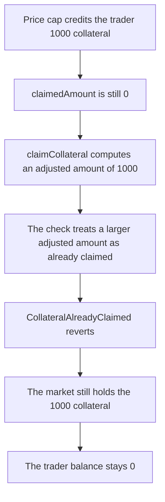

# GMX Synthetics — claimCollateral reverts because the claimed-amount check is inverted

> **Vulnerability classes:** vuln/logic/missing-check · vuln/dos/frozen-funds

<!-- non-defihacklabs -->
<!-- source-auditvault: https://github.com/Auditware/AuditVault/blob/main/findings/18637-h-11-collateral-cannot-be-claimed-due-to-inverted-comparison.md -->
<!-- date: 2023-02 -->

## Key info

| | |
|---|---|
| **Protocol** | GMX Synthetics |
| **Finding** | Sherlock 2023-02-gmx H-11, AuditVault 18637 |
| **Vulnerable code** | `MarketUtils.claimCollateral` |
| **Harm** | 1000 collateral tokens stay in the market; the trader receives 0 |
| **Chain** | local synthetic |

## TL;DR

Collateral returned to a trader after a capped price impact is recorded as `claimableAmount` with `claimedAmount` still 0. `claimCollateral` is supposed to revert only when the account has already taken the adjusted amount. The comparison is backwards: it reverts when `adjustedClaimableAmount >= claimedAmount`. That is true for every fresh credit, so the claim always reverts with `CollateralAlreadyClaimed` and the 1000 tokens never leave the market. The control uses `<=` and pays those 1000 tokens to the trader.

## The vulnerable code

The audited check, reduced but with the blamed comparison intact:

```solidity
uint256 claimableAmount = dataStore.getUint(Keys.claimableCollateralAmountKey(market, token, timeKey, account));
uint256 claimableFactor = dataStore.getUint(Keys.claimableCollateralFactorKey(market, token, timeKey, account));
uint256 claimedAmount = dataStore.getUint(Keys.claimedCollateralAmountKey(market, token, timeKey, account));

uint256 adjustedClaimableAmount = Precision.applyFactor(claimableAmount, claimableFactor);
// @> VULN: inverted comparison. claimedAmount starts at 0, so any positive adjusted amount reverts
if (adjustedClaimableAmount >= claimedAmount) {
    revert CollateralAlreadyClaimed(adjustedClaimableAmount, claimedAmount);
}
```

`Precision.applyFactor` is `value * factor / 1e30`. With factor `1e30` the adjusted amount is the full 1000. `claimedAmount` was never written, so it is 0. `1000 >= 0` reverts before `transfer`.

The shipped fix (gmx-synthetics PR 70) is the control. Only the operator changes:

```solidity
if (adjustedClaimableAmount <= claimedAmount) {
    revert CollateralAlreadyClaimed(adjustedClaimableAmount, claimedAmount);
}
```

`1000 <= 0` is false, so the fixed market transfers the 1000 remainder to the trader. A second claim then reverts, because the claimed slot is now equal to the adjusted amount.

## Root cause

The guard was meant to mean "nothing left to claim". That is `adjustedClaimableAmount <= claimedAmount`. The audited code tests the opposite inequality. Because `claimedAmount` is initialized to 0, the true branch is the one every legitimate first claim hits. The subtraction and the `transfer` underneath it are unreachable whenever the account is actually owed tokens. Both sides of the bug revert for a positive credit: the explicit error when adjusted is at least claimed, and a Solidity underflow if claimed were somehow larger, because the next line subtracts claimed from adjusted. A fresh claim is the first case.

## Preconditions

One account has a positive `claimableCollateralAmount` for a `(market, token, timeKey)` and a claimable factor of `1e30`, so the adjusted amount is the full credit. `claimedCollateralAmount` for that key is 0. The market already holds the 1000 collateral tokens that were minted when the credit was recorded. No timestamp change and no privileged role are required. Anyone can submit the claim. It reverts either way.

## Attack walkthrough

1. Read the factor. It is `10^30`, so the adjusted amount will be the whole credit. See [output.txt](output.txt) line 13.
2. Credit the trader 1000 collateral. The market's balance becomes 1000 and the claimable-amount slot is 1000. The claimed slot stays 0. See [output.txt](output.txt) lines 12 and 14.
3. Call `claimCollateral` for that trader, paying the trader. The inverted comparison sees `1000 >= 0` and reverts `CollateralAlreadyClaimed`. See [output.txt](output.txt) line 15.
4. The market still holds 1000 collateral. The trader's balance is 0. See [output.txt](output.txt) lines 16–17.

The control deploys `MarketUtilsFixed`, credits the same 1000, and calls the same claim with `<=`. The trader's balance becomes 1000 and the fixed market's balance is 0. A second claim reverts. See [output.txt](output.txt) lines 6–8.

## Diagrams



## Impact

The trader loses the 1000 collateral tokens that the market already set aside for them. They cannot be withdrawn by claiming, and the tokens sit in the market contract. This is the path used when a large liquidation or a price gap produces a capped impact and the protocol owes the difference back as claimable collateral. Until the comparison is flipped, every such credit is principal that the account cannot recover. The same credit, with `<=`, pays the trader the full 1000.

## Remediation

Flip the comparison so the revert fires only when the adjusted amount has already been claimed:

```diff
-        if (adjustedClaimableAmount >= claimedAmount) {
+        if (adjustedClaimableAmount <= claimedAmount) {
             revert CollateralAlreadyClaimed(adjustedClaimableAmount, claimedAmount);
         }
```

That is the change in [gmx-synthetics PR 70](https://github.com/gmx-io/gmx-synthetics/pull/70). The control above is that one-line fix.

## How to reproduce

```bash
cd 18637-h-11-collateral-cannot-be-claimed-due-to-inverted-comparison_exp
forge test -vv
```

## Sources

- AuditVault finding: https://github.com/Auditware/AuditVault/blob/main/findings/18637-h-11-collateral-cannot-be-claimed-due-to-inverted-comparison.md
- Sherlock issue: https://github.com/sherlock-audit/2023-02-gmx-judging/issues/136
- Vulnerable claim: https://github.com/sherlock-audit/2023-02-gmx/blob/main/gmx-synthetics/contracts/market/MarketUtils.sol#L622-L644
- Fix: https://github.com/gmx-io/gmx-synthetics/pull/70
- Synthetic: [test/18637-h-11-collateral-cannot-be-claimed-due-to-inverted-comparison.sol](test/18637-h-11-collateral-cannot-be-claimed-due-to-inverted-comparison.sol)
