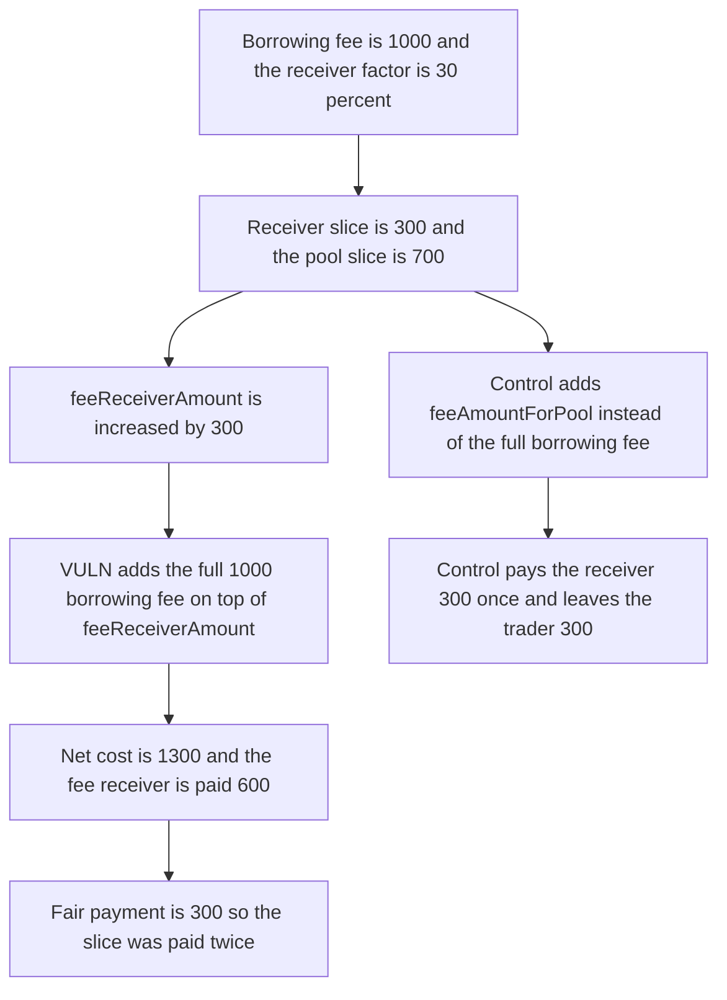

# GMX Synthetics: fee receiver is paid twice the borrowing-fee slice

> **Vulnerability classes:** vuln/logic/fee-calculation · vuln/defi/fee-manipulation

<!-- non-defihacklabs -->
<!-- source-auditvault: https://github.com/Auditware/AuditVault/blob/main/findings/18638-h-12-fee-receiver-is-given-twice-the-amount-of-borrow-fees-i.md -->
<!-- date: 2023-02 -->

## Key info

| Field | Value |
|---|---|
| **Loss** | Fee receiver is paid 600 USD. The fair borrowing-fee slice is 300 USD. The trader's 1,300 deposit is consumed instead of the fair 1,000 |
| **Vulnerable contract** | `PositionPricingUtils.getPositionFees` |
| **Attacker EOA** | `0x1111111111111111111111111111111111111111` (the trader whose close is settled) |
| **Attack contract** | `Exploit` |
| **Attack tx** | `Exploit.run()` |
| **Chain / block / date** | Ethereum model · block 0 · 2023-02 |
| **Compiler** | solc 0.8.27, cancun, via IR |
| **Bug class** | Borrowing-fee receiver slice counted twice in the position's net cost |

## TL;DR

`getPositionFees` puts `borrowingFeeAmountForFeeReceiver` into `feeReceiverAmount`, then adds the full `borrowingFeeAmount` into `totalNetCostAmount`. The full borrowing fee already contains that slice, so the slice is charged twice and paid to the fee receiver. With a 1,000 borrowing fee and a 30% receiver factor, the receiver is owed 300 and is paid 600. The pool still receives its 700. The fair net cost is 1,000. The control uses `feeAmountForPool` and pays the receiver 300 once, leaving the trader 300 of the 1,300 deposit.

## Background

Sherlock's February 2023 GMX Synthetics contest, issue 135 (H-12), reported by IllIllI, float-audits, and rvierdiiev. Sponsor confirmed. `borrowingFeeAmount` is the whole borrowing fee: the pool's portion plus the fee receiver's portion. `Precision.applyFactor(borrowingFeeAmount, borrowingFeeReceiverFactor)` is only the receiver's portion. The recommended fix replaces `positionFeeAmountForPool + borrowingFeeAmount` with `feeAmountForPool`, which is already `positionFeeAmountForPool + borrowingFeeAmount - borrowingFeeAmountForFeeReceiver`. xvi10 landed the fix in gmx-synthetics commit `221d207`. Position fees, affiliate rewards, and funding are zero in this reduction so the double count is the only difference.

## The vulnerable code

```solidity
fees.borrowingFeeAmount = getBorrowingFees() / collateralTokenPriceMin;

uint256 borrowingFeeReceiverFactor = borrowingFeeReceiverFactorStored;
uint256 borrowingFeeAmountForFeeReceiver = Precision.applyFactor(fees.borrowingFeeAmount, borrowingFeeReceiverFactor);

fees.feeAmountForPool = fees.positionFeeAmountForPool + fees.borrowingFeeAmount - borrowingFeeAmountForFeeReceiver;
fees.feeReceiverAmount += borrowingFeeAmountForFeeReceiver;

// @> VULN: feeReceiverAmount already contains borrowingFeeAmountForFeeReceiver, and borrowingFeeAmount is added in full
fees.totalNetCostAmount = fees.referral.affiliateRewardAmount + fees.feeReceiverAmount + fees.positionFeeAmountForPool + fees.funding.fundingFeeAmount + fees.borrowingFeeAmount;
```

`Precision.applyFactor` is `value * factor / 10^30`.

The recommended change, from the judging report:

```diff
- fees.totalNetCostAmount = fees.referral.affiliateRewardAmount + fees.feeReceiverAmount + fees.positionFeeAmountForPool + fees.funding.fundingFeeAmount + fees.borrowingFeeAmount;
+ fees.totalNetCostAmount = fees.referral.affiliateRewardAmount + fees.feeReceiverAmount + fees.feeAmountForPool + fees.funding.fundingFeeAmount;
```

## Root cause

`feeReceiverAmount` is increased by the receiver's borrowing-fee slice before `totalNetCostAmount` is summed. The sum then adds `borrowingFeeAmount` in full instead of `feeAmountForPool`. The receiver slice is inside both terms. The difference between the buggy cost and the fair cost is exactly that slice, and the settlement pays the receiver `feeReceiverAmount` plus the difference.

## Preconditions

- A position has accrued 1,000 of borrowing fees. Collateral price is 1, so the token amount is 1,000.
- `borrowingFeeReceiverFactor` is `3 * 10^29`, which is 30% of `10^30`. The receiver slice is 300. The pool slice is 700.
- Position fees, the affiliate reward, and funding are zero.
- The trader has deposited 1,300, enough to pay the buggy 1,300 charge. The fair charge is 1,000.

## Attack walkthrough

1. The close is settled. The market holds 1,300 of the trader's collateral.
2. `applyFactor(1000, 30%)` is 300. That is what the fee receiver is owed.
3. `feeReceiverAmount` becomes 300. `feeAmountForPool` becomes 700.
4. The buggy `totalNetCostAmount` is `300 + 1,000 = 1,300`. The fair cost, using `feeAmountForPool`, is `300 + 700 = 1,000`.
5. The extra is 300, the same slice again. The receiver is paid `300 + 300 = 600`. The pool is paid 700.
6. The trader's deposit is fully consumed. On the control, the receiver is paid 300, the pool is paid 700, and 300 stays with the trader.

## Diagrams



## Impact

The fee receiver of this close is paid 600 USD. The borrowing-fee slice owed to that receiver is 300 USD, so the receiver is paid twice what it is owed. The trader who deposited 1,300 USD is charged the whole deposit. The fair charge is 1,000 USD, made of the 300 receiver slice and the 700 pool slice, and would have left the trader 300 USD. The 300 USD gap is the second copy of the receiver slice. The control pays 300 USD to the receiver once.

## Remediation

Set `totalNetCostAmount` to `affiliateRewardAmount + feeReceiverAmount + feeAmountForPool + fundingFeeAmount`, which is the change recommended on issue 135 and applied in gmx-synthetics commit `221d207`. With these inputs the net cost is 1,000 and the receiver is paid 300.

## How to reproduce

```bash
cd 18638-h-12-fee-receiver-is-given-twice-the-amount-of-borrow-fees-i_exp
forge test -vv
```

`test_exploit_receiver_paid_twice` asserts a 600 payout, a fair slice of 300, a 1,300 charge, a fair cost of 1,000, and a 700 pool transfer. `test_control_pays_once` asserts the fixed cost and the receiver payout are 1,000 and 300, and that 300 remains with the trader. Captured output is `output.txt`.

## Sources

- AuditVault finding: https://github.com/Auditware/AuditVault/blob/main/findings/18638-h-12-fee-receiver-is-given-twice-the-amount-of-borrow-fees-i.md
- Sherlock judging issue 135: https://github.com/sherlock-audit/2023-02-gmx-judging/issues/135
- Fix: https://github.com/gmx-io/gmx-synthetics/commit/221d20776766123c8692882cc163809bf3ae311b
- Blamed lines: https://github.com/sherlock-audit/2023-02-gmx/blob/main/gmx-synthetics/contracts/pricing/PositionPricingUtils.sol#L377-L400
