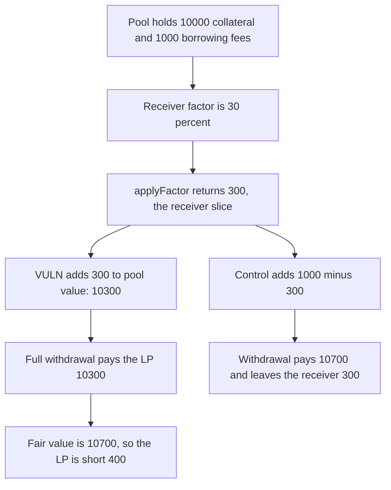

# GMX Synthetics: pool value adds the borrowing-fee receiver's slice

> **Vulnerability classes:** vuln/logic/fee-calculation · vuln/logic/price-calculation

<!-- non-defihacklabs -->
<!-- source-auditvault: https://github.com/Auditware/AuditVault/blob/main/findings/18640-h-14-pool-value-calculation-uses-wrong-portion-of-the-borrow.md -->
<!-- date: 2023-02 -->

## Key info

| Field | Value |
|---|---|
| **Loss** | Full withdrawal pays 10,300 USD instead of the fair 10,700 USD. The LP is short 400 USD |
| **Vulnerable contract** | `MarketUtils.getPoolValue` |
| **Attacker EOA** | `0x1111111111111111111111111111111111111111` (the LP) |
| **Attack contract** | `Exploit` |
| **Attack tx** | `Exploit.run()` |
| **Chain / block / date** | Ethereum model · block 0 · 2023-02 |
| **Compiler** | solc 0.8.27, cancun, via IR |
| **Bug class** | Pool value adds the fee-receiver factor of borrowing fees |

## TL;DR

Borrowing fees are split between the pool and a fee receiver. `getPoolValue` adds `Precision.applyFactor(totalBorrowingFees, borrowingFeeReceiverFactor)`, which is the receiver's slice, and never adds the pool's slice. With 10,000 of collateral, 1,000 of borrowing fees, and a 30% receiver factor, the buggy value is 10,300 and the fair value is 10,700. A full withdrawal pays 10,300. The control adds `totalBorrowingFees - applyFactor(...)` and pays 10,700, leaving only the receiver's 300 in the market.

## Background

Sherlock's February 2023 GMX Synthetics contest, issue 131 (H-14), reported by 0xAmanda and IllIllI. `getPoolValue` prices deposits, withdrawals, and market-token views. Borrowing fees are not all the pool's. The receiver factor, read from `Keys.BORROWING_FEE_RECEIVER_FACTOR`, is the fraction paid to the fee receiver. xvi10's fix is in gmx-synthetics pull request 84. This is the borrowing-fee term. Open funding fees are a different adjustment and are not part of this reduction.

## The vulnerable code

```solidity
cache.value = cache.longTokenUsd + cache.shortTokenUsd;

cache.totalBorrowingFees = getTotalBorrowingFees(..., true);
cache.totalBorrowingFees += getTotalBorrowingFees(..., false);

cache.borrowingFeeReceiverFactor = dataStore.getUint(Keys.BORROWING_FEE_RECEIVER_FACTOR);
cache.value += Precision.applyFactor(cache.totalBorrowingFees, cache.borrowingFeeReceiverFactor); // @> VULN: fee-receiver slice added as pool value
```

`Precision.applyFactor` is `value * factor / 10^30`.

The recommended change, from the judging report:

```diff
- cache.value += Precision.applyFactor(cache.totalBorrowingFees, cache.borrowingFeeReceiverFactor);
+ cache.value += cache.totalBorrowingFees - Precision.applyFactor(cache.totalBorrowingFees, cache.borrowingFeeReceiverFactor);
```

## Root cause

`applyFactor(fees, receiverFactor)` is defined as the receiver's amount. The pool's amount is the complement. Adding the receiver's amount counts someone else's claim as pool value and omits the larger pool claim whenever the receiver factor is below 100%. At 30% the two slices are 300 and 700. The function adds 300.

## Preconditions

- Borrowing fees have been collected into the market. Here long and short fees are 500 each, so the total is 1,000.
- `borrowingFeeReceiverFactor` is `3 * 10^29`, which is 30% of `10^30`.
- Collateral value is 10,000 and the market token supply is 10,000, all held by one LP, so a withdrawal pays the pool value one-for-one.
- The market contract actually holds 11,000 USD (collateral plus the collected fees), so both the buggy and the fair payouts are solvent. The difference is which slice the LP is allowed to take.

## Attack walkthrough

1. The market is seeded. It holds 11,000 USD. The LP is minted 10,000 shares.
2. `applyFactor(1000, 30%)` is 300. That is the receiver's slice. The pool's slice is 700.
3. `getPoolValue` returns 10,000 + 300 = 10,300.
4. `withdraw` pays `10300 * 10000 / 10000 = 10,300` to the LP.
5. The fair value, using the pool slice, is 10,000 + 700 = 10,700. The LP is short 400.
6. 700 USD remains in the market. On the control, the withdrawal pays 10,700 and 300 remains, which is exactly the receiver's slice.

## Diagrams



## Impact

The LP who redeems the whole supply receives 10,300 USD. The accounting that uses the pool's borrowing-fee slice pays 10,700 USD. The 400 USD gap is principal: it is the difference between the pool's 700 and the receiver's 300, and it stays in the market instead of being paid out. The same pool value is what a deposit would mint shares against, so an LP entering or leaving at this price is systematically mis-priced by that 400 on a 10,700 fair value. The control pays 10,700 and leaves only the 300 the receiver is owed.

## Remediation

Add the complement of the receiver factor, `totalBorrowingFees - applyFactor(totalBorrowingFees, borrowingFeeReceiverFactor)`, which is the change in gmx-synthetics pull request 84. With these inputs the added term is 700 and the withdrawal is 10,700.

## How to reproduce

```bash
cd 18640-h-14-pool-value-calculation-uses-wrong-portion-of-the-borrow_exp
forge test -vv
```

`test_exploit_withdrawal_uses_receiver_slice` asserts pool value 10,300, fair value 10,700, an LP balance of 10,300, and a 400 shortfall. `test_control_uses_pool_portion` asserts the fixed value and the withdrawal are both 10,700, and that 300 remains in the market. Captured output is `output.txt`.

## Sources

- AuditVault finding: https://github.com/Auditware/AuditVault/blob/main/findings/18640-h-14-pool-value-calculation-uses-wrong-portion-of-the-borrow.md
- Sherlock judging issue 131: https://github.com/sherlock-audit/2023-02-gmx-judging/issues/131
- Fix: https://github.com/gmx-io/gmx-synthetics/pull/84
- Blamed lines: https://github.com/sherlock-audit/2023-02-gmx/blob/main/gmx-synthetics/contracts/market/MarketUtils.sol#L329-L349
