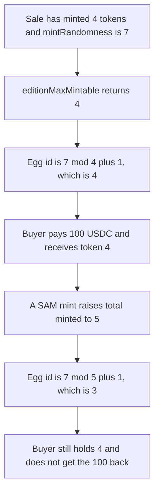

# Sound.xyz SAM — the golden egg id keeps moving after the sale

> **Vulnerability classes:** vuln/logic/reward-calculation · vuln/logic/state-update

<!-- non-defihacklabs -->
<!-- source-auditvault: https://github.com/Auditware/AuditVault/blob/main/findings/18724-h-02-golden-egg-will-continue-to-change-throughout-sam-zacho.md -->
<!-- date: 2023-03 -->

## Key info

| | |
|---|---|
| **Protocol** | Sound.xyz SAM |
| **Finding** | Zach Obront Sound.xyz H-02, AuditVault 18724 |
| **Vulnerable code** | `OpenGoldenEggMetadata.getGoldenEggTokenId` / `editionMaxMintable` |
| **Harm** | Buyer pays 100 USDC for egg id 4 and holds 4 after the egg moves to id 3 |
| **Chain** | local synthetic |

## TL;DR

Once the fixed-price cutoff has passed, `editionMaxMintable()` is the number of tokens minted so far. The golden egg is `(mintRandomness % editionMaxMintable) + 1`. With randomness 7 and 4 tokens already minted, that id is 4. The buyer pays 100 USDC and receives token 4. The next SAM mint raises the total to 5, and the same formula returns 3. The buyer still holds 4, which is no longer the egg, and the 100 USDC is not returned. The control snapshots the mint count on the first `samMint`. After that mint the egg is still 4, and the buyer still holds it.

## The vulnerable code

`getGoldenEggTokenId` uses the live mint cap:

```solidity
uint256 editionMaxMintable = ISoundEditionV1_1(edition).editionMaxMintable();
uint256 randomness = ISoundEditionV1_1(edition).mintRandomness();

if (randomness != 0) {
    // @> VULN: modulus uses live editionMaxMintable, which SAM mints keep increasing
    tokenId = (randomness % editionMaxMintable) + 1;
}
```

Past the cutoff, the cap is total minted, not a frozen sale size:

```solidity
function editionMaxMintable() public view virtual returns (uint32) {
    if (block.timestamp < editionCutoffTime) {
        return editionMaxMintableUpper;
    } else {
        return uint32(FixedPointMathLib.clamp(_totalMinted(), editionMaxMintableLower, editionMaxMintableUpper));
    }
}
```

`editionCutoffTime` is 0 in this reduction, so the else branch is the one that runs. No timestamp change is required. The upper clamp is 100 and the lower clamp is 1, so a total of 4 or 5 is returned unchanged.

The control stores that return value the first time `samMint` is called and keeps returning the stored value:

```solidity
if (!frozen) {
    frozenMax = editionMaxMintable();
    frozen = true;
}
```

## Root cause

The egg id is a pure function of a counter that SAM mints increment. Nothing snapshots the counter when the fixed-price sale ends, so every later mint changes the modulus and can point the egg at a different token. Fees and any purchase that used the previous id are then aimed at the wrong holder.

## Preconditions

`mintRandomness` is 7. Four tokens have already been minted and are held by the seller. `editionMaxMintableUpper` is 100, so the clamp does not freeze the id. The buyer can read `getGoldenEggTokenId` before paying. The next SAM mint is permissionless in this reduction, matching a bonding-curve mint that increases `_totalMinted()`.

## Attack walkthrough

1. Seed the sale: randomness 7, total minted 4, seller owns ids 1 through 4.
2. `editionMaxMintable()` returns 4. The egg is `(7 % 4) + 1 = 4`.
3. The buyer pays the seller 100 USDC and receives token 4.
4. A later account calls `samMint`. Total minted becomes 5. `editionMaxMintable()` returns 5.
5. The egg is now `(7 % 5) + 1 = 3`. Token 3 is still the seller's. The buyer holds 4. The seller's balance is 100 USDC and the buyer's balance is 0. See [output.txt](output.txt).

The control runs the same purchase on an edition that snapshots 4 inside the first `samMint`. After that mint, `getGoldenEggTokenId` is still 4 and `ownerOf(4)` is still the buyer.

## Diagrams



## Impact

The buyer paid 100 USDC for the golden egg and holds a token that is no longer the egg. The new egg is id 3, which the buyer does not own, so any later SAM fee paid to the egg holder goes to the owner of 3. The 100 USDC stays with the seller. Freezing the mint count on the first `samMint` keeps the egg at 4, which is the token the buyer holds.

## Remediation

On the first `samMint`, store `_totalMinted()` and use that stored value inside `editionMaxMintable()` from then on. That is the snapshot Sound added in PR 17 for `OpenGoldenEggMetadata`. The control above does it: the post-mint read is still 4, and the buyer's token is still the egg.

## How to reproduce

```bash
cd 18724-h-02-golden-egg-will-continue-to-change-throughout-sam-zacho_exp
forge test -vv
```

## Sources

- AuditVault finding: https://github.com/Auditware/AuditVault/blob/main/findings/18724-h-02-golden-egg-will-continue-to-change-throughout-sam-zacho.md
- Report: https://github.com/solodit/solodit_content/blob/main/reports/ZachObront/2023-03-01-Sound.xyz.md
- Fix PR: https://github.com/soundxyz/sound-protocol-private/pull/17
- Synthetic: [test/18724-h-02-golden-egg-will-continue-to-change-throughout-sam-zacho.sol](test/18724-h-02-golden-egg-will-continue-to-change-throughout-sam-zacho.sol)
