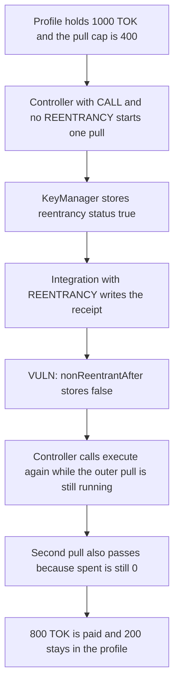

# LUKSO LSP6 KeyManager — a permitted reentry clears the reentrancy guard

> **Vulnerability classes:** vuln/reentrancy/single-function · vuln/logic/incorrect-state-transition · vuln/access-control/broken-logic

<!-- non-defihacklabs -->
<!-- source-auditvault: https://github.com/Auditware/AuditVault/blob/main/findings/18974-trst-h-1-reentrancy-protection-can-likely-be-bypassed-trust.md -->
<!-- date: 2023-04 -->

## Key info

| | |
|---|---|
| **Protocol** | LUKSO LSP6 KeyManager |
| **Finding** | Trust Security 2023-04-13 TRST-H-1, AuditVault 18974 |
| **Vulnerable code** | `LSP6KeyManager._nonReentrantAfter` |
| **Harm** | 800 TOK pulled from a profile whose cap is 400 TOK; 400 TOK taken past the cap; 200 TOK left of 1,000 |
| **Chain** | local synthetic |

## TL;DR

`_nonReentrantAfter` always stores `_reentrancyStatus = false`. A third-party contract that holds `REENTRANCY` is allowed to call back into the KeyManager. When that callback returns, the guard is cleared even though the outer `execute` is still running. The controller, who has `CALL` but not `REENTRANCY`, then runs `execute` again. The profile's pull cap was checked before the callback and updated only after it, so both pulls pass. The controller receives 800 TOK. The cap was 400 TOK.

## The vulnerable code

```solidity
function _nonReentrantAfter() internal virtual {
    // By storing the original value once again, a refund is triggered (see
    // https://eips.ethereum.org/EIPS/eip-2200)
    // @> VULN: always writes false, so a permitted reentry clears the guard while the outer execute is still running
    _reentrancyStatus = false;
    // FIX: write back the status from before this call. Do not force false.
}
```

`_nonReentrantBefore` sets the flag on the first entry and, while it is set, demands the `REENTRANCY` permission. The matching exit does not put the previous value back. Trust Security asked for that restore. The team later kept the flag set whenever the current call was not the outermost one. Either fix stops the second pull.

## Root cause

The guard is a single bool, not a saved/restored bit. The only way a nested `execute` is legal is the `REENTRANCY` permission. That nested call's exit writes `false`, so the permission check is skipped for every later entry in the same outer call. Code that updates a cap only after an external call is safe only while that second entry is impossible.

## Preconditions

The profile holds 1,000 TOK. The controller may `CALL` `AllowanceModule.pull` and does not have `REENTRANCY`. The integration has `REENTRANCY` so it can store a receipt through the KeyManager during the pull. The module checks `spent + amount <= 400 TOK` before `onPull` and writes `spent` after `onPull` returns.

## Attack walkthrough

1. The profile holds 1,000 TOK. `spent` for the controller is 0. The cap is 400 TOK.
2. The controller's permission word is the `CALL` bit. The integration's word is the `REENTRANCY` bit.
3. The controller calls `execute` for one pull of 400 TOK. `_nonReentrantBefore` stores `true`.
4. The cap check passes. The module calls the integration before it pays.
5. The integration calls `execute(setReceipt)`. That entry is allowed. `_nonReentrantAfter` then stores `false`.
6. The integration calls the controller's `reenter`. The guard is already false, so the missing `REENTRANCY` bit is not checked. A second pull of 400 TOK passes the cap because `spent` is still 0, and the profile transfers 400 TOK.
7. The outer pull then adds its own 400 TOK. The controller holds 800 TOK. The profile holds 200 TOK. `spent` is 800.

The control saves the flag from before the call and writes that value back. The same `reenter` reverts inside the integration's catch. The profile pays 400 TOK and keeps 600 TOK. `spent` stays 400. A later pull reverts with `over cap`.

## Diagrams



## Impact

The controller takes 800 TOK from the profile. 400 TOK of that is above the allowance the module enforces for a single non-reentrant pull. The profile is left with 200 TOK of the original 1,000. The owner's accounting shows `spent == 800` against a limit of 400, so the extra tokens are not still claimable through the cap.

## Remediation

In `_nonReentrantAfter`, write back the status from before this call instead of writing `false`. A permitted reentry must leave the outer guard set. The profile's pull path should also move `spent` before the callback, but that does not fix every caller that trusted the guard.

## How to reproduce

```bash
cd 18974-trst-h-1-reentrancy-protection-can-likely-be-bypassed-trust_exp
forge test -vv
```

## Sources

- AuditVault finding: https://github.com/Auditware/AuditVault/blob/main/findings/18974-trst-h-1-reentrancy-protection-can-likely-be-bypassed-trust.md
- Trust Security report: https://github.com/solodit/solodit_content/blob/main/reports/Trust%20Security/2023-04-13-LUKSO%20LSP%20audit.md
- Vulnerable function: https://github.com/lukso-network/lsp-smart-contracts/blob/v0.8.0/contracts/LSP6KeyManager/LSP6KeyManagerCore.sol#L1067-L1075
