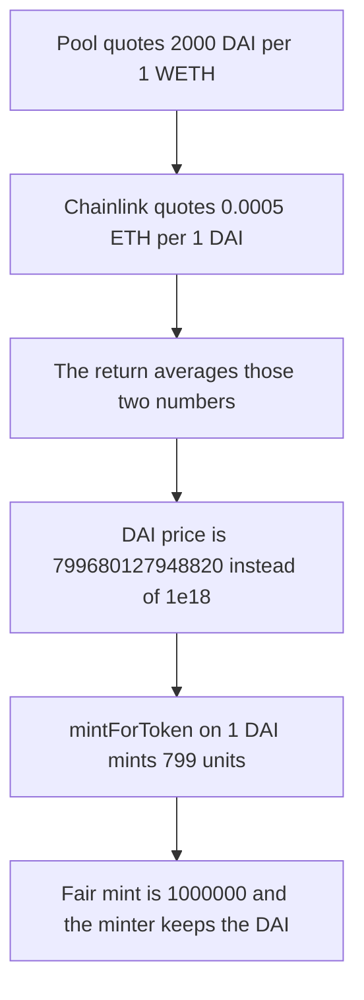

# USSD — StableOracleDAI averages DAI-per-ETH with ETH-per-DAI, so 1 DAI mints 799 units

> **Vulnerability classes:** vuln/oracle/wrong-feed · vuln/logic/price-calculation

> **Reproduction:** a self-contained Foundry PoC that compiles and runs offline
> with only `forge-std` — no fork and no RPC. Trace: [output.txt](output.txt).
> PoC: [test/19130-h-1-stableoracledai-calculates-getpriceusd-with-inverted-bas_exp.sol](test/19130-h-1-stableoracledai-calculates-getpriceusd-with-inverted-bas_exp.sol).

<!-- non-defihacklabs -->
<!-- source-auditvault: https://github.com/Auditware/AuditVault/blob/main/findings/19130-h-1-stableoracledai-calculates-getpriceusd-with-inverted-bas.md -->
<!-- date: 2023-05 -->

---

## Key info

| | |
|---|---|
| **Impact** | **HIGH** — 1 DAI is taken and the depositor is minted **799** units instead of **1,000,000** |
| **Protocol** | USSD `StableOracleDAI.getPriceUSD` |
| **Vulnerable code** | `(DAIWethPrice + uint256(price) * 1e10) / 2` |
| **Bug class** | Pool leg is DAI per WETH, Chainlink leg is DAI/ETH |
| **Finding** | Sherlock — USSD, May 2023 · H-1 · id 19130 |
| **Report** | [2023-05-USSD judging issue 102](https://github.com/sherlock-audit/2023-05-USSD-judging/issues/102) |
| **Source** | [AuditVault finding](https://github.com/Auditware/AuditVault/blob/main/findings/19130-h-1-stableoracledai-calculates-getpriceusd-with-inverted-bas.md) |
| **Status** | The inverted base. Not the 19133 decimal-only case, where both feeds return 2e18. |
| **Compiler** | solc 0.8.27, cancun, via IR |

---

## TL;DR

`quoteSpecificPoolsWithTimePeriod(1 ether, WETH, DAI)` returns **2000e18**, the DAI you get for 1 WETH. Chainlink DAI/ETH returns **0.0005e18**, the ETH you get for 1 DAI. Those are reciprocals. The audited return averages them, after scaling the Chainlink print by `1e10`, and divides the ETH/USD price by that average.

`getPriceUSD` is **799680127948820** instead of **1e18**. `mintForToken` uses the real USSD formula, collateral price times amount, with USSD at 6 decimals. **1 DAI** mints **799** units. A price of $1 mints **1,000,000** units, which is 1.000000 USSD. The minter keeps the DAI.

Inverting the Chainlink print to DAI-per-ETH before the average returns exactly 1e18 and mints 1,000,000.

## The vulnerable code

```solidity
uint256 DAIWethPrice = DAIEthOracle.quoteSpecificPoolsWithTimePeriod(
    1000000000000000000,
    0xC02aaA39b223FE8D0A0e5C4F27eAD9083C756Cc2, // WETH
    0x6B175474E89094C44Da98b954EedeAC495271d0F, // DAI
    pools,
    600
);
(, int256 price,,,) = priceFeedDAIETH.latestRoundData();
// @> VULN: price is DAI/ETH; DAIWethPrice is DAI per WETH
return (wethPriceUSD * 1e18) / ((DAIWethPrice + uint256(price) * 1e10) / 2);
```

`mintForToken` then does `((assetPrice * amount) / 1e18) * 1e6 / 1e18`.

## Root cause

The pool call prices WETH in DAI. The Chainlink feed prices DAI in ETH. Adding them, even after the `1e10` scale the source applies to `price`, does not produce a DAI-per-ETH figure. The divisor is about 2.501e24 instead of 2000e18, so the USD price of DAI collapses from $1 to about 0.0008.

This is not finding 19133. That finding feeds both legs 2e18 and shows the `1e10` scale alone. Here the two legs point in opposite directions: 2000e18 and 0.0005e18.

## Preconditions

- ETH/USD is 2000e18.
- The WETH/DAI quote of 1 WETH is 2000e18 DAI.
- Chainlink DAI/ETH is 0.0005e18.
- The caller mints USSD against 1 DAI.

## Attack walkthrough

1. `getPriceUSD` reads 2000e18 from the pool and 0.0005e18 from Chainlink.
2. The return expression evaluates to 799680127948820.
3. The depositor approves 1 DAI and calls `mintForToken`.
4. USSD minted is 799.
5. The minter's DAI balance is 1e18. The fair mint is 1,000,000 units.

Control: invert the Chainlink value with `1e36 / ethPerDai` before averaging it with the pool quote. `getPriceUSD` is 1e18 and the mint is 1,000,000.

## Diagrams



## Impact

The depositor gives up **1 DAI** and receives **799** USSD units instead of **1,000,000**. That is about 1,251 times too few. The minter keeps the DAI. Every mint that prices DAI through this oracle uses the same collapsed price.

## Remediation

Invert the Chainlink DAI/ETH price into DAI per ETH before averaging it with `DAIWethPrice`.

## Sources

- [AuditVault finding 19130](https://github.com/Auditware/AuditVault/blob/main/findings/19130-h-1-stableoracledai-calculates-getpriceusd-with-inverted-bas.md)
- [Sherlock 2023-05 USSD, issue 102](https://github.com/sherlock-audit/2023-05-USSD-judging/issues/102)
- [StableOracleDAI.sol](https://github.com/sherlock-audit/2023-05-USSD/blob/main/ussd-contracts/contracts/oracles/StableOracleDAI.sol)
- [USSD.sol calculateMint](https://github.com/sherlock-audit/2023-05-USSD/blob/main/ussd-contracts/contracts/USSD.sol)

### Taxonomy

- `vuln/oracle/wrong-feed` · `vuln/logic/price-calculation`
